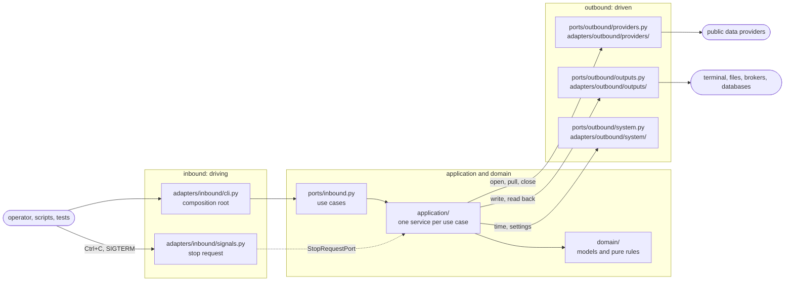

# stream-consumers

[](https://github.com/mavasbel-itam/stream-consumers/actions/workflows/tests.yml)

**Read 73 public real-time data streams, mask personal fields, and write
the events to the terminal, a file, a message broker or a database.**

The instructor's tooling for the final project of COM-22102 *Bases de Datos No
Relacionales* (ITAM, Otoño 2026). It shows which public streams are fast enough
for the project, measures each one's rate, and feeds them into the course
databases. Students build their own ingestion consumer as part of the project.

| | |
|---|---|
| **Sources** | 73 streams in [five groups](#groups), from 6 areas: transport (26); finance & blockchain (22); science & sensors (8); internet & software (7); games, media & social (5); weather & environment (5) |
| **Transports** | HTTP (33: 30 polled, 3 file drops), WebSocket (25), MQTT (6), TCP (3), Kafka (2), SSE (2), NATS (1), ZeroMQ (1) |
| **Commands** | `list`, `keys`, `consume`, `check`, `sample`, `verdict`, `profile` |
| **Text formats** | `jsonl`, `csv`, `tsv`, `json`, `pretty` |
| **Destinations** | SQLite, Kafka, MQTT, NATS, ZeroMQ, MongoDB, Cassandra, Redis, Neo4j, OpenSearch |
| **Quality gate** | 100 % coverage gated on the unit and component tiers and on the end-to-end tier; every source tested against its real provider ([Tests](#tests)) |

> [!WARNING]
> This repository is **public**. Keys live only in the git-ignored `.env`;
> never commit a key, password, token or personal value
> ([Publishing safely](#publishing-safely)).

## Contents

- [Requirements](#requirements)
- [Quick start](#quick-start)
- [Configuration](#configuration)
  - [Where values come from](#where-values-come-from)
  - [API keys](#api-keys)
  - [Settings](#settings)
  - [Output password](#output-password)
  - [Held keys](#held-keys)
  - [Checking the configuration](#checking-the-configuration)
  - [Variables read only by the tests](#variables-read-only-by-the-tests)
  - [Terms worth reading](#terms-worth-reading)
- [Running the consumers](#running-the-consumers)
  - [Options and defaults](#options-and-defaults)
  - [What the output looks like](#what-the-output-looks-like)
  - [Stopping a run](#stopping-a-run)
  - [Recipes](#recipes)
    - [See what the catalog holds](#see-what-the-catalog-holds)
    - [Read one source and pick fields](#read-one-source-and-pick-fields)
    - [Capture ten minutes to a file](#capture-ten-minutes-to-a-file)
    - [Write a CSV file for a spreadsheet](#write-a-csv-file-for-a-spreadsheet)
    - [Store events in SQLite and query them](#store-events-in-sqlite-and-query-them)
    - [Feed a broker or a course database](#feed-a-broker-or-a-course-database)
    - [Run a source that needs a key](#run-a-source-that-needs-a-key)
    - [Run a source of group E](#run-a-source-of-group-e)
    - [Read Fink alerts as valid JSON](#read-fink-alerts-as-valid-json)
    - [Use another key file](#use-another-key-file)
    - [Check a few sources, or all of them](#check-a-few-sources-or-all-of-them)
    - [Set a time limit with timeout](#set-a-time-limit-with-timeout)
    - [Measure for 24 hours in the background, stop, resume and judge](#measure-for-24-hours-in-the-background-stop-resume-and-judge)
    - [Profile the fields of a source](#profile-the-fields-of-a-source)
  - [Exit codes and troubleshooting](#exit-codes-and-troubleshooting)
- [Outputs](#outputs)
  - [Text formats](#text-formats)
  - [Destinations](#destinations)
- [Sources](#sources)
  - [Groups](#groups)
  - [Catalog](#catalog)
- [Measurements](#measurements)
  - [How rates are measured](#how-rates-are-measured)
  - [Why 24 rounds](#why-24-rounds)
  - [Settled verdicts](#settled-verdicts)
- [Known behaviour](#known-behaviour)
- [Architecture](#architecture)
- [Tests](#tests)
- [Publishing safely](#publishing-safely)
- [Decision records](#decision-records)

## Requirements

| Need | For | Notes |
|---|---|---|
| [uv](https://docs.astral.sh/uv/) | everything | installs the pinned Python (3.13, `.python-version`) when it is missing; uv 0.13.0 was used |
| Internet access | reading the sources | 62 of the 73 sources run without a key (3 of them take an optional one) |
| Docker | the tests only | the component and end-to-end tests start brokers and databases in containers ([Tests](#tests)) |
| [jq](https://jqlang.org/), [sqlite3](https://sqlite.org/cli.html) | some recipes only | the [Quick start](#quick-start) and [Recipes](#recipes) pipe output through them; jq 1.8.2 and sqlite3 3.53.4 were used |
| Linux | stopping a run cleanly | Ctrl+C and `kill` are POSIX signals; development and CI run on Linux (GitHub's `ubuntu-24.04` runners), no other system was tested |

Run every command from the repository root.

## Quick start

```bash
uv sync                    # create .venv with the locked dependencies
cp .env.example .env       # then fill in the keys you have (none are needed to start)
```

<sub>Run on 2026-10-21 at 03:08 UTC.</sub>

```console
$ uv run stream-consumers keys | head -4
aisstream      AISSTREAM_API_KEY                secret   required  set      https://aisstream.io/account
aisstream      AISSTREAM_BOUNDING_BOXES         setting  optional  default  default='[[[-90, -180], [90, 180]]]'
crossref       CROSSREF_MAILTO                  setting  optional  default  default=''
cta_bus        CTA_BUS_KEY                      secret   required  set      https://www.ctabustracker.com/bustime/login.jsp
```

`keys` shows each variable's state, never its value. Read your first events,
from a source that needs no key:

<sub>Run on 2026-10-21 at 03:27 UTC.</sub>

```console
$ uv run stream-consumers consume coinbase --max-events 3 2> /dev/null | jq -c '{source, product_id: .payload.product_id, price: .payload.price}'
{"source":"coinbase","product_id":"BTC-USD","price":"82673.1"}
{"source":"coinbase","product_id":"XRP-USD","price":"1.3307"}
{"source":"coinbase","product_id":"ETH-USD","price":"2443.54"}
```

Next: [Configuration](#configuration) for keys, [Running the
consumers](#running-the-consumers) for every command and option, and
[Recipes](#recipes) for common tasks.

## Configuration

### Where values come from

Every key and setting is an environment variable, read in this order:

1. a non-empty variable of the process environment;
2. otherwise the `.env` file in the current directory, or the file given with
   `--env-file <path>` before the command
   (`uv run stream-consumers --env-file other.env keys`).

`.env` holds one `NAME=value` per line; `#` comments and blank lines are
ignored, and one pair of surrounding quotes is removed. Values are never
printed, logged or written to a report.

`.env.example` names every variable the code knows, with how to get each key.
It is the output of `uv run stream-consumers keys --template`, and
`tests/unit/test_configuration.py` fails when the two differ. A source whose
required key is missing reports `key-pending` and never fails a run; an
optional key only raises a provider's limits.

### API keys

| Variable(s) | Source | Needed | How to get it (sign-up page) | Where it goes | Documented limit |
|---|---|---|---|---|---|
| `AISSTREAM_API_KEY` | `aisstream` | required | Sign in with GitHub on the [Account page](https://aisstream.io/account) and create a key (shown once) | `APIKey` in the first WebSocket message | 3 connections per account and per IP; frames dropped for slow readers |
| `CTA_BUS_KEY` | `cta_bus` | required | [Bus Tracker account](https://www.ctabustracker.com/bustime/login.jsp) → My Account → Developer API; e-mailed after approval | query `key` | 100,000 transactions/day |
| `CTA_TRAIN_KEY` | `cta_train` | required | [Train Tracker application form](https://www.transitchicago.com/developers/traintrackerapply/); CTA reviews it | query `key` | 50,000 requests/day |
| `ENTSOE_TOKEN` | `entsoe` | required | [Register](https://transparency.entsoe.eu/), then e-mail transparency@entsoe.eu for RESTful API access ("within 3 working days") | query `securityToken` | 400 requests/min |
| `FINK_KAFKA_SERVERS`, `FINK_GROUP_ID` | `fink` (E · low rate) | required | [Fink subscription form](https://forms.gle/2td4jysT4e9pkf889); the Fink team e-mails one Kafka server address per survey (ZTF, LSST) and your `group.id` — use the ZTF address | Kafka bootstrap servers and `group.id` (no SASL; the broker does not check the `group.id`, which only keeps your read position) | none documented; alerts are kept 4 days |
| `GFW_API_TOKEN` | `gfw` (E · low rate) | required | [Global Fishing Watch account](https://globalfishingwatch.org/our-apis/), then request an API token (self-service; up to 5 tokens, they do not expire); non-commercial use only | `Authorization: Bearer` | 50,000 requests/day, 1,500,000/month |
| `LASAIR_KAFKA_TOPIC` | `lasair` (E · low rate) | required | [Lasair account](https://lasair.lsst.ac.uk/), then build and save a filter with Kafka streaming enabled; its topic is `lasair_` + your user ID + the sanitised filter name | Kafka topic (the server needs no password) | none documented for Kafka |
| `MASTODON_ACCESS_TOKEN` | `mastodon` | required | [Account on the instance](https://social.vivaldi.net/auth/sign_up) (the default `MASTODON_INSTANCE`; a token works only on the instance that issued it), then a user token with scope `read:statuses` | `Authorization: Bearer` | 300 REST calls per 5 min; streaming not stated |
| `MTA_BUSTIME_KEY` | `mta_bustime` | required | [Web form](https://register.developer.obanyc.com/); e-mailed "within half an hour" | query `key` | no number; all-vehicle requests not under 30 s apart |
| `NTA_API_KEY` | `nta` | required | [Developer portal](https://developer.nationaltransport.ie/signup), subscribe to "GTFS Realtime" | header `x-api-key` | one call every 60 s |
| `WMATA_API_KEY` | `wmata` | required | [Developer account](https://developer.wmata.com/signup), subscribe to a Transit Data tier | header `api_key` | not published on an official page |
| `MBTA_API_KEY` | `mbta_v3` | optional | [V3 API portal](https://api-v3.mbta.com/register), one key per application ("might take a day") | header `x-api-key`; enables streaming | 1,000 requests/min (20 without a key) |
| `OPENSKY_CLIENT_ID`, `OPENSKY_CLIENT_SECRET` | `opensky` | optional | [OpenSky account](https://opensky-network.org/my-opensky/account) → create an API client | OAuth 2 client credentials → `Authorization: Bearer` | 4,000 credits/day (400 anonymous) |
| `TFL_APP_KEY` | `tfl` | optional | [API portal](https://api-portal.tfl.gov.uk/signup), subscribe to the product "500 Requests per min" | query `app_key` | 500 requests per minute (subscription page, 2026-10-18) |

NASA FIRMS needs no key: it reads the public 24 h files. How each key was
obtained and tested, and its status, are on the
[API-key page](docs/reference/2026-10-17-15-13-api-key-gated-sources.md).

### Settings

Every setting has a default; `.env.example` shows each one commented out with
its default.

| Variable | Source | Default | Meaning |
|---|---|---|---|
| `AISSTREAM_BOUNDING_BOXES` | `aisstream` | `[[[-90, -180], [90, 180]]]` | JSON list of boxes, each two [latitude, longitude] corners (default: the whole world). |
| `CROSSREF_MAILTO` | `crossref` | (empty) | Contact e-mail sent as mailto= to join Crossref's polite pool (optional). |
| `ENTSOE_AREAS` | `entsoe` | `10Y1001A1001A83F,10YFR-RTE------C,10YES-REE------0` | Comma-separated EIC codes of the areas to read (default Germany, France, Spain; list in the platform's Area List with EIC). |
| `FINK_TOPICS` | `fink` | `fink_sso_ztf_candidates_ztf,fink_vra_ztf,fink_blazar_ztf` | Comma-separated topics, one per Fink filter (ZTF list: https://doc.ztf.fink-broker.org/broker/filters/; LSST list: https://lsst.fink-portal.org/schemas). |
| `GFW_DATASET` | `gfw` | `public-global-fishing-events:latest` | Events dataset (fishing, encounters, loitering or port visits). |
| `GFW_LOOKBACK_DAYS` | `gfw` | `7` | Days back from today whose events are read at every poll. |
| `GFW_PAGES` | `gfw` | `5` | Pages of 100 events read at every poll. |
| `LASAIR_KAFKA_SERVER` | `lasair` | `lasair-lsst-kafka.lsst.ac.uk:9092` | Kafka bootstrap server (the official notebook's 'prod' value). |
| `LASAIR_GROUP_ID` | `lasair` | `stream-consumers` | Kafka consumer group; Lasair remembers per group where delivery stopped, so use your own. |
| `MASTODON_INSTANCE` | `mastodon` | `social.vivaldi.net` | Host name of the Mastodon instance whose federated timeline is read; it must allow live feeds and issue the token. |
| `OPENSKY_POLL_SECONDS` | `opensky` | `30` | Seconds between requests. This box costs 4 credits per request: anonymous 400 credits/day, standard account 4,000/day. |

### Output password

`STREAM_CONSUMERS_OUTPUT_PASSWORD` is the password of an `--out` destination
whose URI names a user but no password ([Destinations](#destinations)). It
belongs to the outputs rather than to a source, and `keys` lists it as `--out`.

### Held keys

Every key the project has stays in `.env`, also the ones no source reads, so
they can be tested again. They are declared in
`src/stream_consumers/adapters/outbound/providers/held_keys.py` (`HELD_KEYS`,
exported by the catalog next to `FACTORIES`), and `keys` lists them as `held`.

| Variable(s) | Belongs to | Provider | What it is |
|---|---|---|---|
| `MASTODON_CLIENT_ID`, `MASTODON_CLIENT_SECRET` | `mastodon` | Mastodon, MASTODON_INSTANCE | Client id and secret of the application that issued MASTODON_ACCESS_TOKEN. |
| `MASTODON_WORLD_ACCESS_TOKEN` | `mastodon` | Mastodon, mastodon.world | Access token on mastodon.world (live feeds open). To read it, run with MASTODON_INSTANCE=mastodon.world and this value as MASTODON_ACCESS_TOKEN. |
| `MASTODON_WORLD_CLIENT_ID`, `MASTODON_WORLD_CLIENT_SECRET` | `mastodon` | Mastodon, mastodon.world | Client id and secret of the application that issued MASTODON_WORLD_ACCESS_TOKEN. |
| `MASTODON_SOCIAL_ACCESS_TOKEN` | `mastodon` | Mastodon, mastodon.social | Access token on mastodon.social, whose live feeds are disabled (only deletions are streamed). |
| `MASTODON_SOCIAL_CLIENT_ID`, `MASTODON_SOCIAL_CLIENT_SECRET` | `mastodon` | Mastodon, mastodon.social | Client id and secret of the application that issued MASTODON_SOCIAL_ACCESS_TOKEN. |
| `NTA_API_KEY_SECONDARY` | `nta` | National Transport Authority (Ireland) | Secondary key of NTA_API_KEY's subscription. |
| `WMATA_API_KEY_SECONDARY` | `wmata` | WMATA | Secondary key of the 'GTFS' product (WMATA_API_KEY is its primary). |
| `WMATA_BUS_ROUTES_KEY` | `wmata` | WMATA | Primary key of the 'Bus Route and Stop Methods' product. |
| `WMATA_BUS_ROUTES_KEY_SECONDARY` | `wmata` | WMATA | Secondary key of the 'Bus Route and Stop Methods' product. |
| `WMATA_METRO_ALERTS_KEY` | `wmata` | WMATA | Primary key of the 'GTFS Metro Alert' product. |
| `WMATA_METRO_ALERTS_KEY_SECONDARY` | `wmata` | WMATA | Secondary key of the 'GTFS Metro Alert' product. |
| `TFL_APP_KEY_SECONDARY` | `tfl` | Transport for London | Secondary key of the 'AirQuality' subscription (TFL_APP_KEY is its primary). |
| `TFL_OCCUPANCY_KEY` | `tfl` | Transport for London | Primary key of the 'Occupancy' subscription. |
| `TFL_OCCUPANCY_KEY_SECONDARY` | `tfl` | Transport for London | Secondary key of the 'Occupancy' subscription. |
| `TFL_CROWDING_KEY` | `tfl` | Transport for London | Primary key of the 'Crowding' subscription. |
| `TFL_CROWDING_KEY_SECONDARY` | `tfl` | Transport for London | Secondary key of the 'Crowding' subscription. |
| `TFL_TRACKERNET_KEY` | `tfl` | Transport for London | Primary key of the 'Trackernet' subscription. |
| `TFL_TRACKERNET_KEY_SECONDARY` | `tfl` | Transport for London | Secondary key of the 'Trackernet' subscription. |
| `COINBASE_CDP_KEY_ID`, `COINBASE_CDP_KEY_SECRET` | `coinbase` | Coinbase Developer Platform | CDP Secret API Key (Ed25519, view only). The coinbase source reads the public Exchange feed and needs no key. |
| `BITSO_API_KEY`, `BITSO_API_SECRET` | `bitso` | Bitso | Private API key and secret (HMAC-SHA256 signed requests). The bitso source reads the public WebSocket and needs no key. |
| `BINANCE_API_KEY`, `BINANCE_API_SECRET` | `binance` | Binance | API key and secret key (HMAC-SHA256 signed requests), reading permission only. The binance source reads the public streams and needs no key. |
| `LASAIR_API_TOKEN` | `lasair` | Lasair (LSST alert broker) | REST API token. The lasair source reads only the Kafka topic of a saved filter (LASAIR_KAFKA_TOPIC), not this token. |

A new key is added to `HELD_KEYS` (or to a source's `Credential`) and to
`tests/live/test_keys_live.py`, which fails if a key has no probe. For each key
that test sends one read-only request with the stored value (must be
accepted), one with its last four characters changed (must be refused) and one
without it (refused where the provider requires a key, accepted where it is
optional):

```bash
uv run pytest tests/live/test_keys_live.py -m live    # KEYS_ENV_FILE=path/.env tests another file
```

### Checking the configuration

`uv run stream-consumers keys` prints one line per variable, with these columns
(the output has no header line):

| Column | Values |
|---|---|
| source | the source id, or `--out` for the output password |
| variable | the variable name |
| kind | `secret`, `setting`, `held` |
| need | `required` or `optional` |
| state | `set`; `MISSING` (a required secret without a value); `not-set` (an optional secret or held key without a value); `default` (a setting left at its default) |
| link or default | the sign-up page, or the setting's default |

It exits 0, or 1 when `.env` holds a variable that no source reads and no held
key declares; such a variable is listed as `unknown`. Its first lines are in
the [Quick start](#quick-start).

### Variables read only by the tests

| Variable | Read by | Default | Meaning |
|---|---|---|---|
| `KEYS_ENV_FILE` | `tests/live/test_keys_live.py` | `.env` | The file whose keys are probed |
| `LIVE_SECONDS` | `tests/live/test_sources_live.py` | `60` | Reading time per source in the live source test |
| `STREAM_CONSUMERS_E2E` | `tests/e2e/local_catalog.py` | — | Addresses of the local test servers, set by the end-to-end tests themselves |

### Terms worth reading

- OpenSky requires a written agreement for "operational" REST API use,
  including automated systems, even non-profit ones.
- Global Fishing Watch data is CC BY-NC 4.0, and tokens must not be shared.
- aisstream.io publishes no terms of use, only a privacy statement.
- Mastodon statuses are personal data and are masked in stored samples.

Every source's terms page is linked in [Sources](#sources).

## Running the consumers

Every command is `uv run stream-consumers <command>`; `--help` after a command
lists its options with their defaults. Source ids are the `id` column of
[Sources](#sources), or the `id` field of `list`.

| Command | What it does | Output | Exit code |
|---|---|---|---|
| `list` | Every source of the catalog (73), one JSON object per line: id, name, category, group, transport, delivery, endpoint, documentation and terms links, credential, settings, personal fields, minimum window | standard output | 0 |
| `keys` | One line per variable, never a value ([Checking the configuration](#checking-the-configuration)) | standard output | 1 if `.env` holds a variable that no source reads and no held key declares |
| `keys --template` | The `.env.example` template, with how to get each key | standard output | 0 |
| `consume <id>` | Reads one source and writes each event in the chosen format, or into a broker or database ([Outputs](#outputs)) | `--out` (standard output by default); a run report as one JSON line on standard error | 0 when the source delivered events or its key is missing (`key-pending`), 1 when it failed or delivered nothing |
| `check [<id> …]` | Reads each source for a short window and reports whether events arrive | one line per source and a total on standard output; `check-<time>.json` in `--reports` | 1 if any source failed or delivered nothing |
| `sample [<id> …]` | The measurement behind the inclusion rule: reads every source once per round, rounds started on wall-clock targets | `round-NN-<time>.json` per round in `--reports`; the latest result and the verdict of each source on standard output | 1 if any source failed or delivered nothing in its latest round |
| `verdict <dir> [<id> …]` | Median rate and verdict (`passes`, `fails`, `open`) of each source from recorded `round-*.json` files (searched recursively) | standard output | 0 |
| `profile [<id> …]` | Keeps a masked sample of events per source and describes their fields | `<source>.jsonl` in `--out` (the extension follows `--format`); `profiles-<time>.json` in `--reports`; one line per source on standard output | 1 if any source failed or delivered nothing |

> [!NOTE]
> `check`, `sample` and `profile` without source ids read the 65
> sources of groups A–D. A source of group E runs only when named.

Every command exits 2 on an invalid argument or an unknown source id; the other
exit codes are in [Exit codes and troubleshooting](#exit-codes-and-troubleshooting).

### Options and defaults

| Command | Option | Default | Meaning |
|---|---|---|---|
| every command | `--env-file <path>` (before the command) | `.env` | File with keys and settings; a non-empty variable of the process environment wins |
| every command | `--catalog <module>` (before the command) | built-in sources | Module exposing `FACTORIES`; the tests use it to load a local catalog |
| `keys` | `--template` | off | Print the `.env` template instead of the status |
| `consume` | `--seconds` | 60 | Reading time, extended to the source's minimum window |
| `consume` | `--max-events` | no limit | Stop after this many events |
| `consume` | `--out` | `-` (standard output) | Where events go: `-`, a file path, or a destination: `sqlite:`, `kafka://`, `mqtt://`, `nats://`, `zmq+tcp://`, `mongodb://`, `cassandra://`, `redis://`, `redis+cluster://`, `neo4j://`, `bolt://`, `opensearch://` ([Outputs](#outputs)) |
| `consume` | `--format` | `jsonl` | Text format for standard output and files: `jsonl`, `csv`, `tsv`, `json`, `pretty`; not accepted with a broker or database destination |
| `consume` | `--raw` | off | Do not mask personal fields |
| `check` | `--seconds` | 30 | Reading time per source, extended to its minimum window |
| `check` | `--reports` | `data/reports` | Directory for `check-<time>.json` |
| `check` | `--concurrency` | 16 | Sources read at the same time |
| `sample` | `--rounds` | 24 | Number of rounds |
| `sample` | `--interval` | 3600 | Seconds between round starts |
| `sample` | `--window` | 60 | Reading time per source and round, extended to its minimum window |
| `sample` | `--reports` | `data/reports` | Directory for `round-NN-<time>.json` |
| `sample` | `--concurrency` | 64 | Sources read at the same time |
| `sample` | `--continue-from <dir>` | none | Reports directory of an interrupted run; its rounds count toward `--rounds` and are not repeated |
| `sample` | `--stop-when-settled` | off | Stop reading a source once its median over `--rounds` is fixed on one side of 1 event/s |
| `verdict` | `--planned` | 24 | Rounds in the plan the verdict is about |
| `profile` | `--max-events` | 500 | Events kept per source |
| `profile` | `--seconds` | 120 | Longest reading time per source, extended to its minimum window |
| `profile` | `--out` | `data/profile` | Directory for the masked samples |
| `profile` | `--format` | `jsonl` | Format of the samples: `jsonl`, `csv`, `tsv`, `json`, `pretty` |
| `profile` | `--reports` | `data/reports` | Directory for `profiles-<time>.json` |
| `profile` | `--concurrency` | 64 | Sources read at the same time |

### What the output looks like

`consume` writes each event to standard output and, when the run ends, its run
report to standard error. `received_at` is Unix time in seconds; `payload` is
the provider's message with nested fields flattened to dotted names, as masking
does (with `--raw` it is written as decoded, unflattened):

<details>
<summary>Two events and the run report of <code>consume coinbase --max-events 2</code></summary>

<sub>Run on 2026-10-21 at 03:08 UTC.</sub>

```console
$ uv run stream-consumers consume coinbase --max-events 2
{"source": "coinbase", "received_at": 1792552122.0062199, "payload": {"type": "ticker", "sequence": 104171686038, "product_id": "ETH-USD", "price": "2443.68", "open_24h": "2411.63", "volume_24h": "93061.61508788", "low_24h": "2374.36", "high_24h": "2475.2", "volume_30d": "2547560.10567186", "best_bid": "2443.62", "best_bid_size": "2.01839783", "best_ask": "2443.69", "best_ask_size": "9.34153068", "side": "sell", "time": "2026-10-21T03:08:40.247491Z", "trade_id": 849579054, "last_size": "0.29154103"}}
{"source": "coinbase", "received_at": 1792552122.0165079, "payload": {"type": "ticker", "sequence": 138067577280, "product_id": "BTC-USD", "price": "82676.78", "open_24h": "82031.99", "volume_24h": "4912.97755252", "low_24h": "81196.01", "high_24h": "83344.25", "volume_30d": "152765.90434835", "best_bid": "82676.78", "best_bid_size": "0.00065606", "best_ask": "82676.79", "best_ask_size": "0.53179583", "side": "sell", "time": "2026-10-21T03:08:41.728242Z", "trade_id": 1108657842, "last_size": "0.00000014"}}
{"source_id": "coinbase", "status": "ok", "events": 2, "seconds": 0.714, "rate": 2.801, "rate_basis": "observed", "attributes_median": 17.0, "first_event_s": 0.633, "started_at": 1792552121.3728852, "detail": ""}
```

</details>

| Run report field | Meaning |
|---|---|
| `status` | `ok`, `no-events`, `error` (the reason in `detail`) or `key-pending` |
| `events`, `seconds`, `rate` | events read, seconds read, events per second |
| `rate_basis` | how the rate was obtained ([How rates are measured](#how-rates-are-measured)) |
| `attributes_median` | median number of payload fields per event |
| `first_event_s` | seconds until the first event |
| `started_at` | Unix time of the start |
| `detail` | the error, or how the run was stopped |

`check` prints one line per source and a total:

<sub>Run on 2026-10-21 at 03:08 UTC.</sub>

```console
$ uv run stream-consumers check wikimedia coinbase --seconds 10
coinbase         ok          events=70      rate=6.952/s      observed   
wikimedia        ok          events=237     rate=23.698/s     observed   
2 sources, 2 delivered or key pending, 0 failed
```

Personal fields declared by each source (`personal_fields`) and any e-mail
address are masked in everything written, unless `consume --raw` is given.
Captured data and reports go to `data/`, which git ignores.

`profile` writes `profiles-<time>.json` to `--reports`. For each source it
holds the event size in compact UTF-8 JSON (mean and 95th percentile), the
share of events equal to an earlier one, the natural key (the smallest set of
at most three fields unique across the sample, preferring identifiers and
times) and, per flattened field, presence, distinct values, kinds, numeric
range, a masked example and a class. Classes are decided in this order
(`FieldClass`, `policy.classify_field`):

| Class | Rule |
|---|---|
| `datetime` | ISO 8601 text, or epoch s/ms/µs/ns or `YYYYMMDD[hhmmss]` within 400 days of the run |
| `geographic` | a latitude or longitude whose partner field is present, within range |
| `number` | numbers, or numeric text without a leading zero (flagged `numeric_text`) |
| `identifier` | text without spaces with more distinct values than a category may have |
| `free-text` | 30+ characters on average, mostly with spaces, at least half distinct |
| `label` | other text with that many distinct values |
| `category` | text or Booleans with at most max(20, 5 % of the events) distinct values |
| `nested`, `empty` | the rest |

### Stopping a run

Press **Ctrl+C**, or send SIGTERM (`kill <pid>`, `timeout`, `docker stop`,
systemd). The first signal ends the run as if its window had ended. Standard
error says `stopping (SIGINT): ending the run, closing outputs and writing
reports; a second signal (Ctrl+C) quits at once` (`SIGTERM` for `kill`), and
then:

| Command or output | After the first signal |
|---|---|
| outputs | the event being written is finished, then every output is closed: a `json` array is closed, CSV and TSV end with a complete row, and the events still waiting in a batch reach their broker or database |
| `consume` | writes its run report, with `detail` saying `stopped by SIGINT after <seconds> of <window> s` |
| `check`, `profile` | end the sources being read and keep what arrived; the sources not started yet are not started (`stopped by SIGINT: <n> of <m> sources not started`); the summary and the report file cover the started sources |
| `sample` | keeps every finished round; a round cut short is not recorded, because its shortened windows would bias the median, and the message says how to go on: `stopped by SIGINT: <n> of <rounds> rounds recorded; a round cut short is not recorded; resume with --continue-from <reports dir>` |
| `list`, `keys`, `verdict` | are interrupted at once (`stopped (SIGINT)`) |
| exit code | the command ends by that signal: a shell reports **130** after Ctrl+C and **143** after SIGTERM, so a script can tell an interrupted run from a complete one |

Ctrl+C typed 5 s into a ten-minute run; the file holds every event the report
counts:

<sub>Run on 2026-10-21 at 03:18 UTC.</sub>

```console
$ uv run stream-consumers consume wikimedia --seconds 600 --out data/wikimedia-stopped.jsonl; echo "exit $?"; wc -l < data/wikimedia-stopped.jsonl
^Cstopping (SIGINT): ending the run, closing outputs and writing reports; a second signal (Ctrl+C) quits at once
{"source_id": "wikimedia", "status": "ok", "events": 54, "seconds": 4.101, "rate": 13.168, "rate_basis": "observed", "attributes_median": 29.0, "first_event_s": 0.925, "started_at": 1792552707.7465887, "detail": "stopped by SIGINT after 4.101 of 600 s"}
exit 130
54
```

A **second** Ctrl+C or SIGTERM, 1 s or more after the first, quits at once with
`stopped immediately by a second SIGINT; outputs may be incomplete`. Use it only
when the first one does not finish, for example when the program reading
standard output stopped reading. A repeat within 1 s is taken as the same stop
delivered twice and changes nothing: GNU `timeout` signals its command and then
its whole process group, and `uv run` passes the first one on, so
`timeout … uv run stream-consumers …` delivers one stop twice, 0.05 ms apart
(measured 2026-10-20).

A command started with `&` from a script, or under `nohup`, runs with SIGINT
ignored: the shell starts background commands that way and it stays ignored,
so Ctrl+C does not reach it. Stop it with `kill <pid>`; `uv run` passes SIGTERM
on to the program. When all 65 active sources were stopped with
SIGTERM at the same time after 8 s of `consume`, each ended with its report and
exit code 143 within 0.31 to 1.46 s (median 1.01 s; 2026-10-20 19:05 UTC). A
WebSocket source waits at most 1 s for the server to answer its close.

> [!WARNING]
> **Ctrl+C in a shell loop.** Through `uv run`, uv reports the 130 as an
> ordinary exit status and bash goes on with the next iteration. Add
> `|| break`, run the loop under `set -e`, or call
> `.venv/bin/stream-consumers` directly.

What each form did when Ctrl+C was typed in the first of three runs of
`for n in 1 2 3; do echo "run $n"; <command>; done; echo "loop ended"`, with
`<command>` = `consume coinbase --seconds 8 --out /dev/null` (run on 2026-10-21 at 03:18 UTC):

| `<command>` started with | After Ctrl+C |
|---|---|
| `.venv/bin/stream-consumers` | the loop and the line after it stop, as for any program ended by Ctrl+C |
| `uv run stream-consumers` | runs 2 and 3 go on, then `loop ended` |
| `uv run stream-consumers … \|\| break` | the loop stops, `loop ended` |
| `uv run stream-consumers …` with the loop under `set -e` | the loop stops, `loop ended` |

### Recipes

Every recipe was run as written, from the repository root, at the time shown
under it; the output is that run's.

| Recipe | Commands used |
|---|---|
| [See what the catalog holds](#see-what-the-catalog-holds) | `list`, `jq` |
| [Read one source and pick fields](#read-one-source-and-pick-fields) | `consume`, `jq` |
| [Capture ten minutes to a file](#capture-ten-minutes-to-a-file) | `consume --seconds --out` |
| [Write a CSV file for a spreadsheet](#write-a-csv-file-for-a-spreadsheet) | `consume --format csv` |
| [Store events in SQLite and query them](#store-events-in-sqlite-and-query-them) | `consume --out sqlite:`, `sqlite3` |
| [Feed a broker or a course database](#feed-a-broker-or-a-course-database) | `consume --out <URI>` |
| [Run a source that needs a key](#run-a-source-that-needs-a-key) | `keys`, `consume` |
| [Run a source of group E](#run-a-source-of-group-e) | `consume` |
| [Read Fink alerts as valid JSON](#read-fink-alerts-as-valid-json) | `consume`, `jq` |
| [Use another key file](#use-another-key-file) | `--env-file` |
| [Check a few sources, or all of them](#check-a-few-sources-or-all-of-them) | `check` |
| [Set a time limit with timeout](#set-a-time-limit-with-timeout) | `timeout`, `consume` |
| [Measure for 24 hours in the background, stop, resume and judge](#measure-for-24-hours-in-the-background-stop-resume-and-judge) | `sample`, `kill`, `verdict` |
| [Profile the fields of a source](#profile-the-fields-of-a-source) | `profile`, `jq` |

#### See what the catalog holds

One source per line, and the ids of group E:

<sub>Run on 2026-10-21 at 03:08 UTC.</sub>

```console
$ uv run stream-consumers list | jq -r '[.id, .group, .transport, .delivery] | @tsv' | head -5
adsb_fi	A	http	poll
adsb_lol	A	http	poll
aisstream	B	websocket	push
albion	A	nats	push
atlas	A	websocket	push
$ uv run stream-consumers list | jq -r 'select(.group == "E") | .id' | paste -sd ' '
bitstamp dt_rail_trains entsoe fink gfw lasair ndbc npm
```

#### Read one source and pick fields

Standard output is handed on after every event, so a pipe sees each one as it arrives:

<sub>Run on 2026-10-21 at 03:08 UTC.</sub>

```console
$ uv run stream-consumers consume coinbase --max-events 3 2> /dev/null | jq -r '[.payload.product_id, .payload.price, .payload.time] | @tsv'
BTC-USD	82671.53	2026-10-21T03:08:55.898396Z
SOL-USD	106.02	2026-10-21T03:08:55.862059Z
XRP-USD	1.331	2026-10-21T03:08:51.348913Z
$ uv run stream-consumers consume coinbase 2> /dev/null | head -2 | jq -c '.payload | {product_id, price}'; echo "exit ${PIPESTATUS[0]}"
{"product_id":"BTC-USD","price":"82672.54"}
{"product_id":"ETH-USD","price":"2443.55"}
exit 141
```

`head` ending the pipe early stops the command with exit code 141, as it does any program.

#### Capture ten minutes to a file

<sub>Run on 2026-10-21 at 03:08 UTC.</sub>

```console
$ uv run stream-consumers consume wikimedia --seconds 600 --out data/wikimedia.jsonl
{"source_id": "wikimedia", "status": "ok", "events": 13078, "seconds": 600.001, "rate": 21.797, "rate_basis": "observed", "attributes_median": 25.0, "first_event_s": 0.793, "started_at": 1792552120.7922876, "detail": ""}
$ wc -l < data/wikimedia.jsonl
13078
```

#### Write a CSV file for a spreadsheet

One column per payload field; a field that first appears later goes into the last column, `extra`:

<sub>Run on 2026-10-21 at 03:08 UTC.</sub>

```console
$ uv run stream-consumers consume citibike --seconds 150 --format csv --out data/citibike.csv
{"source_id": "citibike", "status": "ok", "events": 5830, "seconds": 150.028, "rate": 23.723, "rate_basis": "published", "attributes_median": 15.0, "first_event_s": 1.063, "started_at": 1792552138.5981324, "detail": ""}
$ head -3 data/citibike.csv | cut -c1-110
source,received_at,payload.station_id,payload.num_bikes_available,payload.num_bikes_disabled,payload.num_docks
citibike,1792552139.660834,29ced315-14b5-4edc-bef2-665316dfe3dd,0,0,0,0,0,0,0,86400,4711,0,false,1792552113,
citibike,1792552139.6610975,2235294222661977076,0,0,0,0,0,0,0,86400,2235294222661977076,0,false,1792552113,
$ wc -l < data/citibike.csv
5831
```

#### Store events in SQLite and query them

<sub>Run on 2026-10-21 at 03:17 UTC.</sub>

```console
$ uv run stream-consumers consume coinbase --seconds 30 --out sqlite:data/events.db
{"source_id": "coinbase", "status": "ok", "events": 222, "seconds": 30.079, "rate": 7.381, "rate_basis": "observed", "attributes_median": 17.0, "first_event_s": 0.65, "started_at": 1792552624.1296213, "detail": ""}
$ sqlite3 data/events.db "SELECT payload ->> '$.product_id', count(*) FROM coinbase GROUP BY 1 ORDER BY 2 DESC LIMIT 3"
BTC-USD|113
SOL-USD|48
ETH-USD|34
```

#### Feed a broker or a course database

`--out` takes a destination URI; [Destinations](#destinations) has a run and its read-back for every broker and database.

#### Run a source that needs a key

After adding the key to `.env`:

<sub>Run on 2026-10-21 at 03:17 UTC.</sub>

```console
$ uv run stream-consumers keys | grep cta_bus
cta_bus        CTA_BUS_KEY                      secret   required  set      https://www.ctabustracker.com/bustime/login.jsp
$ uv run stream-consumers consume cta_bus --max-events 2 --out /dev/null
{"source_id": "cta_bus", "status": "ok", "events": 2, "seconds": 1.148, "rate": null, "rate_basis": "unmeasured", "attributes_median": 18.0, "first_event_s": 1.147, "started_at": 1792552655.4032397, "detail": ""}
```

#### Run a source of group E

A group E source is left out of `check`, `sample` and `profile` unless named, and a window without events is normal for it:

<sub>Run on 2026-10-21 at 03:17 UTC.</sub>

```console
$ uv run stream-consumers consume npm --seconds 30 --out /dev/null
{"source_id": "npm", "status": "ok", "events": 33, "seconds": 30.023, "rate": 1.099, "rate_basis": "observed", "attributes_median": 3.0, "first_event_s": 15.213, "started_at": 1792552657.2160535, "detail": ""}
```

#### Read Fink alerts as valid JSON

During the ZTF observing night (about 02:00–15:00 UTC), with the Fink keys in `.env`. Features Fink did not compute arrive as NaN and are written as `null`, so every line is valid JSON; the last column counts the `null` values of each alert:

<sub>Run on 2026-10-21 at 04:23 UTC.</sub>

```console
$ uv run stream-consumers consume fink --max-events 50 --out data/fink.jsonl
{"source_id": "fink", "status": "ok", "events": 50, "seconds": 36.532, "rate": 1.369, "rate_basis": "observed", "attributes_median": 230.0, "first_event_s": 10.792, "started_at": 1792556597.1816957, "detail": ""}
$ jq -e . data/fink.jsonl > /dev/null && echo "every line is valid JSON"
every line is valid JSON
$ jq -r '[.payload."objectId", .payload."candidate.magpsf", ([.payload[] | select(. == null)] | length)] | @tsv' data/fink.jsonl | head -3
ZTF26accpvik	17.46988868713379	69
ZTF26accpvlg	19.588037490844727	69
ZTF26accpvna	15.236658096313477	69
```

#### Use another key file

Here an empty file, so the keyed source waits for its key and the keyless one runs:

<sub>Run on 2026-10-21 at 03:18 UTC.</sub>

```console
$ printf '' > /tmp/no-keys.env
$ uv run stream-consumers --env-file /tmp/no-keys.env check cta_bus wikimedia --seconds 10
cta_bus          key-pending events=0       rate=-            unmeasured missing API credentials CTA_BUS_KEY (free sign-up: https://www.ctabustracker.com/bustime/login.jsp)
wikimedia        ok          events=196     rate=19.600/s     observed   
2 sources, 2 delivered or key pending, 0 failed
```

#### Check a few sources, or all of them

<sub>Run on 2026-10-21 at 03:18 UTC.</sub>

```console
$ uv run stream-consumers check wikimedia coinbase hsl --seconds 10
coinbase         ok          events=91      rate=8.941/s      observed   
hsl              ok          events=8357    rate=827.754/s    observed   
wikimedia        ok          events=197     rate=19.698/s     observed   
3 sources, 3 delivered or key pending, 0 failed
```

<sub>Run on 2026-10-21 at 03:45 UTC.</sub>

```console
$ uv run stream-consumers check > data/check-all.txt; echo "exit $?"
exit 0
$ tail -4 data/check-all.txt
wikimedia        ok          events=562     rate=18.733/s     observed   
wmata            ok          events=1117    rate=37.785/s     published  
xrpl             ok          events=547     rate=18.122/s     observed   
65 sources, 65 delivered or key pending, 0 failed
$ grep -vE ' ok | key-pending ' data/check-all.txt
65 sources, 65 delivered or key pending, 0 failed
```

`check` without ids reads the 65 sources of groups A–D and takes as long as
the longest minimum window (`ukflood`, 960 s): 18 minutes here. The last
command lists every line that is neither `ok` nor `key-pending`; in this run
every source delivered, so only the total is left. A source that is bursty or
quiet at times can read 0 in one window ([Known behaviour](#known-behaviour)).

#### Set a time limit with timeout

`timeout` sends SIGTERM, the run ends cleanly, and `timeout` itself exits 124:

<sub>Run on 2026-10-21 at 03:18 UTC.</sub>

```console
$ timeout 20 uv run stream-consumers consume wikimedia --out data/wikimedia-20s.jsonl; echo "exit $?"
stopping (SIGTERM): ending the run, closing outputs and writing reports; a second signal (Ctrl+C) quits at once
{"source_id": "wikimedia", "status": "ok", "events": 402, "seconds": 19.232, "rate": 20.903, "rate_basis": "observed", "attributes_median": 29.0, "first_event_s": 0.616, "started_at": 1792552710.3451376, "detail": "stopped by SIGTERM after 19.232 of 60 s"}
exit 124
$ wc -l < data/wikimedia-20s.jsonl
402
```

#### Measure for 24 hours in the background, stop, resume and judge

Here each segment was stopped with `kill` right after its first round, to show both:

<sub>Run on 2026-10-21 at 04:03 UTC.</sub>

```console
$ nohup uv run stream-consumers sample --reports data/reports/sampling-20261021 > data/sampling-20261021.log 2>&1 &
$ echo $! > data/sampling-20261021.pid
$ kill "$(cat data/sampling-20261021.pid)"
$ grep '^stopped' data/sampling-20261021.log
stopped by SIGTERM: 1 of 24 rounds recorded; a round cut short is not recorded; resume with --continue-from data/reports/sampling-20261021
$ nohup uv run stream-consumers sample --reports data/reports/sampling-20261021/segment-2 --continue-from data/reports/sampling-20261021 --stop-when-settled > data/sampling-20261021-2.log 2>&1 &
$ echo $! > data/sampling-20261021.pid
$ kill "$(cat data/sampling-20261021.pid)"
$ grep '^stopped' data/sampling-20261021-2.log
stopped by SIGTERM: 2 of 24 rounds recorded; a round cut short is not recorded; resume with --continue-from data/reports/sampling-20261021
$ uv run stream-consumers verdict data/reports/sampling-20261021 --planned 24 | tail -4
wikimedia        rounds=  2/24  median=10.446/s     open
wmata            rounds=  2/24  median=22.244/s     open
xrpl             rounds=  2/24  median=26.502/s     open
0 passes, 0 fails, 65 open
```

#### Profile the fields of a source

<sub>Run on 2026-10-21 at 03:21 UTC.</sub>

```console
$ uv run stream-consumers profile coinbase --max-events 200 --seconds 60 --out data/profile-coinbase --reports data/reports/profile-coinbase
coinbase         ok          events=200     rate=6.422/s      observed   
1 sources, 1 delivered or key pending, 0 failed
$ jq -r '.[0] | "natural key: \(.natural_key | join(", ")); events: \(.events_inspected); fields: \(.fields | length)"' data/reports/profile-coinbase/profiles-*.json
natural key: sequence; events: 200; fields: 17
$ jq -r '.[0].fields[] | select(.name == "price" or .name == "time" or .name == "product_id") | [.name, .field_class, .distinct] | @tsv' data/reports/profile-coinbase/profiles-*.json
price	number	51
product_id	category	5
time	datetime	131
```

### Exit codes and troubleshooting

| What you see | Meaning | What to do |
|---|---|---|
| exit 0 | The run completed; for `consume`, the source delivered or its key is missing | — |
| exit 1 | `consume`/`check`/`sample`/`profile`: a source failed or delivered nothing; `keys`: `.env` holds an `unknown` variable; any command: `error: output <destination> failed: <reason>` | read the status and `detail` below |
| exit 2 | An invalid argument, an unknown source id, an unknown or misused destination | `--help` after the command; `list` for the ids |
| exit 130 / 143 | Stopped by Ctrl+C / SIGTERM; outputs closed and reports written | rerun, or resume `sample` with `--continue-from` |
| exit 141 | The program reading standard output closed the pipe (`head`, `grep -m`) | — |
| status `key-pending` | A required key of the source is not set | `keys`, then add it to `.env` ([API keys](#api-keys)) |
| status `no-events` | The source delivered nothing in its window | normal for group E; sources that are bursty or go quiet at times (`albion`, `dt_road`, `eth_logs`) need a longer `--seconds` ([Known behaviour](#known-behaviour)) |
| status `error` | The source failed; `detail` holds the reason (connection refused, HTTP status, a decoding error) | retry later; check the provider's status page; [Known behaviour](#known-behaviour) |
| `MISSING` in `keys` | A required secret without a value | add it to `.env` |
| `unknown` in `keys` | A `.env` variable that no source reads and no held key declares | remove it, or declare it as a held key |
| warnings before the run report | Client libraries log to standard error (aiokafka `Topic … not found in cluster metadata` while a topic is created; the Cassandra driver's protocol negotiation) | harmless |

## Outputs

`consume` writes to the terminal (`--out -`, the default), to a file
(`--out <path>`) or to a destination URI. The terminal and files take a text
format (`--format`); a destination URI takes no format, because the database or
broker stores the event itself. `profile --format` writes its samples in any
text format.

Every output carries the same three things: `source` (the source id),
`received_at` (Unix time in seconds when the event arrived) and `payload` (the
event, masked unless `--raw`). A NaN or infinite number in an event (Fink's ZTF
alerts carry NaN for features not computed) is written as `null` in every
output, masked or `--raw`, because JSON has no such numbers.

### Text formats

| `--format` | File extension (`profile`) | What is written |
|---|---|---|
| `jsonl` (default) | `.jsonl` | One JSON object per line: `{"source", "received_at", "payload"}` |
| `csv` | `.csv` | A header and one row per event: `source`, `received_at`, then every payload field as `payload.<dotted path>`, then `extra` |
| `tsv` | `.tsv` | The same columns as `csv`, separated by tabs |
| `json` | `.json` | One JSON array holding every event; the document is complete when the run ends (`[]` when nothing arrived) |
| `pretty` | `.txt` | Each event as indented JSON, one after the other (a stream of JSON documents, which `jq` reads as is) |

CSV and TSV (`DelimitedEncoder`):

- the header is taken from the first event, so rows are written while events
  arrive, also to the terminal;
- a field that first appears in a later event goes into the last column,
  `extra`, as one JSON object (`{"payload.<path>": value, ...}`); a header
  field missing from an event is an empty cell;
- lists and empty objects are written as JSON text, `null` as an empty cell,
  `true`/`false` as such;
- quoting follows Python's `csv` module (a value holding the delimiter, a quote
  or a line break is quoted); rows end with `\n`.

<sub>Run on 2026-10-21 at 03:08 UTC.</sub>

```console
$ uv run stream-consumers consume coinbase --max-events 2 --format csv 2> /dev/null
source,received_at,payload.type,payload.sequence,payload.product_id,payload.price,payload.open_24h,payload.volume_24h,payload.low_24h,payload.high_24h,payload.volume_30d,payload.best_bid,payload.best_bid_size,payload.best_ask,payload.best_ask_size,payload.side,payload.time,payload.trade_id,payload.last_size,extra
coinbase,1792552133.8503118,ticker,23069620829,XRP-USD,1.331,1.3049,52004448.48277300,1.2885,1.3448,2272192891.17954300,1.3309,1738.125830,1.3310,2563.221616,buy,2026-10-21T03:08:51.348913Z,254934149,57.975834,
coinbase,1792552133.8514616,ticker,138067583114,BTC-USD,82670.95,82031.99,4913.05419704,81196.01,83344.25,152765.98099287,82670.95,0.00004826,82670.96,0.01058428,sell,2026-10-21T03:08:53.665368Z,1108657911,0.00000008,
```

### Destinations

| `--out` | Where events go |
|---|---|
| `-` (default) | Standard output, in `--format` |
| `<path>` | A file (directories are created), in `--format` |
| `sqlite:<path>` | A SQLite database file ([SQLite](#sqlite)) |
| `kafka://host[:port][,host[:port]…][/<topic>]` | A Kafka topic, default `stream_consumers.{source}`, port 9092 ([Kafka](#kafka)) |
| `mqtt://[user[:password]@]host[:port][/<topic>]` | An MQTT topic, default `stream_consumers/{source}`, port 1883 ([MQTT](#mqtt)) |
| `nats://[user[:password]@]host[:port][,host[:port]…][/<subject>]` | A NATS subject, default `stream_consumers.{source}`, port 4222 ([NATS](#nats)) |
| `zmq+tcp://<interface>:<port>` | A ZeroMQ PUB socket bound on that address, e.g. `zmq+tcp://*:5556` ([ZeroMQ](#zeromq)) |
| `mongodb://…` (any MongoDB connection string) | Collection `<source>` in the database of the URI path, default `stream_consumers` ([MongoDB](#mongodb)) |
| `cassandra://[user[:password]@]host[:port][,host[:port]…][/<keyspace>]` | Table `<source>` in the keyspace, default `stream_consumers`, port 9042 ([Cassandra](#cassandra)) |
| `redis://[[user]:password@]host[:port][/<db>]` | Stream `stream_consumers:<source>` on one server, port 6379, database 0 ([Redis](#redis)) |
| `redis+cluster://[[user]:password@]host[:port][,host[:port]…]` | The same streams in a Redis cluster ([Redis](#redis)) |
| `bolt://[user[:password]@]host[:port][/<database>]` | Nodes `StreamSource` and `StreamEvent` on one Neo4j server, port 7687, the server's default database ([Neo4j](#neo4j)) |
| `neo4j://[user[:password]@]host[:port][/<database>]` | The same with Neo4j's routing (clusters) ([Neo4j](#neo4j)) |
| `opensearch://[user[:password]@]host[:port][,host[:port]…][?tls=1&verify=0]` | Index `stream_consumers-<source>`, port 9200 ([OpenSearch](#opensearch)) |

Rules shared by every destination:

- `{source}` in a topic or subject is replaced by the source id.
- A destination whose scheme is not one of these (`something://…`) is refused
  with exit code 2 instead of being taken for a file name, and so is anything a
  destination does not use: a user for Kafka or ZeroMQ, several hosts for MQTT
  or ZeroMQ, any `?option` other than OpenSearch's `tls` and `verify` and
  MongoDB's own connection-string options.
- Brokers receive the event document `{"source", "received_at", "payload"}` as
  compact UTF-8 JSON (one JSON-lines line without its line break); databases
  store it as described for each.
- Events are written in batches: every 500 events, when the oldest waiting
  event has waited 1 s, and when the run ends (`BatchingEventSink`); ZeroMQ
  sends each event at once.
- An output that cannot be opened or written ends the run with
  `error: output <destination> failed: <reason>` and exit code 1; it is never
  counted as a failure of the source.

> [!WARNING]
> A password written in `--out` is visible to other users of the machine in
> its process list. Write the user without a password
> (`cassandra://cassandra@…`) and put the password in
> `STREAM_CONSUMERS_OUTPUT_PASSWORD` (environment or `.env`, listed by `keys`).
> A password in the URI wins, and the run report shows it as `***`.

Every example below is `consume coinbase` into a server started from the
image the tests use ([Tests](#tests)), read back with that server's own
client; values are cut after `product_id`, and `<port>` and `<password>` stand
for the test server's.

#### SQLite

One table per source, named after the source id: `seq` (row number, in arrival
order), `received_at` (Unix seconds, `REAL`) and `payload` (JSON text). A run
adds rows to an existing file. SQLite's JSON functions read the payload.

<sub>Run on 2026-10-21 at 03:17 UTC.</sub>

```console
$ uv run stream-consumers consume coinbase --max-events 3 --out "sqlite:data/coinbase.db"; echo "exit $?"
{"source_id": "coinbase", "status": "ok", "events": 3, "seconds": 0.735, "rate": 4.082, "rate_basis": "observed", "attributes_median": 17.0, "first_event_s": 0.648, "started_at": 1792552624.483863, "detail": ""}
exit 0
$ sqlite3 data/coinbase.db "SELECT seq, datetime(received_at, 'unixepoch'), payload ->> '$.product_id', payload ->> '$.price' FROM coinbase ORDER BY seq"
1|2026-10-21 03:17:05|XRP-USD|1.3305
2|2026-10-21 03:17:05|DOGE-USD|0.08157
3|2026-10-21 03:17:05|BTC-USD|82648.51
```

#### Kafka

aiokafka producer: key = source id, value = the event document; the run ends
only after the broker acknowledged every batch. Credentials and TLS are not
supported. With the topic omitted, each source gets `stream_consumers.<id>`; a
fixed topic (`kafka://host:9092/all_events`) mixes sources, told apart by the
key.

<sub>Run on 2026-10-21 at 03:18 UTC.</sub>

```console
$ uv run stream-consumers consume coinbase --max-events 3 --out "kafka://127.0.0.1:<port>"; echo "exit $?"
{"source_id": "coinbase", "status": "ok", "events": 3, "seconds": 0.867, "rate": 3.46, "rate_basis": "observed", "attributes_median": 17.0, "first_event_s": 0.649, "started_at": 1792552690.7810872, "detail": ""}
exit 0
```

Read back with aiokafka (topic, partition, offset, key, value):

```text
stream_consumers.coinbase 0 0 b'coinbase' {"source":"coinbase","received_at":1792552691.4302988,"payload":{"type":"ticker","sequence":138067839168,"product_id":"BTC-USD",…
stream_consumers.coinbase 0 1 b'coinbase' {"source":"coinbase","received_at":1792552691.4381266,"payload":{"type":"ticker","sequence":24479217857,"product_id":"DOGE-USD",…
stream_consumers.coinbase 0 2 b'coinbase' {"source":"coinbase","received_at":1792552691.4479966,"payload":{"type":"ticker","sequence":138067839288,"product_id":"BTC-USD",…
```

#### MQTT

paho client, QoS 1 (at least once): every message of a batch waits for the
broker's acknowledgement (10 s at most). User and password from the URI; plain
TCP only.

<sub>Run on 2026-10-21 at 03:18 UTC.</sub>

```console
$ uv run stream-consumers consume coinbase --max-events 3 --out "mqtt://127.0.0.1:<port>"; echo "exit $?"
{"source_id": "coinbase", "status": "ok", "events": 3, "seconds": 0.769, "rate": 3.901, "rate_basis": "observed", "attributes_median": 17.0, "first_event_s": 0.691, "started_at": 1792552695.6627076, "detail": ""}
exit 0
```

Read back with paho, subscribed to `stream_consumers/#` (topic, payload):

```text
stream_consumers/coinbase {"source":"coinbase","received_at":1792552696.3540714,"payload":{"type":"ticker","sequence":23069665321,"product_id":"XRP-USD",…
stream_consumers/coinbase {"source":"coinbase","received_at":1792552696.3600957,"payload":{"type":"ticker","sequence":33250628467,"product_id":"SOL-USD",…
stream_consumers/coinbase {"source":"coinbase","received_at":1792552696.360837,"payload":{"type":"ticker","sequence":104171829706,"product_id":"ETH-USD",…
```

#### NATS

nats-py, core NATS publish; every batch ends with a round trip to the server,
so a lost connection is reported instead of events vanishing. User and
password from the URI; several servers may be listed. A server that cannot be
reached is reported after two attempts per server.

<sub>Run on 2026-10-21 at 03:18 UTC.</sub>

```console
$ uv run stream-consumers consume coinbase --max-events 3 --out "nats://127.0.0.1:<port>"; echo "exit $?"
{"source_id": "coinbase", "status": "ok", "events": 3, "seconds": 0.827, "rate": 3.628, "rate_basis": "observed", "attributes_median": 17.0, "first_event_s": 0.683, "started_at": 1792552699.3533056, "detail": ""}
exit 0
```

Read back with nats-py, subscribed to `stream_consumers.>` (subject, data):

```text
stream_consumers.coinbase {"source":"coinbase","received_at":1792552700.0379677,"payload":{"type":"ticker","sequence":33250628859,"product_id":"SOL-USD",…
stream_consumers.coinbase {"source":"coinbase","received_at":1792552700.0382926,"payload":{"type":"ticker","sequence":23069665655,"product_id":"XRP-USD",…
stream_consumers.coinbase {"source":"coinbase","received_at":1792552700.039454,"payload":{"type":"ticker","sequence":104171830250,"product_id":"ETH-USD",…
```

#### ZeroMQ

A PUB socket bound on the given interface and port; each event is two frames,
the source id (subscribers filter on it) and the event document. ZeroMQ
publish/subscribe delivers only to subscribers already connected: events sent
before a subscriber connects, or while none is, are dropped by design. When the
run ends the socket stays up to 1 s to deliver what is queued.

<sub>Run on 2026-10-21 at 03:17 UTC.</sub>

```console
$ uv run stream-consumers consume coinbase --seconds 5 --out "zmq+tcp://127.0.0.1:<port>"; echo "exit $?"
{"source_id": "coinbase", "status": "ok", "events": 47, "seconds": 5.073, "rate": 9.265, "rate_basis": "observed", "attributes_median": 17.0, "first_event_s": 0.478, "started_at": 1792552680.4528503, "detail": ""}
exit 0
```

Read back with a pyzmq SUB socket connected before the first event (first 3 messages: frame 1, frame 2):

```text
b'coinbase' {"source":"coinbase","received_at":1792552680.9317791,"payload":{"type":"ticker","sequence":138067833621,"product_id":"BTC-USD",…
b'coinbase' {"source":"coinbase","received_at":1792552680.9350433,"payload":{"type":"ticker","sequence":23069664232,"product_id":"XRP-USD",…
b'coinbase' {"source":"coinbase","received_at":1792552680.9367645,"payload":{"type":"ticker","sequence":24479217857,"product_id":"DOGE-USD",…
```

#### Course databases

Every database keeps each source apart under the name `stream_consumers`, so
nothing else in a shared lab database is touched. The adapters
(`outputs/databases.py`) use the client libraries and versions labs-setup
locks (`pymongo` 4.17.0, `cassandra-driver` 3.30.1, `redis` 8.1.0, `neo4j`
6.2.0, `opensearch-py` 3.0.0) and are tested against the images labs-setup
runs (`tests/databases.py`).

#### MongoDB

The URI is handed to pymongo as written, so replica sets, `directConnection`
and `authSource` work as in any MongoDB client; an unknown option is refused.
Each source is a collection in the database of the URI path (default
`stream_consumers`); MongoDB also authenticates against that database unless
`authSource` says otherwise (the labs' root user is in `admin`). A document is
`{received_at, payload}`: `received_at` a BSON date (millisecond precision) and
`payload` the event as a native document. JSON allows integers of any size and
BSON at most 64 bits, so a larger integer is stored as its decimal text
(`storable`); none of the 713 captured payloads nor 55,267 events read from 55
sources on 2026-10-20 between 01:32 and 01:34 UTC held one.

<sub>Run on 2026-10-21 at 03:18 UTC.</sub>

```console
$ uv run stream-consumers consume coinbase --max-events 3 --out "mongodb://ana@127.0.0.1:<port>/?authSource=admin"; echo "exit $?"
{"source_id": "coinbase", "status": "ok", "events": 3, "seconds": 0.639, "rate": 4.695, "rate_basis": "observed", "attributes_median": 17.0, "first_event_s": 0.552, "started_at": 1792552707.1662486, "detail": ""}
exit 0
```

Read back with pymongo, `db.coinbase.find()` in the database `stream_consumers` (received_at, payload):

```text
2026-10-21T03:18:27.718+00:00  {product_id: 'XRP-USD', price: '1.3309', …}
2026-10-21T03:18:27.728+00:00  {product_id: 'DOGE-USD', price: '0.08159', …}
2026-10-21T03:18:27.734+00:00  {product_id: 'BTC-USD', price: '82668.87', …}
```

#### Cassandra

Table `<source>` in the keyspace: `day date, received_at timestamp, id uuid,
payload text` with primary key `((day), received_at, id)`, one partition per
source and UTC day; `received_at` has millisecond precision and the random
`id` keeps events of the same millisecond apart; `payload` is JSON text. A
missing keyspace is created with `NetworkTopologyStrategy`, in every
datacenter the cluster reports a replication factor of its node count, at
most 3. Every node the driver discovers is reached at the host given in the
URI for its native port, the mapping the labs use for their published ports
(`PortMappedEndPointFactory`). The driver logs protocol-version negotiation
warnings to standard error.

<sub>Run on 2026-10-21 at 03:19 UTC.</sub>

```console
$ uv run stream-consumers consume coinbase --max-events 3 --out "cassandra://cassandra@127.0.0.1:<port>"; echo "exit $?"
{"source_id": "coinbase", "status": "ok", "events": 3, "seconds": 0.595, "rate": 5.042, "rate_basis": "observed", "attributes_median": 17.0, "first_event_s": 0.517, "started_at": 1792552777.9190207, "detail": ""}
exit 0
```

Read back with the Cassandra driver, `SELECT day, received_at, id, payload FROM stream_consumers."coinbase"`:

```text
2026-10-21 | 2026-10-21 03:19:38.435 | d0c8a2ec-… | {"type":"ticker","sequence":138067875488,"product_id":"BTC-USD",…
2026-10-21 | 2026-10-21 03:19:38.441 | ebb39529-… | {"type":"ticker","sequence":33250646841,"product_id":"SOL-USD",…
2026-10-21 | 2026-10-21 03:19:38.442 | 116cb7a8-… | {"type":"ticker","sequence":23069671549,"product_id":"XRP-USD",…
```

#### Redis

One stream per source, `stream_consumers:<source>`, one `XADD` per event with
the fields `received_at` (Unix seconds as text) and `payload` (JSON text);
read it with `XRANGE` or `XREAD`. Streams are not trimmed. `redis+cluster://`
lists any of the cluster's nodes; every node address the cluster advertises is
mapped to the host given in the URI for its port, as the labs do.

<sub>Run on 2026-10-21 at 03:18 UTC.</sub>

```console
$ uv run stream-consumers consume coinbase --max-events 3 --out "redis://:<password>@127.0.0.1:<port>/0"; echo "exit $?"
{"source_id": "coinbase", "status": "ok", "events": 3, "seconds": 0.805, "rate": 3.727, "rate_basis": "observed", "attributes_median": 17.0, "first_event_s": 0.57, "started_at": 1792552708.8764338, "detail": ""}
exit 0
```

Read back with redis-py, `XRANGE stream_consumers:coinbase - +`:

```text
1792552709681-0  received_at 1792552709.4462802  payload {"type":"ticker","sequence":138067847298,"product_id":"BTC-USD",…
1792552709681-1  received_at 1792552709.460717  payload {"type":"ticker","sequence":33250631269,"product_id":"SOL-USD",…
1792552709681-2  received_at 1792552709.4620235  payload {"type":"ticker","sequence":23069666399,"product_id":"XRP-USD",…
```

#### Neo4j

`(:StreamSource {id})-[:EMITTED]->(:StreamEvent {received_at, payload})`,
`received_at` a `DateTime` and `payload` JSON text, in the database of the URI
path (default: the server's default database). The labels carry the project's
name because Neo4j Community has a single user database shared with other
data; a uniqueness constraint `stream_consumers_source_id` keeps one
`StreamSource` per source. `neo4j://` uses routing, `bolt://` one server.

<sub>Run on 2026-10-21 at 03:18 UTC.</sub>

```console
$ uv run stream-consumers consume coinbase --max-events 3 --out "bolt://neo4j@127.0.0.1:<port>"; echo "exit $?"
{"source_id": "coinbase", "status": "ok", "events": 3, "seconds": 0.724, "rate": 4.144, "rate_basis": "observed", "attributes_median": 17.0, "first_event_s": 0.538, "started_at": 1792552725.938313, "detail": ""}
exit 0
```

Read back with the Neo4j driver, `MATCH (s:StreamSource)-[:EMITTED]->(e:StreamEvent) RETURN s.id, e.received_at, e.payload ORDER BY e.received_at`:

```text
coinbase | 2026-10-21T03:18:46.477126000+00:00 | {"type":"ticker","sequence":138067853446,"product_id":"BTC-USD",…
coinbase | 2026-10-21T03:18:46.479152000+00:00 | {"type":"ticker","sequence":33250634800,"product_id":"SOL-USD",…
coinbase | 2026-10-21T03:18:46.485941000+00:00 | {"type":"ticker","sequence":23069667275,"product_id":"XRP-USD",…
```

#### OpenSearch

Index `stream_consumers-<source>` with the mapping `received_at: date`,
`payload: flat_object`: OpenSearch stores the payload as a single field whose
inner values are indexed as keywords, so a field whose type changes between
events never gets a document refused (search it with dotted paths, e.g.
`{"term": {"payload.product_id": "ETH-USD"}}`). `tls=1` connects over HTTPS;
`verify=0` accepts a certificate that cannot be verified, which the labs need
for OpenSearch's demonstration certificate. A document refused by OpenSearch
ends the run with `OutputRefusedError` and the first reason.

<sub>Run on 2026-10-21 at 03:19 UTC.</sub>

```console
$ uv run stream-consumers consume coinbase --max-events 3 --out "opensearch://admin@127.0.0.1:<port>?tls=1&verify=0"; echo "exit $?"
{"source_id": "coinbase", "status": "ok", "events": 3, "seconds": 0.655, "rate": 4.58, "rate_basis": "observed", "attributes_median": 17.0, "first_event_s": 0.579, "started_at": 1792552780.4416568, "detail": ""}
exit 0
```

Read back with opensearch-py, `GET stream_consumers-coinbase/_search` sorted by `received_at` (received_at, product_id, price):

```text
2026-10-21T03:19:41.020706+00:00  XRP-USD  1.3304
2026-10-21T03:19:41.022759+00:00  BTC-USD  82640.41
2026-10-21T03:19:41.025347+00:00  SOL-USD  105.9
```

## Sources

### Groups

| Group | Meaning | Sources | Read when no source is named |
|---|---|---|---|
| **A · keyless** | Needs no key | 49 | yes |
| **B · project document** | Listed in the project document | 7 | yes |
| **C · free key** | From a provider with a free key: 6 require it, `mbta_v3` and `tfl` take it optionally, and `firms` reads NASA's keyless public files; rates measured with the key where there is one | 9 | yes |
| **D · candidate** | Waits for a free key before its own measurement | 0 | yes |
| **E · low rate** | Measured below 1 event/s: kept and tested | 8 | no: name the source |

### Catalog

All 73 sources, as `list` reports them, ordered by group and id.
Each row's links, group, transport and key are the catalog's own (`docs_url`,
`credential.sign_up_url`, `terms_url`), and `tests/unit/test_documentation.py`
fails if a row differs from the catalog.

| id | Source (documentation) | Provider | Group | Transport / delivery | Key · terms |
|---|---|---|---|---|---|
| `adsb_fi` | [adsb.fi open data aircraft — 250 NM around Mexico City airport](https://github.com/adsbfi/opendata) | adsb.fi | A · keyless | http / poll | [terms](https://raw.githubusercontent.com/adsbfi/opendata/main/README.md) |
| `adsb_lol` | [adsb.lol aircraft (ADS-B) — 250 NM around Mexico City airport](https://www.adsb.lol/docs/open-data/api/) | adsb.lol | A · keyless | http / poll | [terms](https://www.adsb.lol/docs/open-data/api/) |
| `albion` | [Albion Online Data Project market orders](https://www.albion-online-data.com/) | Albion Online Data Project (community) | A · keyless | nats / push | [terms](https://github.com/ao-data/albiondata-client) |
| `atlas` | [RIPE Atlas measurement results stream (ping)](https://atlas.ripe.net/docs/apis/streaming-api) | RIPE NCC | A · keyless | websocket / push | [terms](https://atlas.ripe.net/legal/terms-conditions/) |
| `base_logs` | [Base (L2) contract event logs (PublicNode RPC)](https://geth.ethereum.org/docs/interacting-with-geth/rpc/pubsub) | Allnodes (PublicNode RPC) | A · keyless | websocket / push | [terms](https://www.publicnode.com/) |
| `bicing` | [Bicing Barcelona bike-share station status (GBFS)](https://opendata-ajuntament.barcelona.cat/data/en/dataset/estat-estacions-bicing) | Barcelona City Council (Bicing) | A · keyless | http / poll | [terms](https://opendata-ajuntament.barcelona.cat/data/en/dataset/estat-estacions-bicing) |
| `bitfinex` | [Bitfinex trades + ticker (public v2)](https://docs.bitfinex.com/docs/ws-public) | Bitfinex | A · keyless | websocket / push | [terms](https://docs.bitfinex.com/docs/ws-public) |
| `bitso` | [Bitso (Mexico) trades + order-book diffs (BTC/MXN, USD/MXN, ETH/MXN)](https://docs.bitso.com/bitso-api/docs) | Bitso (Mexico) | A · keyless | websocket / push | [terms](https://docs.bitso.com/bitso-api/docs) |
| `blockchain` | [Blockchain.com — unconfirmed Bitcoin transactions](https://www.blockchain.com/api/api_websocket) | Blockchain.com | A · keyless | websocket / push | [terms](https://www.blockchain.com/legal/api-terms) |
| `bsc_logs` | [BNB Smart Chain contract event logs (PublicNode RPC)](https://geth.ethereum.org/docs/interacting-with-geth/rpc/pubsub) | Allnodes (PublicNode RPC) | A · keyless | websocket / push | [terms](https://www.publicnode.com/) |
| `bybit` | [Bybit spot tickers](https://bybit-exchange.github.io/docs/v5/websocket/public/ticker) | Bybit | A · keyless | websocket / push | [terms](https://bybit-exchange.github.io/docs/v5/websocket/public/ticker) |
| `citibike` | [Citi Bike New York bike-share station status (GBFS)](https://citibikenyc.com/system-data) | Citi Bike (Lyft, Inc.) | A · keyless | http / poll | [terms](https://citibikenyc.com/data-sharing-policy) |
| `coinbase` | [Coinbase Exchange ticker](https://docs.cdp.coinbase.com/exchange/websocket-feed/overview) | Coinbase | A · keyless | websocket / push | [terms](https://docs.cdp.coinbase.com/exchange/websocket-feed/overview) |
| `coinpaprika` | [CoinPaprika — prices and market data of the 2,000 top-ranked crypto assets](https://docs.coinpaprika.com/api-reference/rest-api/introduction) | CoinPaprika | A · keyless | http / poll | [terms](https://docs.coinpaprika.com/api-plans) |
| `crossref` | [Crossref scholarly metadata (works indexed per day)](https://www.crossref.org/documentation/retrieve-metadata/rest-api/) | Crossref | A · keyless | http / poll | [terms](https://www.crossref.org/documentation/retrieve-metadata/rest-api/) |
| `ct` | [Certificate Transparency logs (RFC 6962), read directly](https://www.rfc-editor.org/rfc/rfc6962) | Certificate Transparency log operators (Google, Cloudflare, DigiCert, Sectigo, Let's Encrypt, TrustAsia) | A · keyless | http / poll | [terms](https://www.rfc-editor.org/rfc/rfc6962) |
| `deribit` | [Deribit perpetual futures ticker](https://docs.deribit.com/) | Deribit | A · keyless | websocket / push | [terms](https://docs.deribit.com/) |
| `dt_marine` | [Digitraffic Finland marine AIS vessel locations](https://www.digitraffic.fi/en/marine-traffic/) | Fintraffic (Digitraffic) | A · keyless | mqtt / push | [terms](https://www.digitraffic.fi/en/terms-of-service/) |
| `dt_rail` | [Digitraffic Finland train GPS locations](https://www.digitraffic.fi/en/railway-traffic/) | Fintraffic (Digitraffic) | A · keyless | mqtt / push | [terms](https://www.digitraffic.fi/en/terms-of-service/) |
| `dt_road` | [Digitraffic Finland road traffic (TMS) and road-weather sensors](https://www.digitraffic.fi/en/road-traffic/) | Fintraffic (Digitraffic) | A · keyless | mqtt / push | [terms](https://www.digitraffic.fi/en/terms-of-service/) |
| `ecobici` | [EcoBici CDMX bike-share station status (GBFS)](https://ecobici.cdmx.gob.mx/datos-abiertos/) | Gobierno de la Ciudad de México (EcoBici, operated by Lyft) | A · keyless | http / poll | [terms](https://ecobici.cdmx.gob.mx/datos-abiertos/) |
| `entur` | [Entur Norway real-time vehicle positions](https://developer.entur.org/pages-real-time-intro) | Entur AS (Norway) | A · keyless | http / poll | [terms](https://developer.entur.org/pages-intro-setup-and-access/) |
| `eth_logs` | [Ethereum mainnet contract event logs (PublicNode RPC)](https://geth.ethereum.org/docs/interacting-with-geth/rpc/pubsub) | Allnodes (PublicNode RPC) | A · keyless | websocket / push | [terms](https://www.publicnode.com/) |
| `gemini` | [Gemini market data v1 (order-book changes + trades)](https://developer.gemini.com/websocket/streams.md) | Gemini Trust Company | A · keyless | websocket / push | [terms](https://developer.gemini.com/websocket/streams.md) |
| `gharchive` | [GH Archive — all public GitHub events (hourly files)](https://www.gharchive.org/) | GH Archive (Ilya Grigorik) | A · keyless | http / file-drop | [terms](https://www.gharchive.org/) |
| `hsl` | [HSL Helsinki High-Frequency Positioning (buses, trams, metro, trains)](https://raw.githubusercontent.com/HSLdevcom/digitransit-site/master/src/pages/en/developers/apis/5-realtime-api/vehicle-positions/high-frequency-positioning/index.md) | Helsinki Regional Transport Authority (HSL) | A · keyless | mqtt / push | [terms](https://raw.githubusercontent.com/HSLdevcom/digitransit-site/master/src/pages/en/developers/apis/7-terms-of-use/index.md) |
| `hyperliquid` | [Hyperliquid trades](https://hyperliquid.gitbook.io/hyperliquid-docs/for-developers/api/websocket/subscriptions) | Hyperliquid | A · keyless | websocket / push | [terms](https://hyperliquid.gitbook.io/hyperliquid-docs/for-developers/api/websocket/subscriptions) |
| `kraken` | [Kraken trades + ticker (v2)](https://docs.kraken.com/api/docs/websocket-v2/trade) | Kraken (Payward) | A · keyless | websocket / push | [terms](https://docs.kraken.com/api/docs/websocket-v2/trade) |
| `mbta_gtfsrt` | [MBTA Boston GTFS-Realtime VehiclePositions](https://www.mbta.com/developers/gtfs-realtime) | Massachusetts Bay Transportation Authority (MBTA) | A · keyless | http / poll | [terms](https://www.mbta.com/developers/gtfs-realtime) |
| `metar` | [NOAA aviationweather.gov METAR observations (global airports)](https://aviationweather.gov/data/api/) | NOAA National Weather Service — Aviation Weather Center | A · keyless | http / poll | [terms](https://aviationweather.gov/data/api/) |
| `mta_gtfsrt` | [MTA New York City Subway GTFS-Realtime (A/C/E feed)](https://api.mta.info/) | Metropolitan Transportation Authority (MTA) | A · keyless | http / poll | [terms](https://www.mta.info/developers) |
| `ndov` | [NDOV Loket Netherlands public transport KV6 (all operators)](https://ndovloket.nl/) | NDOV Loket (Netherlands) | A · keyless | zeromq / push | [terms](https://ndovloket.nl/) |
| `ogn` | [Open Glider Network — live positions of gliders, light aircraft and ADS-B traffic](https://wiki.glidernet.org/wiki:subscribe-to-ogn-data) | Open Glider Network | A · keyless | tcp / push | [terms](https://www.glidernet.org/ogn-data-usage/) |
| `okx` | [OKX public tickers](https://www.okx.com/docs-v5/en/) | OKX | A · keyless | websocket / push | [terms](https://www.okx.com/docs-v5/en/) |
| `osm` | [OpenStreetMap minutely replication diffs](https://wiki.openstreetmap.org/wiki/Planet.osm/diffs) | OpenStreetMap Foundation | A · keyless | http / file-drop | [terms](https://www.openstreetmap.org/copyright) |
| `polygon_logs` | [Polygon PoS contract event logs (PublicNode RPC)](https://geth.ethereum.org/docs/interacting-with-geth/rpc/pubsub) | Allnodes (PublicNode RPC) | A · keyless | websocket / push | [terms](https://www.publicnode.com/) |
| `polymarket` | [Polymarket CLOB market channel (prediction-market prices)](https://docs.polymarket.com/developers/CLOB/websocket/market-channel) | Polymarket | A · keyless | websocket / push | [terms](https://docs.polymarket.com/developers/CLOB/websocket/market-channel) |
| `pskreporter` | [PSK Reporter amateur-radio reception reports](https://www.mqtt.pskreporter.info/) | PSK Reporter (Philip Gladstone) — MQTT feed by M0LTE | A · keyless | mqtt / push | [terms](https://www.mqtt.pskreporter.info/) |
| `rbn` | [Reverse Beacon Network (CW/RTTY skimmer spots)](https://www.reversebeacon.net/) | Reverse Beacon Network | A · keyless | tcp / push | [terms](https://www.reversebeacon.net/) |
| `ris` | [RIPE NCC RIS Live — global BGP routing updates](https://ris-live.ripe.net/manual/) | RIPE NCC | A · keyless | websocket / push | [terms](https://www.ripe.net/about-us/legal/ripe-data-repository-terms-and-conditions) |
| `seedlink` | [EarthScope (IRIS) SeedLink real-time seismic waveforms](https://ds.iris.edu/ds/nodes/dmc/services/seedlink/) | EarthScope Consortium (IRIS DMC) | A · keyless | tcp / push | [terms](https://ds.iris.edu/ds/nodes/dmc/services/seedlink/) |
| `sensorcomm` | [Sensor.Community citizen air-quality sensors](https://github.com/opendata-stuttgart/meta/wiki/EN-APIs) | Sensor.Community (OK Lab Stuttgart / Code for Germany) | A · keyless | http / poll | [terms](https://sensor.community/en/) |
| `sharpe` | [Sharpe — perpetual-futures funding rates of 37 derivatives exchanges](https://www.sharpe.ai/docs/free-api) | Sharpe AI (Sharpe Terminal) | A · keyless | http / poll | [terms](https://www.sharpe.ai/docs/free-api) |
| `solana` | [Solana program logs (public mainnet RPC)](https://solana.com/docs/rpc/websocket/logssubscribe) | Solana Foundation (public mainnet-beta RPC) | A · keyless | websocket / push | [terms](https://solana.com/docs/references/clusters) |
| `twitch` | [Twitch chat (anonymous read-only IRC)](https://dev.twitch.tv/docs/chat/irc/) | Twitch Interactive | A · keyless | websocket / push | [terms](https://legal.twitch.com/legal/developer-agreement/) |
| `ukflood` | [Environment Agency (England) — real-time flood-monitoring readings: river level, flow, rainfall, tide](https://environment.data.gov.uk/flood-monitoring/doc/reference) | Environment Agency (England) | A · keyless | http / poll | [terms](https://www.nationalarchives.gov.uk/doc/open-government-licence/version/3/) |
| `usgs_water` | [USGS Water Services instantaneous values (river gauges)](https://waterservices.usgs.gov/) | U.S. Geological Survey (USGS) | A · keyless | http / poll | [terms](https://waterservices.usgs.gov/) |
| `velib` | [Vélib' Métropole Paris bike-share station status (GBFS)](https://www.data.gouv.fr/datasets/velib-velos-et-bornes-disponibilite-temps-reel) | Vélib' Métropole (Smovengo) | A · keyless | http / poll | [terms](https://www.data.gouv.fr/datasets/velib-velos-et-bornes-disponibilite-temps-reel) |
| `xrpl` | [XRP Ledger transactions](https://xrpl.org/docs/references/http-websocket-apis/public-api-methods/subscription-methods/subscribe) | XRP Ledger Foundation (public cluster xrplcluster.com) | A · keyless | websocket / push | [terms](https://xrpl.org/docs/tutorials/public-servers) |
| `aisstream` | [aisstream.io — global AIS ship positions and static data](https://aisstream.io/documentation) | aisstream.io | B · project document | websocket / push | `AISSTREAM_API_KEY` (required; [sign-up](https://aisstream.io/account)) · [terms](https://aisstream.io/privacypolicy) |
| `binance` | [Binance spot trades + 24 h tickers](https://github.com/binance/binance-spot-api-docs/blob/master/web-socket-streams.md) | Binance | B · project document | websocket / push | [terms](https://www.binance.com/en/terms) |
| `bluesky` | [Bluesky Jetstream — firehose of AT Protocol commits (posts, likes, follows, reposts)](https://github.com/bluesky-social/jetstream) | Bluesky Social PBC | B · project document | websocket / push | [terms](https://bsky.social/about/support/tos) |
| `gdelt` | [GDELT 2.0 Event Database — 15-minute event exports](https://www.gdeltproject.org/data.html) | The GDELT Project | B · project document | http / file-drop | [terms](https://www.gdeltproject.org/about.html) |
| `mempool` | [mempool.space — Bitcoin transactions entering the mempool](https://mempool.space/docs/api/websocket) | The Mempool Open Source Project (mempool.space) | B · project document | websocket / push | [terms](https://mempool.space/terms-of-service) |
| `opensky` | [OpenSky Network state vectors — aircraft over Mexico](https://openskynetwork.github.io/opensky-api/rest.html) | OpenSky Network | B · project document | http / poll | `OPENSKY_CLIENT_ID`, `OPENSKY_CLIENT_SECRET` (optional; [sign-up](https://opensky-network.org/my-opensky/account)) · [terms](https://opensky-network.org/about/terms-of-use) |
| `wikimedia` | [Wikimedia EventStreams — recent changes on all Wikimedia wikis](https://wikitech.wikimedia.org/wiki/Event_Platform/EventStreams_HTTP_Service) | Wikimedia Foundation | B · project document | sse / push | [terms](https://foundation.wikimedia.org/wiki/Policy:Terms_of_Use) |
| `cta_bus` | [CTA Bus Tracker vehicles — every Chicago bus](https://www.transitchicago.com/developers/bustracker/) | Chicago Transit Authority (CTA) | C · free key | http / poll | `CTA_BUS_KEY` (required; [sign-up](https://www.ctabustracker.com/bustime/login.jsp)) · [terms](https://www.transitchicago.com/developers/terms/) |
| `cta_train` | [CTA Train Tracker locations — every Chicago 'L' train](https://www.transitchicago.com/developers/traintracker/) | Chicago Transit Authority (CTA) | C · free key | http / poll | `CTA_TRAIN_KEY` (required; [sign-up](https://www.transitchicago.com/developers/traintrackerapply/)) · [terms](https://www.transitchicago.com/developers/terms/) |
| `firms` | [NASA FIRMS — satellite active-fire detections (VIIRS ×3, MODIS), global 24 h files](https://firms.modaps.eosdis.nasa.gov/active_fire/) | NASA Earth Science Data Systems (LANCE FIRMS) | C · free key | http / poll | [terms](https://www.earthdata.nasa.gov/engage/open-data-services-software-policies/data-use-guidance) |
| `mastodon` | [Mastodon federated public timeline (statuses, edits, deletions)](https://docs.joinmastodon.org/methods/streaming/) | Mastodon (default instance social.vivaldi.net, funded by Vivaldi Technologies) | C · free key | sse / push | `MASTODON_ACCESS_TOKEN` (required; [sign-up](https://social.vivaldi.net/auth/sign_up)) · [terms](https://social.vivaldi.net/terms-of-service) |
| `mbta_v3` | [MBTA V3 API vehicles (Boston subway, bus, commuter rail, ferry)](https://www.mbta.com/developers/v3-api) | Massachusetts Bay Transportation Authority (MBTA) | C · free key | http / poll | `MBTA_API_KEY` (optional; [sign-up](https://api-v3.mbta.com/register)) · [terms](https://www.mbta.com/developers/v3-api) |
| `mta_bustime` | [MTA Bus Time GTFS-Realtime vehicle positions — every New York City bus](https://bustime.mta.info/developers/gtfs-realtime/) | Metropolitan Transportation Authority (MTA) | C · free key | http / poll | `MTA_BUSTIME_KEY` (required; [sign-up](https://register.developer.obanyc.com/)) · [terms](https://www.mta.info/developers/terms-and-conditions) |
| `nta` | [NTA Ireland GTFS-Realtime vehicle positions — Dublin Bus, Bus Éireann, Go-Ahead Ireland](https://developer.nationaltransport.ie/) | National Transport Authority (NTA), Ireland | C · free key | http / poll | `NTA_API_KEY` (required; [sign-up](https://developer.nationaltransport.ie/signup)) · [terms](https://developer.nationaltransport.ie/usagepolicy) |
| `tfl` | [Transport for London Unified API — Tube arrival predictions](https://api-portal.tfl.gov.uk/) | Transport for London (TfL) | C · free key | http / poll | `TFL_APP_KEY` (optional; [sign-up](https://api-portal.tfl.gov.uk/signup)) · [terms](https://api-portal.tfl.gov.uk/) |
| `wmata` | [WMATA GTFS-Realtime vehicle positions — Washington DC Metrobus and Metrorail](https://developer.wmata.com/) | Washington Metropolitan Area Transit Authority (WMATA) | C · free key | http / poll | `WMATA_API_KEY` (required; [sign-up](https://developer.wmata.com/signup)) · [terms](https://developer.wmata.com/license) |
| `bitstamp` | [Bitstamp live trades](https://www.bitstamp.net/websocket/v2/) | Bitstamp | E · low rate | websocket / push | [terms](https://www.bitstamp.net/websocket/v2/) |
| `dt_rail_trains` | [Digitraffic Finland train timetables/actuals](https://www.digitraffic.fi/en/railway-traffic/) | Fintraffic (Digitraffic) | E · low rate | mqtt / push | [terms](https://www.digitraffic.fi/en/terms-of-service/) |
| `entsoe` | [ENTSO-E Transparency Platform — actual electricity generation per production type](https://transparencyplatform.zendesk.com/hc/en-us/sections/12783116987028-Restful-API) | European Network of Transmission System Operators for Electricity (ENTSO-E) | E · low rate | http / poll | `ENTSOE_TOKEN` (required; [sign-up](https://transparency.entsoe.eu/)) · [terms](https://transparencyplatform.zendesk.com/hc/en-us/articles/40921911218961-Legal-Terms-and-Conditions) |
| `fink` | [Fink — ZTF alert livestream (LSST with other settings)](https://doc.ztf.fink-broker.org/services/livestream/) | Fink broker (CNRS/IN2P3 and partners) | E · low rate | kafka / push | `FINK_KAFKA_SERVERS`, `FINK_GROUP_ID` (required; [sign-up](https://forms.gle/2td4jysT4e9pkf889)) · [terms](https://github.com/astrolabsoftware/fink-client) |
| `gfw` | [Global Fishing Watch events API — fishing, encounter, loitering and port-visit events](https://globalfishingwatch.org/our-apis/documentation) | Global Fishing Watch | E · low rate | http / poll | `GFW_API_TOKEN` (required; [sign-up](https://globalfishingwatch.org/our-apis/)) · [terms](https://globalfishingwatch.org/our-apis/documentation/docs/license-rate-limits) |
| `lasair` | [Lasair — Rubin Observatory LSST alerts that pass your saved filter](https://lasair.readthedocs.io/en/main/core_functions/alert-streams.html) | Lasair (Universities of Edinburgh and Belfast) | E · low rate | kafka / push | `LASAIR_KAFKA_TOPIC` (required; [sign-up](https://lasair.lsst.ac.uk/)) · [terms](https://lasair.lsst.ac.uk/privacy) |
| `ndbc` | [NOAA National Data Buoy Center — latest observation of every buoy and coastal station](https://www.ndbc.noaa.gov/faq/rt_data_access.shtml) | NOAA National Data Buoy Center (NDBC) | E · low rate | http / poll | [terms](https://www.weather.gov/disclaimer) |
| `npm` | [npm registry replication changes](https://github.com/npm/registry-follower-tutorial) | npm, Inc. (GitHub) | E · low rate | http / poll | [terms](https://docs.npmjs.com/policies/open-source-terms) |

## Measurements

> [!NOTE]
> **Inclusion rule:** a source belongs to groups A–D when its median measured
> rate is at least **1 event per second** over its sampling rounds; below that
> it goes to group E. GDELT is the one exception: it stays in group B at a
> median of 0.772 events/s because the project document lists it.

The rule is `stream_consumers.domain.policy.MINIMUM_RATE` and
`meets_minimum_rate`. A round in which a source delivered nothing or failed
counts as 0 events/s; a `key-pending` round is left out (`round_rate`). Every
stream measured or screened below 1 event/s, built or not, is on the
[sub-threshold page](docs/reference/2026-10-19-18-27-sub-threshold-sources.md).

One sampling run decides each source: the all-source run `20261017` (24 hourly
rounds of 60-s windows) unless a later run measured it with its key or with a
changed consumer (`mbta_v3`, `firms`, `sensorcomm`, `tfl`: run `d2-20261018`,
after the minimum windows and the `mbta_v3` opening-snapshot fix). A run `<run>` is the
directory `data/reports/sampling-<run>`, read with
`uv run stream-consumers verdict data/reports/sampling-<run> --planned 24`;
`entsoe-20261019` is `data/reports/entsoe-20261019`, and `fink-ztf-20261021`
and `gfw-growth-20261018` are directories of `data/`.

How to read the table:

- **Rounds ≥ 1/s** counts the rounds at or above 1 event/s, of the rounds
  completed (24 planned).
- **passes (certain)**: the median of 24 rounds is at least 1 event/s whatever
  the missing rounds show ([Settled verdicts](#settled-verdicts)).
- **passes on N rounds (stopped early)**: the runs `d2-20261018`,
  `mastodon-world-20261018` and `bytewax-20261019` were stopped on 2026-10-19
  05:38 UTC before 24 rounds; their sources are decided on the median of the
  rounds they completed.
- Group E rows give the measurement and the reason in one line; the evidence
  is on the sub-threshold page.

Read at 2026-10-19 05:39 UTC (`fink`: 2026-10-21).

| id | Group | Median (events/s) | Rounds ≥ 1/s | Run · span (UTC) | Result |
|---|---|---|---|---|---|
| `adsb_fi` | A · keyless | 3.350 | 21 of 24 | `20261017` · 10-17 21:00–10-18 19:44 | passes (certain) |
| `adsb_lol` | A · keyless | 1.727 | 12 of 24 | `20261017` · 10-17 21:00–10-18 19:44 | passes (certain) |
| `aisstream` | B · project document | 74.209 | 12 of 12 | `aisstream-20261018` · 10-18 17:20–10-19 04:20 | passes (certain) |
| `albion` | A · keyless | 6.225 | 20 of 24 | `20261017` · 10-17 21:00–10-18 19:44 | passes (certain) |
| `atlas` | A · keyless | 870.392 | 24 of 24 | `20261017` · 10-17 21:00–10-18 19:44 | passes (certain) |
| `base_logs` | A · keyless | 298.250 | 24 of 24 | `20261017` · 10-17 21:00–10-18 19:44 | passes (certain) |
| `bicing` | A · keyless | 3.681 | 24 of 24 | `20261017` · 10-17 21:00–10-18 19:44 | passes (certain) |
| `binance` | B · project document | 42.585 | 24 of 24 | `20261017` · 10-17 21:00–10-18 19:44 | passes (certain) |
| `bitfinex` | A · keyless | 1.338 | 16 of 24 | `20261017` · 10-17 21:00–10-18 19:44 | passes (certain) |
| `bitso` | A · keyless | 26.812 | 24 of 24 | `20261017` · 10-17 21:00–10-18 19:44 | passes (certain) |
| `bitstamp` | E · low rate | 0.515 | 3 of 24 | `20261017` · 10-17 21:00–10-18 19:44 | group E: trades of the five subscribed pairs arrive at under 1/s in most hours |
| `blockchain` | A · keyless | 1.795 | 2 of 3 | `bytewax-20261019` · 10-19 02:45–10-19 04:45 | passes on 3 rounds (stopped early) |
| `bluesky` | B · project document | 275.843 | 24 of 24 | `20261017` · 10-17 21:00–10-18 19:44 | passes (certain) |
| `bsc_logs` | A · keyless | 372.913 | 24 of 24 | `20261017` · 10-17 21:00–10-18 19:44 | passes (certain) |
| `bybit` | A · keyless | 5.499 | 24 of 24 | `20261017` · 10-17 21:00–10-18 19:44 | passes (certain) |
| `citibike` | A · keyless | 23.368 | 2 of 3 | `bytewax-20261019` · 10-19 02:45–10-19 04:45 | passes on 3 rounds (stopped early) |
| `coinbase` | A · keyless | 5.696 | 24 of 24 | `20261017` · 10-17 21:00–10-18 19:44 | passes (certain) |
| `coinpaprika` | A · keyless | 6.662 | 3 of 3 | `bytewax-20261019` · 10-19 02:45–10-19 04:45 | passes on 3 rounds (stopped early) |
| `crossref` | A · keyless | 7.983 | 23 of 24 | `20261017` · 10-17 21:00–10-18 19:44 | passes (certain) |
| `ct` | A · keyless | 263.575 | 24 of 24 | `20261017` · 10-17 21:00–10-18 19:44 | passes (certain) |
| `cta_bus` | C · free key | 17.379 | 23 of 24 | `20261017` · 10-17 21:00–10-18 19:44 | passes (certain) |
| `cta_train` | C · free key | 1.424 | 17 of 22 | `keyed-20261018` · 10-18 03:23–10-19 00:23 | passes (certain) |
| `deribit` | A · keyless | 3.935 | 24 of 24 | `20261017` · 10-17 21:00–10-18 19:44 | passes (certain) |
| `dt_marine` | A · keyless | 31.041 | 24 of 24 | `20261017` · 10-17 21:00–10-18 19:44 | passes (certain) |
| `dt_rail` | A · keyless | 48.622 | 24 of 24 | `20261017` · 10-17 21:00–10-18 19:44 | passes (certain) |
| `dt_rail_trains` | E · low rate | 0.865 | 7 of 24 | `20261017` · 10-17 21:00–10-18 19:44 | group E: fewer than 1 message per second on `trains/#` in most hours |
| `dt_road` | A · keyless | 274.221 | 24 of 24 | `20261017` · 10-17 21:00–10-18 19:44 | passes (certain) |
| `ecobici` | A · keyless | 1.465 | 15 of 24 | `20261017` · 10-17 21:00–10-18 19:44 | passes (certain) |
| `entsoe` | E · low rate | 0.010 | — | `entsoe-20261019` · 10-19, one 600-s run | group E: one value per area, production type and 15–60 min period; all 59 reporting areas give under 0.4 points/s |
| `entur` | A · keyless | 28.648 | 24 of 24 | `20261017` · 10-17 21:00–10-18 19:44 | passes (certain) |
| `eth_logs` | A · keyless | 43.822 | 21 of 24 | `20261017` · 10-17 21:00–10-18 19:44 | passes (certain) |
| `fink` | E · low rate | 0.588 | 0 of 4 days | `fink-ztf-20261021` (broker offsets per hour) · 10-17 00:00–10-21 00:00 | group E: ZTF alerts arrive only during the observing night (about 02–15 UTC); 24-h rates 0.031, 0.595, 0.582 and 0.625 events/s; no LSST alert after 2026-07-14 |
| `firms` | C · free key | 3.727 | 4 of 7 | `d2-20261018` · 10-18 22:35–10-19 04:35 | passes on 7 rounds (stopped early) |
| `gdelt` | B · project document | 0.772 | 2 of 24 | `20261017` · 10-17 21:00–10-18 19:44 | kept below 1/s: the project document lists it |
| `gemini` | A · keyless | 286.996 | 24 of 24 | `20261017` · 10-17 21:00–10-18 19:44 | passes (certain) |
| `gfw` | E · low rate | 0 | 0 of 22 readings | `gfw-growth-20261018` · 10-18 03:24–10-19 00:24 | group E: events are published days after they happen; dataset totals never grew |
| `gharchive` | A · keyless | 2.939 | 24 of 24 | `20261017` · 10-17 21:00–10-18 19:44 | passes (certain) |
| `hsl` | A · keyless | 648.168 | 24 of 24 | `20261017` · 10-17 21:00–10-18 19:44 | passes (certain) |
| `hyperliquid` | A · keyless | 4.390 | 24 of 24 | `20261017` · 10-17 21:00–10-18 19:44 | passes (certain) |
| `kraken` | A · keyless | 2.968 | 23 of 24 | `20261017` · 10-17 21:00–10-18 19:44 | passes (certain) |
| `lasair` | E · low rate | — | — | — | group E: no filter topic yet; latest detection 2026-07-14 10:03 UTC |
| `mastodon` | C · free key | 2.383 | 13 of 13 | `mastodon-vivaldi-20261018` · 10-18 15:37–10-19 03:37 | passes (certain) |
| `mbta_gtfsrt` | A · keyless | 24.620 | 24 of 24 | `20261017` · 10-17 21:00–10-18 19:44 | passes (certain) |
| `mbta_v3` | C · free key | 45.787 | 7 of 7 | `d2-20261018` · 10-18 22:35–10-19 04:35 | passes on 7 rounds (stopped early) |
| `mempool` | B · project document | 3.554 | 24 of 24 | `20261017` · 10-17 21:00–10-18 19:44 | passes (certain) |
| `metar` | A · keyless | 1.386 | 23 of 24 | `20261017` · 10-17 21:00–10-18 19:44 | passes (certain) |
| `mta_bustime` | C · free key | 50.567 | 20 of 20 | `mta_bustime-20261018` · 10-18 04:56–10-18 23:56 | passes (certain) |
| `mta_gtfsrt` | A · keyless | 10.106 | 24 of 24 | `20261017` · 10-17 21:00–10-18 19:44 | passes (certain) |
| `ndbc` | E · low rate | 0.268 | 0 of 3 | `bytewax-20261019` · 10-19 02:45–10-19 04:45 | group E: about 840 stations, one observation each per file rewrite (every 10–15 min) |
| `ndov` | A · keyless | 67.944 | 24 of 24 | `20261017` · 10-17 21:00–10-18 19:44 | passes (certain) |
| `npm` | E · low rate | 0.790 | 9 of 24 | `20261017` · 10-17 21:00–10-18 19:44 | group E: each changed package counts once per 5-s poll |
| `nta` | C · free key | 11.474 | 21 of 21 | `nta-20261018` · 10-18 04:28–10-19 00:28 | passes (certain) |
| `ogn` | A · keyless | 115.615 | 3 of 3 | `bytewax-20261019` · 10-19 02:45–10-19 04:45 | passes on 3 rounds (stopped early) |
| `okx` | A · keyless | 30.451 | 24 of 24 | `20261017` · 10-17 21:00–10-18 19:44 | passes (certain) |
| `opensky` | B · project document | 30.477 | 12 of 12 | `opensky-20261018` · 10-18 15:53–10-19 02:53 | passes (certain) |
| `osm` | A · keyless | 30.275 | 24 of 24 | `20261017` · 10-17 21:00–10-18 19:44 | passes (certain) |
| `polygon_logs` | A · keyless | 353.452 | 24 of 24 | `20261017` · 10-17 21:00–10-18 19:44 | passes (certain) |
| `polymarket` | A · keyless | 328.189 | 24 of 24 | `20261017` · 10-17 21:00–10-18 19:44 | passes (certain) |
| `pskreporter` | A · keyless | 414.680 | 24 of 24 | `20261017` · 10-17 21:00–10-18 19:44 | passes (certain) |
| `rbn` | A · keyless | 23.200 | 24 of 24 | `20261017` · 10-17 21:00–10-18 19:44 | passes (certain) |
| `ris` | A · keyless | 2921.520 | 24 of 24 | `20261017` · 10-17 21:00–10-18 19:44 | passes (certain) |
| `seedlink` | A · keyless | 1.873 | 23 of 24 | `20261017` · 10-17 21:00–10-18 19:44 | passes (certain) |
| `sensorcomm` | A · keyless | 58.733 | 5 of 7 | `d2-20261018` · 10-18 22:35–10-19 04:35 | passes on 7 rounds (stopped early) |
| `sharpe` | A · keyless | 40.396 | 3 of 3 | `bytewax-20261019` · 10-19 02:45–10-19 04:45 | passes on 3 rounds (stopped early) |
| `solana` | A · keyless | 1391.347 | 24 of 24 | `20261017` · 10-17 21:00–10-18 19:44 | passes (certain) |
| `tfl` | C · free key | 1.750 | 5 of 7 | `d2-20261018` · 10-18 22:35–10-19 04:35 | passes on 7 rounds (stopped early) |
| `twitch` | A · keyless | 5.275 | 24 of 24 | `20261017` · 10-17 21:00–10-18 19:44 | passes (certain) |
| `ukflood` | A · keyless | 4.865 | 3 of 3 | `bytewax-20261019` · 10-19 02:45–10-19 04:45 | passes on 3 rounds (stopped early) |
| `usgs_water` | A · keyless | 2.402 | 24 of 24 | `20261017` · 10-17 21:00–10-18 19:44 | passes (certain) |
| `velib` | A · keyless | 4.578 | 24 of 24 | `20261017` · 10-17 21:00–10-18 19:44 | passes (certain) |
| `wikimedia` | B · project document | 29.034 | 24 of 24 | `20261017` · 10-17 21:00–10-18 19:44 | passes (certain) |
| `wmata` | C · free key | 47.679 | 20 of 20 | `wmata-20261018` · 10-18 04:56–10-18 23:56 | passes (certain) |
| `xrpl` | A · keyless | 23.440 | 24 of 24 | `20261017` · 10-17 21:00–10-18 19:44 | passes (certain) |

### How rates are measured

| Delivery | Rate | Example |
|---|---|---|
| push | events received ÷ seconds consumed | WebSocket, MQTT, SSE, NATS, ZeroMQ, TCP, Kafka |
| poll | records new or changed between the first and last poll ÷ time between them | GBFS, GTFS-Realtime, ADS-B |
| poll, snapshot with a stated period | records in the snapshot ÷ that period | METAR (last hour), Sensor.Community (5 min), FIRMS (24 h) |
| file drop | records in the newest complete file ÷ the period it covers | GH Archive (1 h), GDELT (15 min), OpenStreetMap (1 min) |

`RunReport.rate_basis` records which one applies: `observed`, `published`, or
`unmeasured` when a run ended before a rate could be computed.

### Why 24 rounds

Rounds are spread over a day (24 rounds, one per hour) because many streams
follow the daily cycle of where they are: in the 2026-10-17/18 rounds `ecobici`
ranged from 3.63 events/s in the evening to 0.14 at night, and in 18 of the 56
measured sources at least one single round was on the other side of 1 event/s
from the source's 24-round median. A short test at one time of day therefore
cannot decide inclusion.

### Settled verdicts

A source's verdict is fixed before the 24th round once the missing rounds can no
longer move its median across 1 event/s (`policy.verdict`). Each missing round
could add 0 events/s, any higher rate or nothing, so the lowest possible median
fills them with 0 and the highest with an unbounded rate. With 24 rounds
planned, 13 rounds at or above 1 event/s always pass and 13 below always fail;
it can be earlier (12 rounds of at least 2 events/s already give a lowest median
of 1). `sample --stop-when-settled` stops reading each source at that point, and
the run ends when every source is settled; `verdict` gives the median and
verdict of each source from recorded rounds.

## Known behaviour

The dated measurements behind each line are on the
[known-behaviour page](docs/reference/2026-10-21-03-28-known-behaviour.md).

| Source | Behaviour | What to do |
|---|---|---|
| `albion` | Market orders arrive in bursts (one measurement: silent for 50 s, then 350 orders in 30 s), so a 30- or 60-s window can read 0 | a longer `--seconds` |
| `citibike` | The feed is regenerated every 60 s (`ttl` 60) behind a CloudFront cache, so a 60-s window can poll copies of one version only | its minimum window is 150 s |
| `coinpaprika`, `sharpe` | The whole snapshot is refreshed about every 5 min (CoinPaprika: "up to 10 min"; Sharpe's freshness SLA is 600 s) | their minimum windows are 630 s |
| `dt_road` | Road sensors publish in bursts; a short window can see none | a longer `--seconds` |
| `eth_logs` | PublicNode's Ethereum endpoint can acknowledge the unfiltered `eth_subscribe("logs")` and then send no logs for minutes, while the BSC, Base and Polygon endpoints deliver; it recovers by itself | retry later, or a longer `--seconds` |
| `fink` | ZTF alerts arrive only during the observing night, about 02:00–15:00 UTC | read it during those hours |
| `firms`, `sensorcomm` | Their whole files must arrive before the first event, and the servers can send them at under 0.1 MB/s | their minimum windows are 600 s; the HTTP client allows 120 s for connecting and for each wait for bytes, and 900 s for a whole request |
| `mastodon` | A token works only on the instance that issued it, and mastodon.social has its live feeds disabled (its public stream carries only `delete` events); social.vivaldi.net and mastodon.world have them on | change `MASTODON_INSTANCE` together with a token from that instance |
| `mbta_v3` | With `MBTA_API_KEY` it streams; the first `reset` message lists every vehicle, the starting state rather than a change, so it yields no events, like the first poll of a polled feed | — |
| `mta_bustime` | The GTFS-Realtime feed answers the same with no key or a wrong key (its SIRI API refuses them: 401 / 403); the source still sends the key, as the provider's documentation requires | — |
| `nta` | One call per 60 s, so two polls need more than 60 s | its minimum window is 150 s |
| `seedlink` | EarthScope moved the service to `rtserve.earthscope.org`; its SeedLink page still names the old host `rtserve.iris.washington.edu`, which no longer resolves | — (the source reads the new host) |
| `tfl` | Answers carry `Cache-Control: … s-maxage=60` and a shared cache serves them with or without a key, so a poll 30 s after a fresh answer can return the same copy (`X-Cache: HIT`) | its minimum window is 150 s |
| `ukflood` | Polled every 15 min | its minimum window is 960 s |
| `usgs_water` | The legacy Water Services announce their retirement on 2027-02-22 | — |

Sources declare a minimum measuring window (`SourceDescriptor.min_window_s`);
`consume`, `check`, `sample` and `profile` extend a shorter `--seconds` or
`--window` to it.

## Architecture

Hexagonal (ports and adapters) with split inbound and outbound ports. Inbound
and outbound name who starts the conversation, not which way the data flows.
Alistair Cockburn's
[original article](https://alistair.cockburn.us/hexagonal-architecture/) puts it
this way: "A primary actor is an actor that drives the application […]. A
secondary actor is one that the application drives, either to get answers from
or to merely notify. The distinction between primary and secondary lies in who
triggers or is in charge of the conversation."

- **Inbound (driving):** the command line drives the application. The
  operator's request to stop is inbound for the same reason:
  `adapters/inbound/signals.py` turns Ctrl+C and SIGTERM into a
  `StopRequestPort`, which the CLI hands to every use case that reads sources
  ([Stopping a run](#stopping-a-run)).
- **Outbound (driven):** the data providers. Data comes in from them, but
  `ConsumeService` opens each source, pulls its events, decides when the window
  ends (`--seconds`, `--max-events`) and closes it, the way an application
  reads from a database. The outputs (terminal, files, brokers, databases,
  reports) are outbound too, and so is the operating system (clock,
  environment). The outbound side is split by these three purposes.



<details>
<summary>The package tree</summary>

```text
src/stream_consumers/
  domain/            models, pure rules (rates, change detection, back-off, masking, field profiles), errors
  ports/
    inbound.py       use cases: ListSources, ConsumeStream, CheckSources, SampleSources, JudgeSampling,
                     ProfileSources, DescribeConfiguration; StopRequest (the operator's stop)
    outbound/
      providers.py   EventSource, SourceFactory, SourceRegistry, Decoder, HttpClient, RequestAuth, HeldKeyCatalog
      outputs.py     EventSink, EventSinkFactory, EventFormat, EventEncoder, ReportSink, SamplingHistory
      system.py      Clock, SecretProvider
  application/       one service per inbound port; depends on ports and domain only
  adapters/
    inbound/
      cli.py         the composition root: the only module that names concrete classes
      signals.py     StopRequestPort → SignalStopRequest (first SIGINT/SIGTERM: stop; second: quit at once)
    outbound/
      providers/
        sources/       one module per source (descriptor + decoder + factory), families in _families.py
        transports/    EventSourcePort → BaseEventSource → DecodingEventSource → Push / Poll / FileDrop,
                       and MergedEventSource; one module per transport
        decoders.py    DecoderPort → BaseDecoder → Json / Line / Csv / GtfsRealtime / AvroSchemaInKey
        auth.py        RequestAuthPort → OAuthClientCredentials
        http.py        HttpClientPort → AiohttpClient
        registry.py    SourceRegistryPort → FactoryRegistry
        held_keys.py   HeldKeyCatalogPort → StaticHeldKeyCatalog (keys kept in .env that no source reads)
      outputs/
        formats.py     EventFormatPort → JsonLines / Csv / Tsv / JsonArray / PrettyJson,
                       EventEncoderPort → BaseEventEncoder → JsonLines / PrettyJson / JsonArray / Delimited
        sinks.py       EventSinkPort → BaseEventSink → Null / TextStream → TextFile,
                       EventSinkFactoryPort → TextFileSinkFactory, ReportSinkPort → JsonReportSink
        batching.py    BaseEventSink → BatchingEventSink (batches by size, by age and on close)
        sqlite.py      BatchingEventSink → SqliteEventSink
        brokers.py     BatchingEventSink → BrokerEventSink → Kafka / Mqtt / Nats EventSink;
                       BaseEventSink → ZeroMqEventSink
        databases.py   BatchingEventSink → MongoDb / Cassandra / Redis / Neo4j / OpenSearch EventSink
        history.py     SamplingHistoryPort → JsonSamplingHistory (reads round-*.json for `verdict` and `--continue-from`)
      system/
        clock.py       ClockPort → SystemClock
        environment.py SecretProviderPort → EnvSecretProvider (process environment, then .env)
```

</details>

Transports: WebSocket, SSE, MQTT, NATS, ZeroMQ, TCP, HTTP polling, file drops and
Kafka (aiokafka). `raise_if_cancelling` in `providers/transports/base.py` stops
every retry loop when its task is being cancelled, even if a client library
turns the CancelledError into another exception (websockets 15–17 raises
AssertionError when `recv()` is cancelled while reassembling a fragmented
message and another frame is already queued; without the check a merged source
never stopped).

`tests/unit/test_architecture.py` checks these rules on the code:

- the domain imports nothing outside itself; ports and application import only
  the domain and ports;
- every adapter and service class extends a port, and only the CLI imports the
  services;
- the outbound adapters sit only in the three groups, every outbound adapter
  class implements a port of its own group, and no outbound group imports
  another;
- the provider ports and the output ports do not depend on each other.

## Tests

| Tier | What it covers | Needs | Coverage |
|---|---|---|---|
| unit | domain, decoders against real captured messages (`tests/fixtures/raw`), factories, sinks, the CLI in-process (stopped by real signals sent to the test process), the signal handling, the architecture rules, this README against the code | nothing | 100 % gated, with component |
| component | services with scripted sources; every transport against a local server, Kafka against a real broker; sources with their own fetching logic against captured answers; every broker and database output writing into a real server and read back with that server's own client, also after a stop (every event the run report counts was stored; database tests are marked `databases`); every service stopped while waiting, between events, before starting and between rounds | Docker | (same gate) |
| e2e | the CLI as a subprocess against local servers for every transport (Kafka included), working and failing; SIGINT and SIGTERM for each of the nine transports (stopped within 2 s, report written); every text format and SQLite complete after a stop; `check`, `profile` and `sample` stopped and resumed; a second signal; a SIGINT ignored by a background job; Ctrl+C typed on a pseudo-terminal under a shell loop | Docker | 100 % gated on the CLI, services, ports and infrastructure adapters (`.coveragerc.e2e`) |
| live | every source against its real provider for 60 s, or its longer minimum window (groups A–D must deliver or wait for their key; a group E source may also deliver nothing, its measured state); every key in `.env` accepted and a damaged copy refused (`test_keys_live.py`); the secret check (`test_secrets_live.py`, [Publishing safely](#publishing-safely)) | Internet, `.env` | reported only (`.coveragerc.live`) |

```bash
uv run pytest --cov                                   # unit + component, fails under 100 %
uv run pytest -m databases                            # only the database outputs (about 2 min, five databases in Docker)
uv run coverage erase --rcfile=.coveragerc.e2e
uv run pytest tests/e2e
uv run coverage combine --rcfile=.coveragerc.e2e && uv run coverage report --rcfile=.coveragerc.e2e
uv run coverage run --rcfile=.coveragerc.live -m pytest tests/live -m live   # needs Internet; never in CI
uv run pytest tests/live/test_secrets_live.py -m live  # before every push: needs .env, not the Internet
uv run ruff check src tests && uv run ruff format --check src tests
```

CI (`.github/workflows/tests.yml`) runs lint, the unit and component tiers,
the database tests in their own job in parallel, and the e2e tier, and gates
the 100 % on the combined coverage of both test jobs.

<details>
<summary>Test servers and images</summary>

The component and e2e tiers start servers with Docker, published on 127.0.0.1
only:

| Server | Image |
|---|---|
| Kafka (single node, KRaft) | `apache/kafka:3.9.1` |
| NATS | `nats:2.15.1` |
| MQTT, for an output stopped mid-run | `eclipse-mosquitto:2.1.2-alpine` |
| MongoDB | `mongo:7.0.43` |
| Cassandra | `cassandra:5.0.9` |
| Redis, one server and a three-master cluster | `redis:8.4.0-bookworm` |
| Neo4j | `neo4j:2026.04.0-community-ubi9` |
| OpenSearch, with TLS | `opensearchproject/opensearch:3.4.0` |

The database images are the ones labs-setup runs, pinned to the releases their
tags carried on 2026-10-20 (`tests/databases.py`). The other MQTT tests use
an `amqtt` broker inside the test process; the stopped-output test uses
Mosquitto because amqtt 0.12.1 forwarded only 8 to 29 of 58 acknowledged
messages of a burst to its subscriber, while Mosquitto delivered all 58 in 5 of
5 runs (2026-10-20).

</details>

`.coveragerc.e2e` leaves out of the e2e gate three paths that run where
coverage cannot record them: the second signal (the process ends by it), the
exception hook that hides the traceback after Ctrl+C (it runs after coverage
has stopped) and a Ctrl+C outside a run. The unit tier covers them and the e2e
tier checks their exit codes.

<details>
<summary>Fixtures</summary>

Fixtures are real messages captured on 2026-10-13 (`velib` and `cta_bus` on
2026-10-17; `cta_train`, `nta`, `mta_bustime`, `wmata`, `mastodon`, `aisstream`
and the MBTA stream on 2026-10-18; `blockchain`, `citibike`, `coinpaprika`,
`ogn`, `sharpe`, `ukflood`, `ndbc`, `entsoe` and `gfw` on 2026-10-19; `fink` on
2026-10-21), trimmed, with personal values replaced by `<masked>`; a test checks
that no fixture leaks a personal value or an e-mail address.

Fixtures of keyed sources (`aisstream`, `cta_bus`, `cta_train`, `entsoe`,
`fink`, `gfw`, `mastodon`, `mbta_v3_stream`, `mta_bustime`, `nta`, `wmata`)
were captured with the key and stored without it; a test checks that they say
when they were captured and that the key is not stored.

`lasair`, whose filter topic is not set, uses the provider's official
documentation example, marked with `origin`, `documentation_url` and the
`corrections` applied (a trailing comma removed), until a topic exists. The
`fink` fixture holds three ZTF alerts exactly as delivered (Avro body, schema in
the key), so its NaN features are kept and the tests check they are written as
`null`.

</details>

## Publishing safely

The repository is public on GitHub as
[`mavasbel-itam/stream-consumers`](https://github.com/mavasbel-itam/stream-consumers),
so no key, password, token or personal value may ever be committed:

- every key stays in the git-ignored `.env`, and everything captured or
  measured stays in the git-ignored `data/`;
- personal values in fixtures and documents are written as `<masked>`;
- every commit is authored and committed as
  `mavasbel <28605223+mavasbel@users.noreply.github.com>` (set it with
  `git config user.email` in every clone).

Before every push:

```bash
uv run pytest tests/live/test_secrets_live.py -m live
```

It fails when a secret of `.env`, whole or as a 12-character piece, or a known
token format is in any object git holds (every ref, reflog and unreachable
object) or in the files to publish; when any of them holds a personal e-mail
address; or when a commit's author or committer is not the no-reply address. A
12-character piece that lies wholly inside a public address the catalog itself
publishes (a documentation, terms, endpoint or sign-up URL) does not count.

## Decision records

The records behind this repository are in [`docs/`](docs/README.md). Plans and
research are historical (later facts are added as dated addenda); reference
pages are status pages with a change log.

| Page | Kind | What it holds |
|---|---|---|
| [`docs/README.md`](docs/README.md) | index | What each record holds, naming, and which records are historical |
| [`docs/research/2026-10-12-21-37-public-data-streams-survey.md`](docs/research/2026-10-12-21-37-public-data-streams-survey.md) | research | First survey of public real-time streams: endpoints, access, terms, measured rates, sample events |
| [`docs/research/2026-10-12-22-41-public-data-streams-full-report.md`](docs/research/2026-10-12-22-41-public-data-streams-full-report.md) | research | Full report of the same survey, with the measurement code and every field of every sample event |
| [`docs/research/2026-10-13-18-54-stream-consumers-and-api-keys-record.md`](docs/research/2026-10-13-18-54-stream-consumers-and-api-keys-record.md) | research | How this repository was built and validated, and the record of the API keys |
| [`docs/research/2026-10-19-02-46-bytewax-real-time-list-screening.md`](docs/research/2026-10-19-02-46-bytewax-real-time-list-screening.md) | research | Screening of the 69 free entries of Bytewax's real-time data list |
| [`docs/plans/2026-10-19-03-07-stream-consumers-provisional-release-plan.md`](docs/plans/2026-10-19-03-07-stream-consumers-provisional-release-plan.md) | plan | Plan for releasing while the last sampling runs were still going |
| [`docs/plans/2026-10-20-00-11-event-outputs-plan.md`](docs/plans/2026-10-20-00-11-event-outputs-plan.md) | plan | Plan for the event outputs: text formats, SQLite, message brokers and the course databases |
| [`docs/plans/2026-10-20-06-41-graceful-stop-and-readme-plan.md`](docs/plans/2026-10-20-06-41-graceful-stop-and-readme-plan.md) | plan | Plan for stopping every command cleanly on Ctrl+C or SIGTERM, a fresh live check, and the README rewrite |
| [`docs/plans/2026-10-21-03-03-readme-regeneration-plan.md`](docs/plans/2026-10-21-03-03-readme-regeneration-plan.md) | plan | Plan for regenerating this README from scratch, and where every passage of the previous one went |
| [`docs/reference/2026-10-17-15-13-api-key-gated-sources.md`](docs/reference/2026-10-17-15-13-api-key-gated-sources.md) | reference | Status of every API key and keyed source, how to get each key, test results, change log |
| [`docs/reference/2026-10-19-18-27-sub-threshold-sources.md`](docs/reference/2026-10-19-18-27-sub-threshold-sources.md) | reference | Group E and every other stream measured or screened below 1 event/s, with evidence and change log |
| [`docs/reference/2026-10-21-03-28-known-behaviour.md`](docs/reference/2026-10-21-03-28-known-behaviour.md) | reference | The dated measurements behind every line of [Known behaviour](#known-behaviour), with change log |

The repository was called `non-relational-dbs/stream-consumers` until
2026-10-19 (GitHub redirects the old name), and its history was rewritten on
2026-10-20 to remove personal e-mail addresses; `docs/README.md` maps the old
commit IDs to the new ones.

<details>
<summary>Link check</summary>

On 2026-10-21 at 05:33 UTC, 127 of the 128 distinct external links of this
README answered HTTP 200 to a script, each tried with a named user agent and
then without one (`www.mta.info` answers 403 to the first and 200 to the
second; several Wikimedia, OpenSky and ENTSO-E pages the other way round).
The exception is `www.binance.com/en/terms`, which answers 202 with a
JavaScript challenge (`x-amzn-waf-action: challenge`); the Internet Archive's
latest capture of it with HTTP 200 is of 2026-10-13.

Earlier checks: 119 of 125 on 2026-10-20 19:07 UTC (the six exceptions were
confirmed through the Zendesk Help Center API and the Internet Archive), 115 of
123 on 2026-10-19 23:18 UTC, and 108 of 111 on 2026-10-13.

</details>
