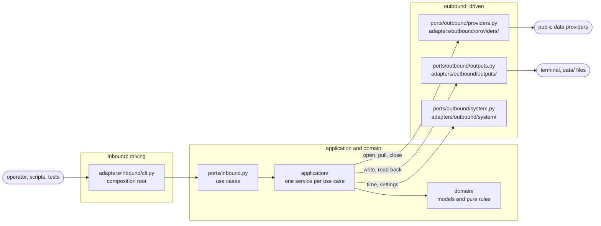

# stream-consumers

Consumers and subscribers for the public real-time data streams evaluated for the
final project of COM-22102 *Bases de Datos No Relacionales* (ITAM, Otoño 2026).

**Private, instructor-only repository**
([`mavasbel-itam/stream-consumers`](https://github.com/mavasbel-itam/stream-consumers)
on GitHub; it was `non-relational-dbs/stream-consumers` until 2026-10-19, and
older records still use that name). Students build their own ingestion
consumer as part of the project; do not share this repository with them.

The decision records are in [`docs/`](docs/README.md): the stream surveys,
how this repository was built, the screening of the Bytewax list and the status
of every API key
([`docs/reference/2026-10-17-15-13-api-key-gated-sources.md`](docs/reference/2026-10-17-15-13-api-key-gated-sources.md)).

## Quick start

Requires [uv](https://docs.astral.sh/uv/), which also installs the Python 3.13
the project pins if it is missing. Run every command from the repository root.

```bash
uv sync                                                     # create .venv with the locked dependencies
cp .env.example .env                                        # then fill in the keys you have (API keys and configuration)
uv run stream-consumers keys                                # which keys are set, missing or held; values are never shown
uv run stream-consumers consume wikimedia --max-events 5    # needs no key: five events as JSON lines
```

[Running the consumers](#running-the-consumers) explains every command, its
options and its output.

## Contents

- [Quick start](#quick-start)
- [Inclusion rule](#inclusion-rule)
- [Sources (65)](#sources-65)
- [Sources Below 1 Event/s (Measured & Low-Rate Catalog)](#sources-below-1-events-measured--low-rate-catalog)
- [Sampling results](#sampling-results)
- [How rates are measured](#how-rates-are-measured)
- [Running the consumers](#running-the-consumers)
- [Outputs](#outputs)
- [API keys and configuration](#api-keys-and-configuration)
- [Architecture](#architecture)
- [Tests](#tests)
- [Known behaviour](#known-behaviour)
- [Reference links](#reference-links)

## Inclusion rule

A source is included when its **median measured rate is at least 1 event per
second** over the sampling rounds (`stream_consumers.domain.policy.MINIMUM_RATE`,
`meets_minimum_rate`). A round in which the source delivered nothing (`no-events`)
or failed (`error`) counts as 0 events/s; a `key-pending` round measures nothing
and is left out (`round_rate`). The exceptions and pending cases:

- **GDELT is kept** although its measured medians were 0.977 events/s (2026-10-13)
  and 0.772 events/s (24 rounds, 2026-10-17/18), because the project document
  lists it (decision of 2026-10-13).
- Free-key providers whose keyless route was measured at ≥ 1 event/s are included
  (MBTA V3, TfL, NASA FIRMS); the key is optional for MBTA V3 and TfL, and FIRMS
  uses its keyless public files.
- **Candidates** (group D) needed a free key; until their own sampling with the
  key finished, their rate was unmeasured. They were built and tested against the
  providers' official documentation examples so that adding the key to `.env` was
  enough to run them. A candidate is accepted (group C, or B for aisstream.io)
  when its own sampling gives a median of at least 1 event/s with the key, and is
  transferred to the low-rate catalog otherwise.
  Seven of the eight were measured with their keys on 2026-10-17/19 and accepted
  on 2026-10-19: `cta_bus`, `cta_train`, `mastodon`, `mta_bustime`, `nta` and
  `wmata` (group C) and `aisstream` (group B), each with a certain median of at
  least 1 event/s (see [Sampling results](#sampling-results)). The ENTSO-E
  (`entsoe`) token arrived and was tested on 2026-10-19; the source measured
  0.010 events/s and cannot reach 1 event/s even reading every European area
  (under 0.4 points/s), so it went to group E
  ([Sources Below 1 Event/s](#sources-below-1-events-measured--low-rate-catalog)).
- Measured below 1 event/s and therefore excluded: Nostr, Stellar,
  ENA, PyPI, Hacker News, MLB; not measurable as configured: BitMEX, APRS-IS,
  Kystverket AIS, zKillboard.

Every rate in the source list was then re-checked with this repository's own
`sample` command; the results are in [Sampling results](#sampling-results).

- **Low-rate group (E) since 2026-10-19**: every source measured below
  1 event/s was first removed from the catalog and, on 2026-10-19, restored
  unchanged into group E: kept, tested and documented, but left out of
  `check`, `sample` and `profile` unless named (see
  [Sources Below 1 Event/s](#sources-below-1-events-measured--low-rate-catalog)).
  The removals, with the evidence of the day:
- **Lasair and Fink, removed 2026-10-18 (group E since 2026-10-19)**: both relay
  alerts of the Rubin Observatory LSST, and neither had published a single
  alert since 2026-07-14 (Lasair's latest detection 2026-07-14 10:03 UTC, 0
  objects in the last 30 days; Fink's last alert night 2026-07-14), so both
  would measure 0 events/s. The Kafka transport and the Avro decoder are
  tested against a local broker.
- **Removed 2026-10-18 after the 24-hour sampling of 2026-10-17/18, group E
  since 2026-10-19** (24 hourly rounds, 60-s windows): Bitstamp (`bitstamp`,
  median 0.515 events/s), npm (`npm`, 0.790) and Digitraffic train timetables
  (`dt_rail_trains`, 0.865), all below 1 event/s. GDELT (0.772) stays in the
  active catalog, as decided above.
- **Global Fishing Watch (`gfw`), removed 2026-10-18 (group E since
  2026-10-19)**: its events API publishes events days after they happen (the
  latest day with events was 2026-10-14 when read on 2026-10-18), so a poll
  sees no new events within a round. The totals of all four event datasets
  over a fixed date range did not grow at all in 18 hourly readings
  (2026-10-18 03:24–21:24 UTC), so the median arrival rate is 0 events/s; the
  readings continued to 2026-10-19 00:24 UTC (22 in all) and never changed.
- **ENTSO-E (`entsoe`), group E since 2026-10-19**: see the candidates above.
- **Added on 2026-10-19 from the Bytewax "Awesome Public Real-Time Datasets"
  list** (all 69 free entries screened): `blockchain`, `citibike`, `coinpaprika`,
  `ogn`, `sharpe` and `ukflood`, each keyless with a median of at least 1
  event/s in their own sampling. NOAA's National Data Buoy Center latest
  observations (`ndbc`) were added too and moved to group E on 2026-10-19:
  median 0.268 events/s over 3 rounds. Not added from that list: EPA AirNow (its hourly file lists 4,415 sites but only
  1,980 reported in the hour 2026-10-18 22:00 UTC, 0.55 events/s), Yahoo
  Finance (its terms forbid automated collection) and GitHub's REST events
  (the same events as `gharchive`).
- **Vélib' Paris was re-added on 2026-10-17**: it had been excluded at 0.983
  events/s on its earliest (night-time) rounds, but its median over 15 earlier
  cross-check rounds was 4.4 events/s; the 24-hour sampling decides.

## Sources (65)

Groups: **keyless** (49), **project document** (7, the sources the project
document lists), **free key** (9: key optional for 3, required for 6, rate
measured with the key), and **candidate** (group D, empty since 2026-10-19).
The 8 sources measured below 1 event/s are group E, listed in
[Sources Below 1 Event/s](#sources-below-1-events-measured--low-rate-catalog);
the code holds 73 sources in all.

| id | Source | Provider | Group | Transport | Delivery |
|---|---|---|---|---|---|
| `base_logs` | [Base (L2) contract event logs (PublicNode RPC)](https://geth.ethereum.org/docs/interacting-with-geth/rpc/pubsub) | Allnodes (PublicNode RPC) | keyless | websocket | push |
| `bitfinex` | [Bitfinex trades + ticker (public v2)](https://docs.bitfinex.com/docs/ws-public) | Bitfinex | keyless | websocket | push |
| `bitso` | [Bitso (Mexico) trades + order-book diffs (BTC/MXN, USD/MXN, ETH/MXN)](https://docs.bitso.com/bitso-api/docs) | Bitso (Mexico) | keyless | websocket | push |
| `blockchain` | [Blockchain.com — unconfirmed Bitcoin transactions](https://www.blockchain.com/api/api_websocket) | Blockchain.com | keyless | websocket | push |
| `bsc_logs` | [BNB Smart Chain contract event logs (PublicNode RPC)](https://geth.ethereum.org/docs/interacting-with-geth/rpc/pubsub) | Allnodes (PublicNode RPC) | keyless | websocket | push |
| `bybit` | [Bybit spot tickers](https://bybit-exchange.github.io/docs/v5/websocket/public/ticker) | Bybit | keyless | websocket | push |
| `coinbase` | [Coinbase Exchange ticker](https://docs.cdp.coinbase.com/exchange/websocket-feed/overview) | Coinbase | keyless | websocket | push |
| `coinpaprika` | [CoinPaprika — prices and market data of the 2,000 top-ranked crypto assets](https://docs.coinpaprika.com/api-reference/rest-api/introduction) | CoinPaprika | keyless | http | poll |
| `deribit` | [Deribit perpetual futures ticker](https://docs.deribit.com/) | Deribit | keyless | websocket | push |
| `eth_logs` | [Ethereum mainnet contract event logs (PublicNode RPC)](https://geth.ethereum.org/docs/interacting-with-geth/rpc/pubsub) | Allnodes (PublicNode RPC) | keyless | websocket | push |
| `gemini` | [Gemini market data v1 (order-book changes + trades)](https://developer.gemini.com/websocket/streams.md) | Gemini Trust Company | keyless | websocket | push |
| `hyperliquid` | [Hyperliquid trades](https://hyperliquid.gitbook.io/hyperliquid-docs/for-developers/api/websocket/subscriptions) | Hyperliquid | keyless | websocket | push |
| `kraken` | [Kraken trades + ticker (v2)](https://docs.kraken.com/api/docs/websocket-v2/trade) | Kraken (Payward) | keyless | websocket | push |
| `okx` | [OKX public tickers](https://www.okx.com/docs-v5/en/) | OKX | keyless | websocket | push |
| `polygon_logs` | [Polygon PoS contract event logs (PublicNode RPC)](https://geth.ethereum.org/docs/interacting-with-geth/rpc/pubsub) | Allnodes (PublicNode RPC) | keyless | websocket | push |
| `polymarket` | [Polymarket CLOB market channel (prediction-market prices)](https://docs.polymarket.com/developers/CLOB/websocket/market-channel) | Polymarket | keyless | websocket | push |
| `sharpe` | [Sharpe — perpetual-futures funding rates of 37 derivatives exchanges](https://www.sharpe.ai/docs/free-api) | Sharpe AI (Sharpe Terminal) | keyless | http | poll |
| `solana` | [Solana program logs (public mainnet RPC)](https://solana.com/docs/rpc/websocket/logssubscribe) | Solana Foundation (public mainnet-beta RPC) | keyless | websocket | push |
| `xrpl` | [XRP Ledger transactions](https://xrpl.org/docs/references/http-websocket-apis/public-api-methods/subscription-methods/subscribe) | XRP Ledger Foundation (public cluster xrplcluster.com) | keyless | websocket | push |
| `albion` | [Albion Online Data Project market orders](https://www.albion-online-data.com/) | Albion Online Data Project (community) | keyless | nats | push |
| `twitch` | [Twitch chat (anonymous read-only IRC)](https://dev.twitch.tv/docs/chat/irc/) | Twitch Interactive | keyless | websocket | push |
| `atlas` | [RIPE Atlas measurement results stream (ping)](https://atlas.ripe.net/docs/apis/streaming-api) | RIPE NCC | keyless | websocket | push |
| `ct` | [Certificate Transparency logs (RFC 6962), read directly](https://www.rfc-editor.org/rfc/rfc6962) | Certificate Transparency log operators (Google, Cloudflare, DigiCert, Sectigo, Let's Encrypt, TrustAsia) | keyless | http | poll |
| `gharchive` | [GH Archive — all public GitHub events (hourly files)](https://www.gharchive.org/) | GH Archive (Ilya Grigorik) | keyless | http | file-drop |
| `osm` | [OpenStreetMap minutely replication diffs](https://wiki.openstreetmap.org/wiki/Planet.osm/diffs) | OpenStreetMap Foundation | keyless | http | file-drop |
| `ris` | [RIPE NCC RIS Live — global BGP routing updates](https://ris-live.ripe.net/manual/) | RIPE NCC | keyless | websocket | push |
| `crossref` | [Crossref scholarly metadata (works indexed per day)](https://www.crossref.org/documentation/retrieve-metadata/rest-api/) | Crossref | keyless | http | poll |
| `pskreporter` | [PSK Reporter amateur-radio reception reports](https://www.mqtt.pskreporter.info/) | PSK Reporter (Philip Gladstone) — MQTT feed by M0LTE | keyless | mqtt | push |
| `rbn` | [Reverse Beacon Network (CW/RTTY skimmer spots)](https://www.reversebeacon.net/) | Reverse Beacon Network | keyless | tcp | push |
| `seedlink` | [EarthScope (IRIS) SeedLink real-time seismic waveforms](https://ds.iris.edu/ds/nodes/dmc/services/seedlink/) | EarthScope Consortium (IRIS DMC) | keyless | tcp | push |
| `sensorcomm` | [Sensor.Community citizen air-quality sensors](https://github.com/opendata-stuttgart/meta/wiki/EN-APIs) | Sensor.Community (OK Lab Stuttgart / Code for Germany) | keyless | http | poll |
| `usgs_water` | [USGS Water Services instantaneous values (river gauges)](https://waterservices.usgs.gov/) | U.S. Geological Survey (USGS) | keyless | http | poll |
| `adsb_fi` | [adsb.fi open data aircraft — 250 NM around Mexico City airport](https://github.com/adsbfi/opendata) | adsb.fi | keyless | http | poll |
| `adsb_lol` | [adsb.lol aircraft (ADS-B) — 250 NM around Mexico City airport](https://www.adsb.lol/docs/open-data/api/) | adsb.lol | keyless | http | poll |
| `bicing` | [Bicing Barcelona bike-share station status (GBFS)](https://opendata-ajuntament.barcelona.cat/data/en/dataset/estat-estacions-bicing) | Barcelona City Council (Bicing) | keyless | http | poll |
| `citibike` | [Citi Bike New York bike-share station status (GBFS)](https://citibikenyc.com/system-data) | Citi Bike (Lyft, Inc.) | keyless | http | poll |
| `dt_marine` | [Digitraffic Finland marine AIS vessel locations](https://www.digitraffic.fi/en/marine-traffic/) | Fintraffic (Digitraffic) | keyless | mqtt | push |
| `dt_rail` | [Digitraffic Finland train GPS locations](https://www.digitraffic.fi/en/railway-traffic/) | Fintraffic (Digitraffic) | keyless | mqtt | push |
| `dt_road` | [Digitraffic Finland road traffic (TMS) and road-weather sensors](https://www.digitraffic.fi/en/road-traffic/) | Fintraffic (Digitraffic) | keyless | mqtt | push |
| `ecobici` | [EcoBici CDMX bike-share station status (GBFS)](https://ecobici.cdmx.gob.mx/datos-abiertos/) | Gobierno de la Ciudad de México (EcoBici, operated by Lyft) | keyless | http | poll |
| `entur` | [Entur Norway real-time vehicle positions](https://developer.entur.org/pages-real-time-intro) | Entur AS (Norway) | keyless | http | poll |
| `hsl` | [HSL Helsinki High-Frequency Positioning (buses, trams, metro, trains)](https://raw.githubusercontent.com/HSLdevcom/digitransit-site/master/src/pages/en/developers/apis/5-realtime-api/vehicle-positions/high-frequency-positioning/index.md) | Helsinki Regional Transport Authority (HSL) | keyless | mqtt | push |
| `mbta_gtfsrt` | [MBTA Boston GTFS-Realtime VehiclePositions](https://www.mbta.com/developers/gtfs-realtime) | Massachusetts Bay Transportation Authority (MBTA) | keyless | http | poll |
| `mta_gtfsrt` | [MTA New York City Subway GTFS-Realtime (A/C/E feed)](https://api.mta.info/) | Metropolitan Transportation Authority (MTA) | keyless | http | poll |
| `ndov` | [NDOV Loket Netherlands public transport KV6 (all operators)](https://ndovloket.nl/) | NDOV Loket (Netherlands) | keyless | zeromq | push |
| `ogn` | [Open Glider Network — live positions of gliders, light aircraft and ADS-B traffic](https://wiki.glidernet.org/wiki:subscribe-to-ogn-data) | Open Glider Network | keyless | tcp | push |
| `velib` | [Vélib' Métropole Paris bike-share station status (GBFS)](https://www.data.gouv.fr/datasets/velib-velos-et-bornes-disponibilite-temps-reel) | Vélib' Métropole (Smovengo) | keyless | http | poll |
| `metar` | [NOAA aviationweather.gov METAR observations (global airports)](https://aviationweather.gov/data/api/) | NOAA National Weather Service — Aviation Weather Center | keyless | http | poll |
| `ukflood` | [Environment Agency (England) — real-time flood-monitoring readings: river level, flow, rainfall, tide](https://environment.data.gov.uk/flood-monitoring/doc/reference) | Environment Agency (England) | keyless | http | poll |
| `binance` | [Binance spot trades + 24 h tickers](https://github.com/binance/binance-spot-api-docs/blob/master/web-socket-streams.md) | Binance | project document | websocket | push |
| `mempool` | [mempool.space — Bitcoin transactions entering the mempool](https://mempool.space/docs/api/websocket) | The Mempool Open Source Project (mempool.space) | project document | websocket | push |
| `bluesky` | [Bluesky Jetstream — firehose of AT Protocol commits (posts, likes, follows, reposts)](https://github.com/bluesky-social/jetstream) | Bluesky Social PBC | project document | websocket | push |
| `gdelt` | [GDELT 2.0 Event Database — 15-minute event exports](https://www.gdeltproject.org/data.html) | The GDELT Project | project document | http | file-drop |
| `wikimedia` | [Wikimedia EventStreams — recent changes on all Wikimedia wikis](https://wikitech.wikimedia.org/wiki/Event_Platform/EventStreams_HTTP_Service) | Wikimedia Foundation | project document | sse | push |
| `opensky` | [OpenSky Network state vectors — aircraft over Mexico](https://openskynetwork.github.io/opensky-api/rest.html) | OpenSky Network | project document | http | poll |
| `aisstream` | [aisstream.io — global AIS ship positions and static data](https://aisstream.io/documentation) | aisstream.io | project document | websocket | push |
| `mbta_v3` | [MBTA V3 API vehicles (Boston subway, bus, commuter rail, ferry)](https://www.mbta.com/developers/v3-api) | Massachusetts Bay Transportation Authority (MBTA) | free key (optional) | http | poll |
| `tfl` | [Transport for London Unified API — Tube arrival predictions](https://api-portal.tfl.gov.uk/) | Transport for London (TfL) | free key (optional) | http | poll |
| `firms` | [NASA FIRMS — satellite active-fire detections (VIIRS ×3, MODIS), global 24 h files](https://firms.modaps.eosdis.nasa.gov/active_fire/) | NASA Earth Science Data Systems (LANCE FIRMS) | free key (optional) | http | poll |
| `cta_bus` | [CTA Bus Tracker vehicles — every Chicago bus](https://www.transitchicago.com/developers/bustracker/) | Chicago Transit Authority (CTA) | free key (required) | http | poll |
| `cta_train` | [CTA Train Tracker locations — every Chicago 'L' train](https://www.transitchicago.com/developers/traintracker/) | Chicago Transit Authority (CTA) | free key (required) | http | poll |
| `mastodon` | [Mastodon federated public timeline (statuses, edits, deletions)](https://docs.joinmastodon.org/methods/streaming/) | Mastodon (default instance social.vivaldi.net, funded by Vivaldi Technologies) | free key (required) | sse | push |
| `mta_bustime` | [MTA Bus Time GTFS-Realtime vehicle positions — every New York City bus](https://bustime.mta.info/developers/gtfs-realtime/) | Metropolitan Transportation Authority (MTA) | free key (required) | http | poll |
| `nta` | [NTA Ireland GTFS-Realtime vehicle positions — Dublin Bus, Bus Éireann, Go-Ahead Ireland](https://developer.nationaltransport.ie/) | National Transport Authority (NTA), Ireland | free key (required) | http | poll |
| `wmata` | [WMATA GTFS-Realtime vehicle positions — Washington DC Metrobus and Metrorail](https://developer.wmata.com/) | Washington Metropolitan Area Transit Authority (WMATA) | free key (required) | http | poll |

## Sources Below 1 Event/s (Measured & Low-Rate Catalog)

Group E (`Group.LOW_RATE`) holds the 8 sources measured below 1 event/s. Their
consumers, decoders and test data are kept and tested like every other source
(the 100 % coverage gate includes them), and every key they read has a live
probe. `check`, `sample` and `profile` leave them out when no source id is
given (`Group.active`); name one to run it, for example
`uv run stream-consumers check ndbc --seconds 960`. `list` shows all 73 sources
with their group. The measurements and the evidence behind each row are in
[`docs/reference/2026-10-19-18-27-sub-threshold-sources.md`](docs/reference/2026-10-19-18-27-sub-threshold-sources.md).

| id | Source | Transport / delivery | Key | Measured | Why it stays below 1 event/s (evidence) |
|---|---|---|---|---|---|
| `bitstamp` | [Bitstamp live trades](https://www.bitstamp.net/websocket/v2/) | websocket / push | — | median **0.515** events/s; 24/24 rounds, 3 at ≥ 1/s, min 0.150, max 3.555 (`sampling-20261017`) | Trades of the five subscribed pairs (BTC/USD, ETH/USD, XRP/USD, BTC/EUR, SOL/USD) arrive at under 1/s in most hours |
| `dt_rail_trains` | [Digitraffic Finland train timetables/actuals](https://www.digitraffic.fi/en/railway-traffic/) | mqtt / push | — | median **0.865**; 24/24 rounds, 7 at ≥ 1/s, min 0.200, max 1.246 (`sampling-20261017`) | Every message on `trains/#` is counted; fewer than 1 per second in most hours |
| `entsoe` | [ENTSO-E actual generation per production type](https://transparencyplatform.zendesk.com/hc/en-us/sections/12783116987028-Restful-API) | http / poll | `ENTSOE_TOKEN` (required, set) | **0.010** with the default areas (Germany, France, Spain), 600 s on 2026-10-19; all 59 reporting areas: one request round takes about 380 s, so no rate in 600 s (`data/reports/entsoe-20261019/`) | The platform publishes one value per period (15 to 60 min) per area and production type: asked at 15:21–15:23 UTC for the window 10:00–16:00 UTC, the 100 areas listed by entsoe-py returned 7,226 points (59 areas with data), 0.38 points/s even over only the 5 h 21 min up to the query and if every point were new |
| `fink` | [Fink — Rubin Observatory LSST and ZTF alerts](https://doc.lsst.fink-broker.org/services/livestream/) | kafka / push | `FINK_KAFKA_SERVERS`, `FINK_GROUP_ID` (required, not set) | 0 (no measurement possible without credentials) | No LSST alert night after 2026-07-14 (checked 2026-10-18) |
| `gfw` | [Global Fishing Watch events API](https://globalfishingwatch.org/our-apis/documentation) | http / poll | `GFW_API_TOKEN` (required, set) | **0**: dataset totals unchanged in all 22 hourly readings, 2026-10-18 03:24 – 2026-10-19 00:24 UTC (`data/gfw-growth-20261018/`) | Events are derived from AIS after processing and published days later (latest day with events 2026-10-14 when read on 2026-10-18) |
| `lasair` | [Lasair — LSST alerts passing a saved filter](https://lasair.readthedocs.io/en/main/core_functions/alert-streams.html) | kafka / push | `LASAIR_KAFKA_TOPIC` (required, not set) | 0 (no filter topic yet) | Latest detection 2026-07-14 10:03 UTC, 0 objects in the last 30 days (checked 2026-10-18) |
| `ndbc` | [NOAA National Data Buoy Center latest observations](https://www.ndbc.noaa.gov/faq/rt_data_access.shtml) | http / poll | — | median **0.268**; 3 rounds of 960 s: 0.268, 0.569, 0.045 (`sampling-bytewax-20261019`, stopped early) | About 840 stations, one observation each per file rewrite; rewrites seen 9 min 59 s and 14 min 51 s apart |
| `npm` | [npm registry replication changes](https://github.com/npm/registry-follower-tutorial) | http / poll | — | median **0.790**; 24/24 rounds, 9 at ≥ 1/s, min 0.259, max 1.616 (`sampling-20261017`) | Polled every 5 s; the feed returns each changed package once per request, so several updates of one package between polls count once |

## Sampling results

One sampling run decides each source: the all-source run of 2026-10-17/18
(24 hourly rounds, 60-s windows) unless a later run measured the source with
its key or with a changed consumer (`mbta_v3`, `firms`, `sensorcomm`, `tfl`:
run `d2`, after the minimum windows and the `mbta_v3` opening-snapshot fix).
Values come from `uv run stream-consumers verdict data/reports/<run> --planned 24`.
**passes (certain)** means the median of 24 rounds is at least 1 event/s
whatever the missing rounds show. The runs `d2`, `mastodon-world` and
`bytewax` were stopped on 2026-10-19 05:38 UTC before 24 rounds; their
sources are decided on the median of the rounds they completed
(**passes on N rounds (stopped early)**), and `ndbc`, the only one below
1 event/s, went to group E. Read at
<!-- results-read-at -->2026-10-19 05:39 UTC; the table lists every source of groups A–C (65); the
group E measurements are in [Sources Below 1 Event/s](#sources-below-1-events-measured--low-rate-catalog).

<!-- results-table -->
| id | Group | Run (`data/reports/sampling-…`) | Rounds | Rounds ≥ 1/s | Median (events/s) | Rounds span (UTC) | Result |
|---|---|---|---|---|---|---|---|
| `adsb_fi` | keyless | 20261017 | 24/24 | 21 | 3.350 | 10-17 21:00–10-18 19:44 | passes (certain) |
| `adsb_lol` | keyless | 20261017 | 24/24 | 12 | 1.727 | 10-17 21:00–10-18 19:44 | passes (certain) |
| `aisstream` | project document | aisstream-20261018 | 12/24 | 12 | 74.209 | 10-18 17:20–10-19 04:20 | passes (certain) |
| `albion` | keyless | 20261017 | 24/24 | 20 | 6.225 | 10-17 21:00–10-18 19:44 | passes (certain) |
| `atlas` | keyless | 20261017 | 24/24 | 24 | 870.392 | 10-17 21:00–10-18 19:44 | passes (certain) |
| `base_logs` | keyless | 20261017 | 24/24 | 24 | 298.250 | 10-17 21:00–10-18 19:44 | passes (certain) |
| `bicing` | keyless | 20261017 | 24/24 | 24 | 3.681 | 10-17 21:00–10-18 19:44 | passes (certain) |
| `binance` | project document | 20261017 | 24/24 | 24 | 42.585 | 10-17 21:00–10-18 19:44 | passes (certain) |
| `bitfinex` | keyless | 20261017 | 24/24 | 16 | 1.338 | 10-17 21:00–10-18 19:44 | passes (certain) |
| `bitso` | keyless | 20261017 | 24/24 | 24 | 26.812 | 10-17 21:00–10-18 19:44 | passes (certain) |
| `blockchain` | keyless | bytewax-20261019 | 3/24 | 2 | 1.795 | 10-19 02:45–10-19 04:45 | passes on 3 rounds (stopped early) |
| `bluesky` | project document | 20261017 | 24/24 | 24 | 275.843 | 10-17 21:00–10-18 19:44 | passes (certain) |
| `bsc_logs` | keyless | 20261017 | 24/24 | 24 | 372.913 | 10-17 21:00–10-18 19:44 | passes (certain) |
| `bybit` | keyless | 20261017 | 24/24 | 24 | 5.499 | 10-17 21:00–10-18 19:44 | passes (certain) |
| `citibike` | keyless | bytewax-20261019 | 3/24 | 2 | 23.368 | 10-19 02:45–10-19 04:45 | passes on 3 rounds (stopped early) |
| `coinbase` | keyless | 20261017 | 24/24 | 24 | 5.696 | 10-17 21:00–10-18 19:44 | passes (certain) |
| `coinpaprika` | keyless | bytewax-20261019 | 3/24 | 3 | 6.662 | 10-19 02:45–10-19 04:45 | passes on 3 rounds (stopped early) |
| `crossref` | keyless | 20261017 | 24/24 | 23 | 7.983 | 10-17 21:00–10-18 19:44 | passes (certain) |
| `ct` | keyless | 20261017 | 24/24 | 24 | 263.575 | 10-17 21:00–10-18 19:44 | passes (certain) |
| `cta_bus` | free key | 20261017 | 24/24 | 23 | 17.379 | 10-17 21:00–10-18 19:44 | passes (certain) |
| `cta_train` | free key | keyed-20261018 | 22/24 | 17 | 1.424 | 10-18 03:23–10-19 00:23 | passes (certain) |
| `deribit` | keyless | 20261017 | 24/24 | 24 | 3.935 | 10-17 21:00–10-18 19:44 | passes (certain) |
| `dt_marine` | keyless | 20261017 | 24/24 | 24 | 31.041 | 10-17 21:00–10-18 19:44 | passes (certain) |
| `dt_rail` | keyless | 20261017 | 24/24 | 24 | 48.622 | 10-17 21:00–10-18 19:44 | passes (certain) |
| `dt_road` | keyless | 20261017 | 24/24 | 24 | 274.221 | 10-17 21:00–10-18 19:44 | passes (certain) |
| `ecobici` | keyless | 20261017 | 24/24 | 15 | 1.465 | 10-17 21:00–10-18 19:44 | passes (certain) |
| `entur` | keyless | 20261017 | 24/24 | 24 | 28.648 | 10-17 21:00–10-18 19:44 | passes (certain) |
| `eth_logs` | keyless | 20261017 | 24/24 | 21 | 43.822 | 10-17 21:00–10-18 19:44 | passes (certain) |
| `firms` | free key | d2-20261018 | 7/24 | 4 | 3.727 | 10-18 22:35–10-19 04:35 | passes on 7 rounds (stopped early) |
| `gdelt` | project document | 20261017 | 24/24 | 2 | 0.772 | 10-17 21:00–10-18 19:44 | kept below 1/s: the project document lists it |
| `gemini` | keyless | 20261017 | 24/24 | 24 | 286.996 | 10-17 21:00–10-18 19:44 | passes (certain) |
| `gharchive` | keyless | 20261017 | 24/24 | 24 | 2.939 | 10-17 21:00–10-18 19:44 | passes (certain) |
| `hsl` | keyless | 20261017 | 24/24 | 24 | 648.168 | 10-17 21:00–10-18 19:44 | passes (certain) |
| `hyperliquid` | keyless | 20261017 | 24/24 | 24 | 4.390 | 10-17 21:00–10-18 19:44 | passes (certain) |
| `kraken` | keyless | 20261017 | 24/24 | 23 | 2.968 | 10-17 21:00–10-18 19:44 | passes (certain) |
| `mastodon` | free key | mastodon-vivaldi-20261018 | 13/24 | 13 | 2.383 | 10-18 15:37–10-19 03:37 | passes (certain) |
| `mbta_gtfsrt` | keyless | 20261017 | 24/24 | 24 | 24.620 | 10-17 21:00–10-18 19:44 | passes (certain) |
| `mbta_v3` | free key | d2-20261018 | 7/24 | 7 | 45.787 | 10-18 22:35–10-19 04:35 | passes on 7 rounds (stopped early) |
| `mempool` | project document | 20261017 | 24/24 | 24 | 3.554 | 10-17 21:00–10-18 19:44 | passes (certain) |
| `metar` | keyless | 20261017 | 24/24 | 23 | 1.386 | 10-17 21:00–10-18 19:44 | passes (certain) |
| `mta_bustime` | free key | mta_bustime-20261018 | 20/24 | 20 | 50.567 | 10-18 04:56–10-18 23:56 | passes (certain) |
| `mta_gtfsrt` | keyless | 20261017 | 24/24 | 24 | 10.106 | 10-17 21:00–10-18 19:44 | passes (certain) |
| `ndov` | keyless | 20261017 | 24/24 | 24 | 67.944 | 10-17 21:00–10-18 19:44 | passes (certain) |
| `nta` | free key | nta-20261018 | 21/24 | 21 | 11.474 | 10-18 04:28–10-19 00:28 | passes (certain) |
| `ogn` | keyless | bytewax-20261019 | 3/24 | 3 | 115.615 | 10-19 02:45–10-19 04:45 | passes on 3 rounds (stopped early) |
| `okx` | keyless | 20261017 | 24/24 | 24 | 30.451 | 10-17 21:00–10-18 19:44 | passes (certain) |
| `opensky` | project document | opensky-20261018 | 12/24 | 12 | 30.477 | 10-18 15:53–10-19 02:53 | passes (certain) |
| `osm` | keyless | 20261017 | 24/24 | 24 | 30.275 | 10-17 21:00–10-18 19:44 | passes (certain) |
| `polygon_logs` | keyless | 20261017 | 24/24 | 24 | 353.452 | 10-17 21:00–10-18 19:44 | passes (certain) |
| `polymarket` | keyless | 20261017 | 24/24 | 24 | 328.189 | 10-17 21:00–10-18 19:44 | passes (certain) |
| `pskreporter` | keyless | 20261017 | 24/24 | 24 | 414.680 | 10-17 21:00–10-18 19:44 | passes (certain) |
| `rbn` | keyless | 20261017 | 24/24 | 24 | 23.200 | 10-17 21:00–10-18 19:44 | passes (certain) |
| `ris` | keyless | 20261017 | 24/24 | 24 | 2921.520 | 10-17 21:00–10-18 19:44 | passes (certain) |
| `seedlink` | keyless | 20261017 | 24/24 | 23 | 1.873 | 10-17 21:00–10-18 19:44 | passes (certain) |
| `sensorcomm` | keyless | d2-20261018 | 7/24 | 5 | 58.733 | 10-18 22:35–10-19 04:35 | passes on 7 rounds (stopped early) |
| `sharpe` | keyless | bytewax-20261019 | 3/24 | 3 | 40.396 | 10-19 02:45–10-19 04:45 | passes on 3 rounds (stopped early) |
| `solana` | keyless | 20261017 | 24/24 | 24 | 1391.347 | 10-17 21:00–10-18 19:44 | passes (certain) |
| `tfl` | free key | d2-20261018 | 7/24 | 5 | 1.750 | 10-18 22:35–10-19 04:35 | passes on 7 rounds (stopped early) |
| `twitch` | keyless | 20261017 | 24/24 | 24 | 5.275 | 10-17 21:00–10-18 19:44 | passes (certain) |
| `ukflood` | keyless | bytewax-20261019 | 3/24 | 3 | 4.865 | 10-19 02:45–10-19 04:45 | passes on 3 rounds (stopped early) |
| `usgs_water` | keyless | 20261017 | 24/24 | 24 | 2.402 | 10-17 21:00–10-18 19:44 | passes (certain) |
| `velib` | keyless | 20261017 | 24/24 | 24 | 4.578 | 10-17 21:00–10-18 19:44 | passes (certain) |
| `wikimedia` | project document | 20261017 | 24/24 | 24 | 29.034 | 10-17 21:00–10-18 19:44 | passes (certain) |
| `wmata` | free key | wmata-20261018 | 20/24 | 20 | 47.679 | 10-18 04:56–10-18 23:56 | passes (certain) |
| `xrpl` | keyless | 20261017 | 24/24 | 24 | 23.440 | 10-17 21:00–10-18 19:44 | passes (certain) |

## How rates are measured

| Delivery | Rate | Example |
|---|---|---|
| push | events received ÷ seconds consumed | WebSocket, MQTT, SSE, NATS, ZeroMQ, TCP |
| poll | records new or changed between the first and last poll ÷ time between them | GBFS, GTFS-Realtime, ADS-B |
| poll, snapshot with a stated period | records in the snapshot ÷ that period | METAR (last hour), Sensor.Community (5 min), FIRMS (24 h) |
| file drop | records in the newest complete file ÷ the period it covers | GH Archive (1 h), GDELT (15 min), OpenStreetMap (1 min) |

`RunReport.rate_basis` records which one applies (`observed`, `published`, or
`unmeasured` when a run ended before a rate could be computed).

Rounds are spread over a day (24 rounds, one per hour) because many streams
follow the daily cycle of where they are: in the 2026-10-17/18 rounds `ecobici`
ranged from 3.63 events/s in the evening to 0.14 at night, and in 18 of the 56
measured sources at least one single round was on the other side of 1 event/s
from the source's 24-round median. A short test at one time of day therefore
cannot decide inclusion.

A source's verdict is fixed before the 24th round once the missing rounds can no
longer move its median across 1 event/s (`policy.verdict`): each missing round
could add 0 events/s, any higher rate or nothing, so the lowest possible median
fills them with 0 and the highest with an unbounded rate. With 24 rounds planned,
13 rounds at or above 1 event/s always pass and 13 below always fail; it can be
earlier (12 rounds of at least 2 events/s already give a lowest median of 1).
`sample --stop-when-settled` stops reading each source at that point, and the run
ends when every source is settled; `verdict` gives the median and verdict of each
source from recorded rounds.

## Running the consumers

Every command is `uv run stream-consumers <command>`, run from the repository
root after `uv sync` ([Quick start](#quick-start)); `--help` after a command
lists its options with their defaults. Source ids are the `id` column of the
tables above, or the `id` field of `list`.

| Command | What it does | Output | Exit code |
|---|---|---|---|
| `list` | Every source of the catalog (73), one JSON object per line: id, name, group, transport, delivery, endpoint, documentation and terms links, credential, settings, personal fields, minimum window | standard output | 0 |
| `keys` | One line per variable: source, variable, kind (`secret`, `setting`, `held`), required or optional, state (`set`, `MISSING`, `not-set`, `default`), sign-up page or default; never a value | standard output | 1 if `.env` holds a variable that no source reads and no held key declares |
| `keys --template` | The `.env.example` template, with how to get each key | standard output | 0 |
| `consume <id>` | Reads one source and writes each event in the chosen format, or into a database ([Outputs](#outputs)) | `--out` (standard output by default); a run report as one JSON line on standard error | 0 when the source delivered events or its key is missing (`key-pending`), 1 when it failed or delivered nothing |
| `check [<id> …]` | Reads each source for a short window and reports whether events arrive | one line per source and a total on standard output; `check-<time>.json` in `--reports` | 1 if any source failed or delivered nothing |
| `sample [<id> …]` | The measurement behind the inclusion rule: reads every source once per round, rounds started on wall-clock targets | `round-NN-<time>.json` per round in `--reports`; the latest result and the verdict of each source on standard output | 1 if any source failed or delivered nothing in its latest round |
| `verdict <dir> [<id> …]` | Median rate and verdict (`passes`, `fails`, `open`) of each source from recorded `round-*.json` files (searched recursively) | standard output | 0 |
| `profile [<id> …]` | Keeps a masked sample of events per source and describes their fields | `<source>.jsonl` in `--out` (the extension follows `--format`); `profiles-<time>.json` in `--reports`; one line per source on standard output | 1 if any source failed or delivered nothing |

`check`, `sample` and `profile` without source ids read the 65 sources of
groups A–C; a group E source runs only when named. Every command exits 2 on an
invalid argument or an unknown source id, and 141 (128 + SIGPIPE, as `head`
or `grep -m` cause) when the program reading its output closes the pipe early.

### Options and defaults

| Command | Option | Default | Meaning |
|---|---|---|---|
| every command | `--env-file <path>` (before the command) | `.env` | File with keys and settings; a variable already set in the process environment wins |
| every command | `--catalog <module>` (before the command) | built-in sources | Module exposing `FACTORIES`; the tests use it to load a local catalog |
| `keys` | `--template` | off | Print the `.env` template instead of the status |
| `consume` | `--seconds` | 60 | Reading time, extended to the source's minimum window |
| `consume` | `--max-events` | no limit | Stop after this many events |
| `consume` | `--out` | `-` (standard output) | Where events go: `-`, a file path, or a destination: `sqlite:`, `kafka://`, `mqtt://`, `nats://`, `zmq+tcp://` ([Outputs](#outputs)) |
| `consume` | `--format` | `jsonl` | Text format for standard output and files: `jsonl`, `csv`, `tsv`, `json`, `pretty`; not accepted with a database destination |
| `consume` | `--raw` | off | Do not mask personal fields |
| `check` | `--seconds` | 30 | Reading time per source, extended to its minimum window |
| `check` | `--reports` | `data/reports` | Directory for `check-<time>.json` |
| `check` | `--concurrency` | 16 | Sources read at the same time |
| `sample` | `--rounds` | 24 | Number of rounds |
| `sample` | `--interval` | 3600 | Seconds between round starts |
| `sample` | `--window` | 60 | Reading time per source and round, extended to its minimum window |
| `sample` | `--reports` | `data/reports` | Directory for `round-NN-<time>.json` |
| `sample` | `--concurrency` | 64 | Sources read at the same time |
| `sample` | `--continue-from <dir>` | none | Reports directory of an interrupted run; its rounds count toward `--rounds` and are not repeated |
| `sample` | `--stop-when-settled` | off | Stop reading a source once its median over `--rounds` is fixed on one side of 1 event/s |
| `verdict` | `--planned` | 24 | Rounds in the plan the verdict is about |
| `profile` | `--max-events` | 500 | Events kept per source |
| `profile` | `--seconds` | 120 | Longest reading time per source, extended to its minimum window |
| `profile` | `--out` | `data/profile` | Directory for the masked samples |
| `profile` | `--format` | `jsonl` | Format of the samples: `jsonl`, `csv`, `tsv`, `json`, `pretty` |
| `profile` | `--reports` | `data/reports` | Directory for `profiles-<time>.json` |
| `profile` | `--concurrency` | 64 | Sources read at the same time |

### Examples

```bash
uv run stream-consumers list                                      # the 73 sources
uv run stream-consumers consume hsl --seconds 60 --out data/hsl.jsonl
uv run stream-consumers consume coinbase --max-events 100         # to the terminal
uv run stream-consumers consume coinbase --seconds 60 --format csv --out data/coinbase.csv
uv run stream-consumers consume coinbase --seconds 60 --out sqlite:data/events.db   # table coinbase
uv run stream-consumers check                                     # the 65 sources of groups A–C (D is empty) for 30 s
uv run stream-consumers check wikimedia coinbase --seconds 10     # only these two
uv run stream-consumers check ndbc --seconds 960                  # a group E source runs only when named
uv run stream-consumers sample --rounds 24 --interval 3600 --window 60 --reports data/reports/sampling
uv run stream-consumers sample --stop-when-settled --reports data/reports/sampling/segment-2 \
    --continue-from data/reports/sampling                         # resume an interrupted run; stop each source once settled
uv run stream-consumers verdict data/reports/sampling --planned 24
uv run stream-consumers profile --max-events 500 --seconds 120 --out data/profile
uv run stream-consumers --env-file /path/to/other.env keys
```

### What the output looks like

`consume coinbase --max-events 2` on 2026-10-19 at 23:10 UTC wrote these two
events to standard output (`received_at` is Unix time in seconds; `payload` is
the provider's message with nested fields flattened to dotted names, as
masking does; with `--raw` it is written as decoded, unflattened):

```json
{"source": "coinbase", "received_at": 1792451429.0183232, "payload": {"type": "ticker", "sequence": 33222444004, "product_id": "SOL-USD", "price": "104.93", "open_24h": "103.97", "volume_24h": "404714.89067842", "low_24h": "103.44", "high_24h": "106.11", "volume_30d": "23266608.11904641", "best_bid": "104.910", "best_bid_size": "60.94180712", "best_ask": "104.930", "best_ask_size": "97.50987129", "side": "buy", "time": "2026-10-19T23:10:25.601474Z", "trade_id": 358224642, "last_size": "0.13555312"}}
{"source": "coinbase", "received_at": 1792451429.02297, "payload": {"type": "ticker", "sequence": 24472285875, "product_id": "DOGE-USD", "price": "0.07954", "open_24h": "0.07933", "volume_24h": "60654047.70000000", "low_24h": "0.07854", "high_24h": "0.0802", "volume_30d": "5285390369.80000000", "best_bid": "0.07952", "best_bid_size": "12614.0", "best_ask": "0.07954", "best_ask_size": "57061.8", "side": "buy", "time": "2026-10-19T23:10:24.975242Z", "trade_id": 175642876, "last_size": "74.1"}}
```

and this run report to standard error:

```json
{"source_id": "coinbase", "status": "ok", "events": 2, "seconds": 1.284, "rate": 1.558, "rate_basis": "observed", "attributes_median": 17.0, "first_event_s": 1.119, "started_at": 1792451427.899483, "detail": ""}
```

`check wikimedia coinbase --seconds 10` on 2026-10-19 at 23:15 UTC printed:

```text
coinbase         ok          events=91      rate=8.944/s      observed   
wikimedia        ok          events=290     rate=28.997/s     observed   
2 sources, 2 delivered or key pending, 0 failed
```

`status` is `ok`, `no-events`, `error` (with the reason in `detail`) or
`key-pending`; `rate_basis` is explained in
[How rates are measured](#how-rates-are-measured).

Personal fields declared by each source (`personal_fields`) and any e-mail
address are masked in everything written, unless `consume --raw` is given.
Captured data and reports go to `data/`, which git ignores.

`profile` writes `profiles-<time>.json` to `--reports`: per source the event
size in compact UTF-8 JSON (mean and 95th percentile), the share of events equal
to an earlier one, the natural key (smallest set of at most three fields unique
across the sample, preferring identifiers and times) and, per flattened field,
presence, distinct values, kinds, numeric range, a masked example and a class.
Classes are decided in this order (`FieldClass`, `policy.classify_field`):
`datetime` (ISO 8601 text, or epoch s/ms/µs/ns or `YYYYMMDD[hhmmss]` within
400 days of the run), `geographic` (a latitude or longitude whose partner field
is present, within range), `number` (numbers, or numeric text without a leading
zero, flagged `numeric_text`), `identifier` (text without spaces with more
distinct values than a category may have), `free-text` (30+ characters on
average, mostly with spaces, at least half distinct), `label` (other text with
that many distinct values), `category` (text or Booleans with at most
max(20, 5 % of the events) distinct values), `nested` and `empty`.

## Outputs

`consume` writes to the terminal (`--out -`, the default), to a file
(`--out <path>`) or to a destination URI. The terminal and files take a text
format (`--format`); a destination URI takes no format, the database stores
the event itself. Every output carries the same three things: `source` (the
source id), `received_at` (Unix time in seconds when the event arrived) and
`payload` (the event, masked unless `--raw`). `profile --format` writes its
samples in any text format.

### Text formats

| `--format` | File extension (`profile`) | What is written |
|---|---|---|
| `jsonl` (default) | `.jsonl` | One JSON object per line: `{"source", "received_at", "payload"}` |
| `csv` | `.csv` | A header and one row per event: `source`, `received_at`, then every payload field as `payload.<dotted path>`, then `extra` |
| `tsv` | `.tsv` | The same columns as `csv`, separated by tabs |
| `json` | `.json` | One JSON array holding every event; the document is complete when the run ends (`[]` when nothing arrived) |
| `pretty` | `.txt` | Each event as indented JSON, one after the other (a stream of JSON documents, which `jq` reads as is) |

CSV and TSV rules (`DelimitedEncoder`): the header is taken from the first
event, so rows are written while events arrive, also to the terminal. A field
that first appears in a later event goes into the last column, `extra`, as one
JSON object (`{"payload.<path>": value, ...}`); a header field missing from an
event is an empty cell. Lists and empty objects are written as JSON text, `null`
as an empty cell, `true`/`false` as such. Quoting follows Python's `csv`
module (a value holding the delimiter, a quote or a line break is quoted);
rows end with `\n`.

`consume coinbase --max-events 2 --format csv` on 2026-10-20 at 00:53 UTC
printed:

```text
source,received_at,payload.type,payload.sequence,payload.product_id,payload.price,payload.open_24h,payload.volume_24h,payload.low_24h,payload.high_24h,payload.volume_30d,payload.best_bid,payload.best_bid_size,payload.best_ask,payload.best_ask_size,payload.side,payload.time,payload.trade_id,payload.last_size,extra
coinbase,1792457636.1090796,ticker,138001376731,BTC-USD,81522.62,82199.79,4720.41274336,81350.1,83076.23,161399.04581082,81522.62,0.39140551,81522.63,0.00002088,sell,2026-10-20T00:53:55.968284Z,1108190504,0.00000014,
coinbase,1792457636.1208763,ticker,104123319944,ETH-USD,2394.89,2411.12,80994.31740659,2382.34,2443.86,2620838.10967965,2394.83,0.79308902,2394.98,0.00018758,buy,2026-10-20T00:53:55.926247Z,849382951,0.00057969,
```

### Destinations

| `--out` | Where events go |
|---|---|
| `-` (default) | Standard output, in `--format` |
| `<path>` | A file (directories are created), in `--format` |
| `sqlite:<path>` | A SQLite database file ([below](#sqlite)) |
| `kafka://host[:port][,host[:port]…][/<topic>]` | A Kafka topic, default `stream_consumers.{source}`, port 9092 ([below](#kafka)) |
| `mqtt://[user[:password]@]host[:port][/<topic>]` | An MQTT topic, default `stream_consumers/{source}`, port 1883 ([below](#mqtt)) |
| `nats://[user[:password]@]host[:port][,host[:port]…][/<subject>]` | A NATS subject, default `stream_consumers.{source}`, port 4222 ([below](#nats)) |
| `zmq+tcp://<interface>:<port>` | A ZeroMQ PUB socket bound on that address, e.g. `zmq+tcp://*:5556` ([below](#zeromq)) |

`{source}` in a topic or subject is replaced by the source id. A destination
whose scheme is not one of these (`something://…`) is refused with exit code 2
instead of being taken for a file name, and so is anything a destination does
not use (a user for Kafka or ZeroMQ, several hosts for MQTT or ZeroMQ, any
`?option`). The run report shows a password as `***`; a password given in
`--out` is visible to other users of the machine in its process list, so use
it only for local and lab servers.

Brokers and databases receive the event document `{"source", "received_at",
"payload"}` as compact UTF-8 JSON (one JSON-lines line without its line
break). They are written in batches: every 500 events, when the oldest waiting
event has waited 1 s, and when the run ends (`BatchingEventSink`); ZeroMQ sends
each event at once. An output that cannot be opened or written ends the run
with `error: output <destination> failed: <reason>` and exit code 1; it is
never counted as a failure of the source. Client libraries may log warnings to
standard error before the run report (aiokafka logs `Topic … not found in
cluster metadata` while the broker creates a topic on first use).

#### SQLite

One table per source, named after the source id: `seq` (row number, in arrival
order), `received_at` (Unix seconds, `REAL`) and `payload` (JSON text). A run
adds rows to an existing file. SQLite's JSON functions read the payload. After
`consume coinbase --max-events 20 --out sqlite:data/events.db` on 2026-10-20 at
00:53 UTC, this query

```sql
SELECT seq, datetime(received_at, 'unixepoch'), payload ->> '$.product_id', payload ->> '$.price'
FROM coinbase ORDER BY seq LIMIT 3;
```

returned these rows (read with Python's `sqlite3` module):

```text
(1, '2026-10-20 00:53:36', 'BTC-USD', '81531.77')
(2, '2026-10-20 00:53:36', 'XRP-USD', '1.2959')
(3, '2026-10-20 00:53:36', 'ETH-USD', '2394.64')
```

#### Kafka

aiokafka producer: key = source id, value = the event document; the run ends
only after the broker acknowledged every batch. Credentials and TLS are not
supported. With the topic omitted, each source gets `stream_consumers.<id>`; a
fixed topic (`kafka://host:9092/all_events`) mixes sources, told apart by the
key. `consume coinbase --max-events 3 --out kafka://127.0.0.1:<port>` against
a local `apache/kafka:3.9.1` broker on 2026-10-20 at 01:10 UTC exited 0; a
consumer then read (each value cut here after `product_id`):

```text
stream_consumers.coinbase 0 0 b'coinbase' {"source":"coinbase","received_at":1792458652.007029,"payload":{"type":"ticker","sequence":23054787779,"product_id":"XRP-USD",
stream_consumers.coinbase 0 1 b'coinbase' {"source":"coinbase","received_at":1792458652.007099,"payload":{"type":"ticker","sequence":24472685076,"product_id":"DOGE-USD"
stream_consumers.coinbase 0 2 b'coinbase' {"source":"coinbase","received_at":1792458652.0184221,"payload":{"type":"ticker","sequence":104124067184,"product_id":"ETH-USD"
```

(topic, partition, offset, key, value).

#### MQTT

paho client, QoS 1 (at least once): every message of a batch waits for the
broker's acknowledgement (10 s at most). User and password from the URI;
plain TCP only.

#### NATS

nats-py, core NATS publish; every batch ends with a round trip to the server,
so a lost connection is reported instead of events vanishing. User and
password from the URI; several servers may be listed. A server that cannot be
reached is reported after two attempts per server.

#### ZeroMQ

A PUB socket bound on the given interface and port; each event is two frames,
the source id (subscribers filter on it) and the event document. ZeroMQ
publish/subscribe delivers only to subscribers already connected: events sent
before a subscriber connects, or while none is, are dropped by design. When the
run ends the socket stays up to 1 s to deliver what is queued.

## API keys and configuration

Credentials and settings are read from the process environment, then from a
git-ignored `.env` file (`--env-file` changes the path). Values are never
printed, logged or written to a report.

```bash
cp .env.example .env                          # every variable the sources read and every held key, with how to get each
uv run stream-consumers keys                  # which are set, missing (required) or not set (optional);
                                              # exits 1 and lists as `unknown` any .env variable neither read nor held
uv run stream-consumers check cta_train       # one source for 30 s once its key is in .env
uv run stream-consumers keys --template       # regenerates .env.example (a unit test keeps them identical)
```

A source whose required credentials are missing reports `key-pending` in `check`,
`sample` and `profile`; it never fails a run.

`.env` holds only the variables of `.env.example`, and every key the project
has is kept in it. Keys that no source reads are **held keys**, declared in
`stream_consumers/adapters/outbound/providers/held_keys.py` (`HELD_KEYS`,
exported by the catalog next to `FACTORIES`) and listed by `keys` as `held`: secondary keys
(NTA, WMATA, TfL), WMATA and TfL products the sources do not read, the
Mastodon applications' client id and secret and the tokens of other instances
(mastodon.world, mastodon.social), the Coinbase CDP key, the Bitso and Binance
key pairs (reading permission only; the Binance probe also fails if the key
can trade or withdraw), and the Lasair REST API token (the `lasair` source reads only the Kafka topic of a saved filter). A new key is added to `HELD_KEYS` (or to a source's
`Credential`) and to `tests/live/test_keys_live.py`, which fails if a key has
no probe. That test sends, for each key, one read-only request with the stored
value (must be accepted), one with its last four characters changed (must be
refused) and one without it (refused where the provider requires a key,
accepted where the key is optional):

```bash
uv run pytest tests/live/test_keys_live.py -m live    # KEYS_ENV_FILE=path/.env to test another file
```

| Variable(s) | Source | Needed | How to get it (sign-up page) | Where it goes | Documented limit |
|---|---|---|---|---|---|
| `AISSTREAM_API_KEY` | `aisstream` | required | Sign in with GitHub on the [Account page](https://aisstream.io/account) and create a key (shown once) | `APIKey` in the first WebSocket message | 3 connections per account and per IP; frames dropped for slow readers |
| `CTA_BUS_KEY` | `cta_bus` | required | [Bus Tracker account](https://www.ctabustracker.com/bustime/login.jsp) → My Account → Developer API; e-mailed after approval | query `key` | 100,000 transactions/day |
| `CTA_TRAIN_KEY` | `cta_train` | required | [Train Tracker application form](https://www.transitchicago.com/developers/traintrackerapply/); CTA reviews it | query `key` | 50,000 requests/day |
| `ENTSOE_TOKEN` | `entsoe` | required | [Register](https://transparency.entsoe.eu/), then e-mail transparency@entsoe.eu for RESTful API access ("within 3 working days") | query `securityToken` | 400 requests/min |
| `FINK_KAFKA_SERVERS`, `FINK_GROUP_ID` | `fink` (group E) | required | [Fink subscription form](https://forms.gle/2td4jysT4e9pkf889); the Fink team e-mails the Kafka server address and your `group.id` | Kafka bootstrap servers and `group.id` | none documented |
| `GFW_API_TOKEN` | `gfw` (group E) | required | [Global Fishing Watch account](https://globalfishingwatch.org/our-apis/), then request an API token (self-service; up to 5 tokens, they do not expire); non-commercial use only | `Authorization: Bearer` | 50,000 requests/day, 1,500,000/month |
| `LASAIR_KAFKA_TOPIC` | `lasair` (group E) | required | [Lasair account](https://lasair.lsst.ac.uk/), then build and save a filter with Kafka streaming enabled; its topic is `lasair_` + your user ID + the sanitised filter name | Kafka topic (the server needs no password) | none documented for Kafka |
| `MASTODON_ACCESS_TOKEN` | `mastodon` | required | [Account on the instance](https://social.vivaldi.net/auth/sign_up) (the default `MASTODON_INSTANCE`; a token works only on the instance that issued it), then a user token with scope `read:statuses` | `Authorization: Bearer` | 300 REST calls per 5 min; streaming not stated |
| `MTA_BUSTIME_KEY` | `mta_bustime` | required | [Web form](https://register.developer.obanyc.com/); e-mailed "within half an hour" | query `key` | no number; all-vehicle requests not under 30 s apart |
| `NTA_API_KEY` | `nta` | required | [Developer portal](https://developer.nationaltransport.ie/signup), subscribe to "GTFS Realtime" | header `x-api-key` | one call every 60 s |
| `WMATA_API_KEY` | `wmata` | required | [Developer account](https://developer.wmata.com/signup), subscribe to a Transit Data tier | header `api_key` | not published on an official page |
| `MBTA_API_KEY` | `mbta_v3` | optional | [V3 API portal](https://api-v3.mbta.com/register), one key per application ("might take a day") | header `x-api-key`; enables streaming | 1,000 requests/min (20 without a key) |
| `OPENSKY_CLIENT_ID`, `OPENSKY_CLIENT_SECRET` | `opensky` | optional | [OpenSky account](https://opensky-network.org/my-opensky/account) → create an API client | OAuth 2 client credentials → `Authorization: Bearer` | 4,000 credits/day (400 anonymous) |
| `TFL_APP_KEY` | `tfl` | optional | [API portal](https://api-portal.tfl.gov.uk/signup), subscribe to the product "500 Requests per min" | query `app_key` | 500 requests per minute (subscription page, 2026-10-18) |

Settings with defaults: `AISSTREAM_BOUNDING_BOXES`, `CROSSREF_MAILTO`,
`ENTSOE_AREAS`, `FINK_TOPICS`, `GFW_DATASET`, `GFW_LOOKBACK_DAYS`, `GFW_PAGES`,
`LASAIR_GROUP_ID`, `LASAIR_KAFKA_SERVER`, `MASTODON_INSTANCE`,
`OPENSKY_POLL_SECONDS` (each described, with its default, in `.env.example`). NASA FIRMS needs no key:
it reads the public 24 h files.

Terms worth reading before use: OpenSky requires a written agreement for
"operational" REST API use, including automated systems, even non-profit ones;
Global Fishing Watch data is CC BY-NC 4.0 and tokens must not be shared;
aisstream.io publishes no terms of use (only a privacy statement);
Mastodon statuses are personal data and are masked in stored samples.

## Architecture

Hexagonal (ports and adapters) with split inbound and outbound ports. Inbound
and outbound name who starts the conversation, not which way the data flows.
Alistair Cockburn's
[original article](https://alistair.cockburn.us/hexagonal-architecture/) puts it
this way: "A primary actor is an actor that drives the application […]. A
secondary actor is one that the application drives, either to get answers from
or to merely notify. The distinction between primary and secondary lies in who
triggers or is in charge of the conversation." The command line drives the
application, so it is the inbound (driving) adapter. The data providers are
outbound (driven): data comes in from them, but `ConsumeService` opens each
source, pulls its events, decides when the window ends (`--seconds`,
`--max-events`) and closes it, the same way an application reads from a
database. The outputs (terminal, JSON-lines files, reports) are outbound too.
The outbound side is therefore split by purpose: data providers, outputs, and
the operating system.



```text
src/stream_consumers/
  domain/            models, pure rules (rates, change detection, back-off, masking, field profiles), errors
  ports/
    inbound.py       use cases: ListSources, ConsumeStream, CheckSources, SampleSources, JudgeSampling,
                     ProfileSources, DescribeConfiguration
    outbound/
      providers.py   EventSource, SourceFactory, SourceRegistry, Decoder, HttpClient, RequestAuth, HeldKeyCatalog
      outputs.py     EventSink, EventSinkFactory, EventFormat, EventEncoder, ReportSink, SamplingHistory
      system.py      Clock, SecretProvider
  application/       one service per inbound port; depends on ports and domain only
  adapters/
    inbound/cli.py   the composition root: the only module that names concrete classes
    outbound/
      providers/
        sources/       one module per source (descriptor + decoder + factory), families in _families.py
        transports/    EventSourcePort → BaseEventSource → DecodingEventSource → Push / Poll / FileDrop,
                       and MergedEventSource; one module per transport
        decoders.py    DecoderPort → BaseDecoder → Json / Line / Csv / GtfsRealtime / AvroSchemaInKey
        auth.py        RequestAuthPort → OAuthClientCredentials
        http.py        HttpClientPort → AiohttpClient
        registry.py    SourceRegistryPort → FactoryRegistry
        held_keys.py   HeldKeyCatalogPort → StaticHeldKeyCatalog (keys kept in .env that no source reads)
      outputs/
        formats.py     EventFormatPort → JsonLines / Csv / Tsv / JsonArray / PrettyJson,
                       EventEncoderPort → BaseEventEncoder → JsonLines / PrettyJson / JsonArray / Delimited
        sinks.py       EventSinkPort → BaseEventSink → Null / TextStream → TextFile,
                       EventSinkFactoryPort → TextFileSinkFactory, ReportSinkPort → JsonReportSink
        batching.py    BaseEventSink → BatchingEventSink (batches by size, by age and on close)
        sqlite.py      BatchingEventSink → SqliteEventSink
        brokers.py     BatchingEventSink → BrokerEventSink → Kafka / Mqtt / Nats EventSink;
                       BaseEventSink → ZeroMqEventSink
        history.py     SamplingHistoryPort → JsonSamplingHistory (reads round-*.json for `verdict` and `--continue-from`)
      system/
        clock.py       ClockPort → SystemClock
        environment.py SecretProviderPort → EnvSecretProvider (process environment, then .env)
```

Transports: WebSocket, SSE, MQTT, NATS, ZeroMQ, TCP, HTTP polling, file drops and
Kafka (aiokafka). `raise_if_cancelling` in `providers/transports/base.py` stops
every retry loop when its task is being cancelled, even if a client library
turns the CancelledError into another exception (websockets 15–17 raises
AssertionError when `recv()` is cancelled while reassembling a fragmented
message and another frame is already queued; without the check a merged source
never stopped).

`tests/unit/test_architecture.py` checks these rules on the code: the domain
imports nothing outside itself, ports and application import only the domain and
ports, every adapter and service class extends a port, only the CLI imports the
services, the outbound adapters sit only in the three groups, every outbound
adapter class implements a port of its own group, no outbound group imports
another, and the provider ports and output ports do not depend on each other.

## Tests

| Tier | What | Command | Coverage |
|---|---|---|---|
| unit | domain, decoders against real captured messages (`tests/fixtures/raw`), factories, sinks, CLI in-process, architecture rules | `uv run pytest --cov` (with component) | 100 % gated |
| component | services with scripted sources; every transport against a local server, Kafka against a real broker; sources with their own fetching logic against captured answers | (same run) | (same gate) |
| e2e | the CLI as a subprocess against local servers for every transport (Kafka included), working and failing | see below | 100 % gated on the CLI, services, ports and infrastructure adapters (`.coveragerc.e2e`) |
| live | every source against its real provider, 60 s; every key in `.env` accepted, a damaged copy refused (`test_keys_live.py`) | see below | reported only (`.coveragerc.live`) |

```bash
uv run pytest --cov                                   # unit + component, fails under 100 %
uv run coverage erase --rcfile=.coveragerc.e2e
uv run pytest tests/e2e
uv run coverage combine --rcfile=.coveragerc.e2e && uv run coverage report --rcfile=.coveragerc.e2e
uv run coverage run --rcfile=.coveragerc.live -m pytest tests/live -m live   # needs Internet; never in CI
uv run ruff check src tests && uv run ruff format --check src tests
```

The component and e2e tiers start a single-node Kafka broker with Docker
(`apache/kafka:3.9.1`, published on 127.0.0.1 only); Docker is required.

Fixtures are real messages captured on 2026-10-13 (`velib` and `cta_bus` on
2026-10-17; `cta_train`, `nta`, `mta_bustime`, `wmata`, `mastodon`, `aisstream`
and the MBTA stream on 2026-10-18; `blockchain`, `citibike`, `coinpaprika`,
`ogn`, `sharpe`, `ukflood`, `ndbc`, `entsoe` and `gfw` on 2026-10-19), trimmed,
with personal values replaced by `<masked>`; a test checks that no fixture leaks
a personal value or an e-mail address. Fixtures of keyed sources (`aisstream`,
`cta_bus`, `cta_train`, `entsoe`, `gfw`, `mastodon`, `mbta_v3_stream`,
`mta_bustime`, `nta`, `wmata`) were captured with the key and stored without it;
a test checks that they say when they were captured and that the key is not
stored. `lasair`, whose filter topic is not set, still uses the provider's
official documentation example, marked with `origin`, `documentation_url` and the
`corrections` applied (a trailing comma removed), until a topic exists. `fink`
has no fixture: its Avro decoder is tested with messages written to the local
Kafka broker.

## Known behaviour

- Digitraffic road sensors (`dt_road`) publish in bursts; a short window can see
  none.
- Albion Online market orders (`albion`) arrive in bursts: on 2026-10-19 the
  subject `marketorders.deduped` was silent for 50 s and then carried 350
  orders in 30 s, so 60-s windows at 03:53 and 04:10 UTC read 0 events and
  one at 04:24 UTC read 4.1 events/s (1 of the 24 rounds of 2026-10-17/18 read
  0).
- PublicNode's Ethereum endpoint (`eth_logs`) can acknowledge the unfiltered
  `eth_subscribe("logs")` and then send no logs: on 2026-10-19 it sent none
  in 60-s windows at 03:53, 04:10, 04:24 and 05:45 UTC nor in a 180-s window at
  06:01 UTC, while `eth_getLogs` returned
  666 logs for the latest block, a subscription filtered by one contract
  address received 252 logs in 40 s, and
  the BSC, Base and Polygon endpoints delivered (3 of the 24 rounds of
  2026-10-17/18 read 0; median 43.8 events/s). It recovered without any change
  here: on 2026-10-19 14:44 UTC the unfiltered subscription delivered 58.5 logs/s
  over 40 s and `check eth_logs` read 96.3 events/s.
- With `MBTA_API_KEY`, `mbta_v3` streams: the first `reset` message lists
  every vehicle (245 on 2026-10-18 04:54 UTC). It is the starting state, not a
  change, so it yields no events, like the first poll of a polled feed (until
  2026-10-18 it was counted: 37.3 vs 32.3 events/s live-only that minute).
- `mta_bustime`'s GTFS-Realtime feed answered the same with no key or a wrong
  key on 2026-10-18 (its SIRI API refuses them: 401 / 403); the source still
  sends the key, as the provider's documentation requires.
- The default `MASTODON_INSTANCE` is social.vivaldi.net (since 2026-10-19;
  measured with its token since 2026-10-18). mastodon.social reports
  `configuration.timelines_access.live_feeds` local and remote `disabled`
  (`GET /api/v2/instance`, 2026-10-18), so its public stream carries only
  `delete` events; social.vivaldi.net and mastodon.world report both `public`.
  A token works only on the instance that issued it (the social.vivaldi.net
  token got HTTP 401 on mastodon.world), so changing `MASTODON_INSTANCE` needs a
  token from that instance. mastodon.world was measured as a second option
  (median 1.833 events/s over its first 5 rounds, 2026-10-18/19).
- TfL answers carry `Cache-Control: ... s-maxage=60` and a shared cache serves
  them with or without a key, so a poll 30 s after a fresh answer can return
  the same copy (`X-Cache: HIT`); a 60-s round then measures 0 events/s
  (5 of 24 rounds on 2026-10-17/18).
- Sources declare a minimum measuring window (`SourceDescriptor.min_window_s`);
  `check`, `sample` and `profile` extend a shorter `--seconds`/`--window` to it.
  150 s for `tfl` (the 60-s cache) and `nta` (one call per 60 s, so two polls
  need more than 60 s). 600 s for `firms` and `sensorcomm`: their whole files
  must arrive before the first event, and on 2026-10-19 the servers sent them
  at 0.05–0.09 MB/s (first event after 462 s and 297 s for `firms`, 155 s for
  `sensorcomm`, in 600-s checks), while the 2026-10-17/18 rounds needed at most
  73 s and 50 s. Until 2026-10-19 the HTTP client also cut every request at
  120 s in total, so a slow but steady download (Sensor.Community's 8.5 MB in
  175 s) failed and the round counted 0 events/s (both sources: 6 consecutive
  rounds on 2026-10-18 00:01–04:45 UTC, and 3 rounds of the `d2` run on
  2026-10-19 01:35–02:35 UTC). The 120 s now bound connecting and each wait for
  bytes; a whole request is capped at 900 s. `citibike` is regenerated every 60 s (`ttl`
  60) behind a CloudFront cache: a 60-s check on 2026-10-19 02:13 UTC polled
  only copies of one version and measured 0 events/s, so its window is 150 s.
  `coinpaprika` and `sharpe` refresh their whole
  snapshot together about every 5 min (CoinPaprika: "up to 10 min"; Sharpe's
  freshness SLA is 600 s), so their windows are 630 s; `ukflood` is polled every
  15 min, so its window is 960 s.
- The USGS legacy Water Services announce their retirement on 2027-02-22.
- Branch protection is not available for private repositories on the GitHub Free
  plan; work reaches `main` through pull requests by convention.

## Reference links

Every documentation, terms-of-use and sign-up page of the 73 sources, as the
catalog declares them (`list` prints the same fields: `docs_url`, `terms_url`
and `credential.sign_up_url`). `tests/unit/test_documentation.py` fails if one
is missing here.

| id | Group | Documentation | Terms of use | Sign-up (keyed sources) |
|---|---|---|---|---|
| `adsb_fi` | keyless | <https://github.com/adsbfi/opendata> | <https://raw.githubusercontent.com/adsbfi/opendata/main/README.md> | — |
| `adsb_lol` | keyless | <https://www.adsb.lol/docs/open-data/api/> | <https://www.adsb.lol/docs/open-data/api/> | — |
| `albion` | keyless | <https://www.albion-online-data.com/> | <https://github.com/ao-data/albiondata-client> | — |
| `atlas` | keyless | <https://atlas.ripe.net/docs/apis/streaming-api> | <https://atlas.ripe.net/legal/terms-conditions/> | — |
| `base_logs` | keyless | <https://geth.ethereum.org/docs/interacting-with-geth/rpc/pubsub> | <https://www.publicnode.com/> | — |
| `bicing` | keyless | <https://opendata-ajuntament.barcelona.cat/data/en/dataset/estat-estacions-bicing> | <https://opendata-ajuntament.barcelona.cat/data/en/dataset/estat-estacions-bicing> | — |
| `bitfinex` | keyless | <https://docs.bitfinex.com/docs/ws-public> | <https://docs.bitfinex.com/docs/ws-public> | — |
| `bitso` | keyless | <https://docs.bitso.com/bitso-api/docs> | <https://docs.bitso.com/bitso-api/docs> | — |
| `blockchain` | keyless | <https://www.blockchain.com/api/api_websocket> | <https://www.blockchain.com/legal/api-terms> | — |
| `bsc_logs` | keyless | <https://geth.ethereum.org/docs/interacting-with-geth/rpc/pubsub> | <https://www.publicnode.com/> | — |
| `bybit` | keyless | <https://bybit-exchange.github.io/docs/v5/websocket/public/ticker> | <https://bybit-exchange.github.io/docs/v5/websocket/public/ticker> | — |
| `citibike` | keyless | <https://citibikenyc.com/system-data> | <https://citibikenyc.com/data-sharing-policy> | — |
| `coinbase` | keyless | <https://docs.cdp.coinbase.com/exchange/websocket-feed/overview> | <https://docs.cdp.coinbase.com/exchange/websocket-feed/overview> | — |
| `coinpaprika` | keyless | <https://docs.coinpaprika.com/api-reference/rest-api/introduction> | <https://docs.coinpaprika.com/api-plans> | — |
| `crossref` | keyless | <https://www.crossref.org/documentation/retrieve-metadata/rest-api/> | <https://www.crossref.org/documentation/retrieve-metadata/rest-api/> | — |
| `ct` | keyless | <https://www.rfc-editor.org/rfc/rfc6962> | <https://www.rfc-editor.org/rfc/rfc6962> | — |
| `deribit` | keyless | <https://docs.deribit.com/> | <https://docs.deribit.com/> | — |
| `dt_marine` | keyless | <https://www.digitraffic.fi/en/marine-traffic/> | <https://www.digitraffic.fi/en/terms-of-service/> | — |
| `dt_rail` | keyless | <https://www.digitraffic.fi/en/railway-traffic/> | <https://www.digitraffic.fi/en/terms-of-service/> | — |
| `dt_road` | keyless | <https://www.digitraffic.fi/en/road-traffic/> | <https://www.digitraffic.fi/en/terms-of-service/> | — |
| `ecobici` | keyless | <https://ecobici.cdmx.gob.mx/datos-abiertos/> | <https://ecobici.cdmx.gob.mx/datos-abiertos/> | — |
| `entur` | keyless | <https://developer.entur.org/pages-real-time-intro> | <https://developer.entur.org/pages-intro-setup-and-access/> | — |
| `eth_logs` | keyless | <https://geth.ethereum.org/docs/interacting-with-geth/rpc/pubsub> | <https://www.publicnode.com/> | — |
| `gemini` | keyless | <https://developer.gemini.com/websocket/streams.md> | <https://developer.gemini.com/websocket/streams.md> | — |
| `gharchive` | keyless | <https://www.gharchive.org/> | <https://www.gharchive.org/> | — |
| `hsl` | keyless | <https://raw.githubusercontent.com/HSLdevcom/digitransit-site/master/src/pages/en/developers/apis/5-realtime-api/vehicle-positions/high-frequency-positioning/index.md> | <https://raw.githubusercontent.com/HSLdevcom/digitransit-site/master/src/pages/en/developers/apis/7-terms-of-use/index.md> | — |
| `hyperliquid` | keyless | <https://hyperliquid.gitbook.io/hyperliquid-docs/for-developers/api/websocket/subscriptions> | <https://hyperliquid.gitbook.io/hyperliquid-docs/for-developers/api/websocket/subscriptions> | — |
| `kraken` | keyless | <https://docs.kraken.com/api/docs/websocket-v2/trade> | <https://docs.kraken.com/api/docs/websocket-v2/trade> | — |
| `mbta_gtfsrt` | keyless | <https://www.mbta.com/developers/gtfs-realtime> | <https://www.mbta.com/developers/gtfs-realtime> | — |
| `metar` | keyless | <https://aviationweather.gov/data/api/> | <https://aviationweather.gov/data/api/> | — |
| `mta_gtfsrt` | keyless | <https://api.mta.info/> | <https://www.mta.info/developers> | — |
| `ndov` | keyless | <https://ndovloket.nl/> | <https://ndovloket.nl/> | — |
| `ogn` | keyless | <https://wiki.glidernet.org/wiki:subscribe-to-ogn-data> | <https://www.glidernet.org/ogn-data-usage/> | — |
| `okx` | keyless | <https://www.okx.com/docs-v5/en/> | <https://www.okx.com/docs-v5/en/> | — |
| `osm` | keyless | <https://wiki.openstreetmap.org/wiki/Planet.osm/diffs> | <https://www.openstreetmap.org/copyright> | — |
| `polygon_logs` | keyless | <https://geth.ethereum.org/docs/interacting-with-geth/rpc/pubsub> | <https://www.publicnode.com/> | — |
| `polymarket` | keyless | <https://docs.polymarket.com/developers/CLOB/websocket/market-channel> | <https://docs.polymarket.com/developers/CLOB/websocket/market-channel> | — |
| `pskreporter` | keyless | <https://www.mqtt.pskreporter.info/> | <https://www.mqtt.pskreporter.info/> | — |
| `rbn` | keyless | <https://www.reversebeacon.net/> | <https://www.reversebeacon.net/> | — |
| `ris` | keyless | <https://ris-live.ripe.net/manual/> | <https://www.ripe.net/about-us/legal/ripe-data-repository-terms-and-conditions> | — |
| `seedlink` | keyless | <https://ds.iris.edu/ds/nodes/dmc/services/seedlink/> | <https://ds.iris.edu/ds/nodes/dmc/services/seedlink/> | — |
| `sensorcomm` | keyless | <https://github.com/opendata-stuttgart/meta/wiki/EN-APIs> | <https://sensor.community/en/> | — |
| `sharpe` | keyless | <https://www.sharpe.ai/docs/free-api> | <https://www.sharpe.ai/docs/free-api> | — |
| `solana` | keyless | <https://solana.com/docs/rpc/websocket/logssubscribe> | <https://solana.com/docs/references/clusters> | — |
| `twitch` | keyless | <https://dev.twitch.tv/docs/chat/irc/> | <https://legal.twitch.com/legal/developer-agreement/> | — |
| `ukflood` | keyless | <https://environment.data.gov.uk/flood-monitoring/doc/reference> | <https://www.nationalarchives.gov.uk/doc/open-government-licence/version/3/> | — |
| `usgs_water` | keyless | <https://waterservices.usgs.gov/> | <https://waterservices.usgs.gov/> | — |
| `velib` | keyless | <https://www.data.gouv.fr/datasets/velib-velos-et-bornes-disponibilite-temps-reel> | <https://www.data.gouv.fr/datasets/velib-velos-et-bornes-disponibilite-temps-reel> | — |
| `xrpl` | keyless | <https://xrpl.org/docs/references/http-websocket-apis/public-api-methods/subscription-methods/subscribe> | <https://xrpl.org/docs/tutorials/public-servers> | — |
| `aisstream` | project document | <https://aisstream.io/documentation> | <https://aisstream.io/privacypolicy> | <https://aisstream.io/account> |
| `binance` | project document | <https://github.com/binance/binance-spot-api-docs/blob/master/web-socket-streams.md> | <https://www.binance.com/en/terms> | — |
| `bluesky` | project document | <https://github.com/bluesky-social/jetstream> | <https://bsky.social/about/support/tos> | — |
| `gdelt` | project document | <https://www.gdeltproject.org/data.html> | <https://www.gdeltproject.org/about.html> | — |
| `mempool` | project document | <https://mempool.space/docs/api/websocket> | <https://mempool.space/terms-of-service> | — |
| `opensky` | project document | <https://openskynetwork.github.io/opensky-api/rest.html> | <https://opensky-network.org/about/terms-of-use> | <https://opensky-network.org/my-opensky/account> |
| `wikimedia` | project document | <https://wikitech.wikimedia.org/wiki/Event_Platform/EventStreams_HTTP_Service> | <https://foundation.wikimedia.org/wiki/Policy:Terms_of_Use> | — |
| `cta_bus` | free key | <https://www.transitchicago.com/developers/bustracker/> | <https://www.transitchicago.com/developers/terms/> | <https://www.ctabustracker.com/bustime/login.jsp> |
| `cta_train` | free key | <https://www.transitchicago.com/developers/traintracker/> | <https://www.transitchicago.com/developers/terms/> | <https://www.transitchicago.com/developers/traintrackerapply/> |
| `firms` | free key | <https://firms.modaps.eosdis.nasa.gov/active_fire/> | <https://www.earthdata.nasa.gov/engage/open-data-services-software-policies/data-use-guidance> | — |
| `mastodon` | free key | <https://docs.joinmastodon.org/methods/streaming/> | <https://social.vivaldi.net/terms-of-service> | <https://social.vivaldi.net/auth/sign_up> |
| `mbta_v3` | free key | <https://www.mbta.com/developers/v3-api> | <https://www.mbta.com/developers/v3-api> | <https://api-v3.mbta.com/register> |
| `mta_bustime` | free key | <https://bustime.mta.info/developers/gtfs-realtime/> | <https://www.mta.info/developers/terms-and-conditions> | <https://register.developer.obanyc.com/> |
| `nta` | free key | <https://developer.nationaltransport.ie/> | <https://developer.nationaltransport.ie/usagepolicy> | <https://developer.nationaltransport.ie/signup> |
| `tfl` | free key | <https://api-portal.tfl.gov.uk/> | <https://api-portal.tfl.gov.uk/> | <https://api-portal.tfl.gov.uk/signup> |
| `wmata` | free key | <https://developer.wmata.com/> | <https://developer.wmata.com/license> | <https://developer.wmata.com/signup> |
| `bitstamp` | low-rate (E) | <https://www.bitstamp.net/websocket/v2/> | <https://www.bitstamp.net/websocket/v2/> | — |
| `dt_rail_trains` | low-rate (E) | <https://www.digitraffic.fi/en/railway-traffic/> | <https://www.digitraffic.fi/en/terms-of-service/> | — |
| `entsoe` | low-rate (E) | <https://transparencyplatform.zendesk.com/hc/en-us/sections/12783116987028-Restful-API> | <https://transparencyplatform.zendesk.com/hc/en-us/articles/40921911218961-Legal-Terms-and-Conditions> | <https://transparency.entsoe.eu/> |
| `fink` | low-rate (E) | <https://doc.lsst.fink-broker.org/services/livestream/> | <https://github.com/astrolabsoftware/fink-client> | <https://forms.gle/2td4jysT4e9pkf889> |
| `gfw` | low-rate (E) | <https://globalfishingwatch.org/our-apis/documentation> | <https://globalfishingwatch.org/our-apis/documentation/docs/license-rate-limits> | <https://globalfishingwatch.org/our-apis/> |
| `lasair` | low-rate (E) | <https://lasair.readthedocs.io/en/main/core_functions/alert-streams.html> | <https://lasair.lsst.ac.uk/privacy> | <https://lasair.lsst.ac.uk/> |
| `ndbc` | low-rate (E) | <https://www.ndbc.noaa.gov/faq/rt_data_access.shtml> | <https://www.weather.gov/disclaimer> | — |
| `npm` | low-rate (E) | <https://github.com/npm/registry-follower-tutorial> | <https://docs.npmjs.com/policies/open-source-terms> | — |

Link check of 2026-10-19 23:18 UTC: of the 123 distinct external links in
this README, 115 answered HTTP 200 to a script. The other eight are live pages
that refuse or could not serve a script at that moment:

- `github.com/mavasbel-itam/stream-consumers` answers 404 to anyone not signed
  in, because the repository is private; the GitHub API confirms it exists.
- The two ENTSO-E Help Center pages answer 403 to scripts; the Zendesk Help
  Center API returned both (HTTP 200, titles "Legal Terms and Conditions" and
  "Restful API integration guide").
- `www.binance.com/en/terms` answers 202 with a JavaScript challenge.
- `www.mta.info/developers` and its terms page answer 403 to scripts; their text
  was retrieved with a browser-like fetch on 2026-10-13.
- `www.earthdata.nasa.gov` (the FIRMS terms) answered 403 to every request from
  this host, its home page included; the Internet Archive captured the page
  with HTTP 200 on 2026-10-18.
- `www.adsb.lol` answered 503 "no healthy upstream" for the whole website while
  its API (`api.adsb.lol`, which `adsb_lol` reads) answered 200; the Internet
  Archive captured the page with HTTP 200 on 2026-10-03.

Earlier checks: 108 of 111 links answered HTTP 200 on 2026-10-13 (the
Binance and MTA pages above were the three exceptions), and the 13 links of the
sources added on 2026-10-19 answered HTTP 200 that day.

Decision records in [`docs/`](docs/README.md), all linked here:

| Page | Kind | What it holds |
|---|---|---|
| [`docs/README.md`](docs/README.md) | index | What each record holds, naming, and which records are historical |
| [`docs/research/2026-10-12-21-37-public-data-streams-survey.md`](docs/research/2026-10-12-21-37-public-data-streams-survey.md) | research | First survey of public real-time streams: endpoints, access, terms, measured rates, sample events |
| [`docs/research/2026-10-12-22-41-public-data-streams-full-report.md`](docs/research/2026-10-12-22-41-public-data-streams-full-report.md) | research | Full report of the same survey, with the measurement code and every field of every sample event |
| [`docs/research/2026-10-13-18-54-stream-consumers-and-api-keys-record.md`](docs/research/2026-10-13-18-54-stream-consumers-and-api-keys-record.md) | research | How this repository was built and validated, and the record of the API keys |
| [`docs/research/2026-10-19-02-46-bytewax-real-time-list-screening.md`](docs/research/2026-10-19-02-46-bytewax-real-time-list-screening.md) | research | Screening of the 69 free entries of Bytewax's real-time data list |
| [`docs/plans/2026-10-19-03-07-stream-consumers-provisional-release-plan.md`](docs/plans/2026-10-19-03-07-stream-consumers-provisional-release-plan.md) | plan | Plan for releasing while the last sampling runs were still going |
| [`docs/plans/2026-10-20-00-11-event-outputs-plan.md`](docs/plans/2026-10-20-00-11-event-outputs-plan.md) | plan | Plan for the event outputs: text formats, SQLite, message brokers and the course databases |
| [`docs/reference/2026-10-17-15-13-api-key-gated-sources.md`](docs/reference/2026-10-17-15-13-api-key-gated-sources.md) | reference | Status of every API key and keyed source, how to get each key, test results, change log |
| [`docs/reference/2026-10-19-18-27-sub-threshold-sources.md`](docs/reference/2026-10-19-18-27-sub-threshold-sources.md) | reference | Group E and every other stream measured or screened below 1 event/s, with evidence and change log |
